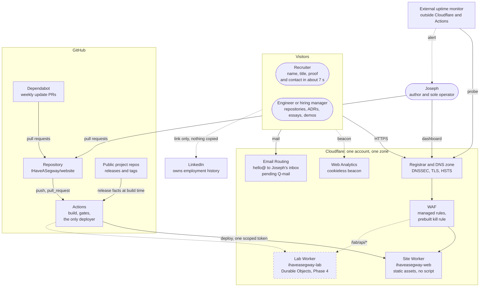
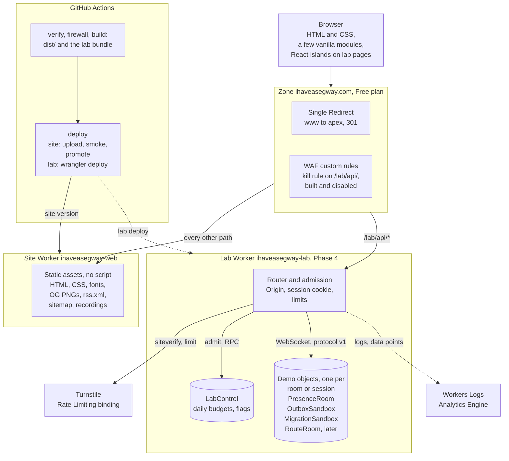
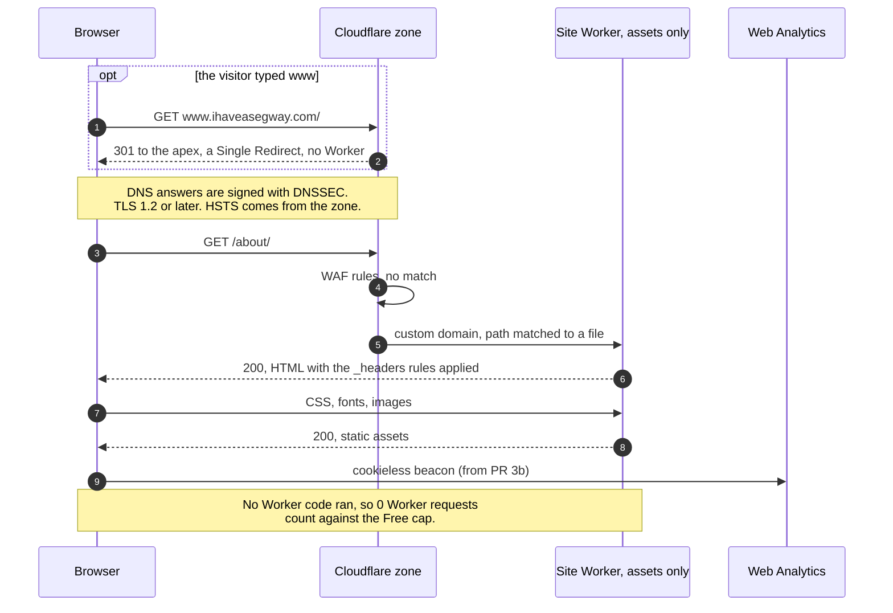
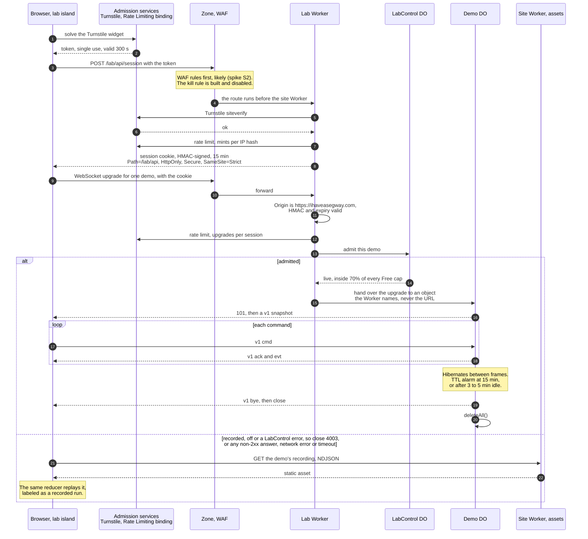

# Architecture

How ihaveasegway.com fits together: the systems around it, who owns each piece of data, how a page view, a lab session and a change move through it, and what each failure takes down. The data ownership table is step 2 of the architect's pass, done in full. Why the site exists is in [product.md](product.md), each technology and its pin in [stack.md](stack.md), and each hard-to-reverse decision in [adr/](adr/README.md). Nothing is built yet. PR 2 builds the foundation: the site Worker, the pipeline and the zone hardening. The lab arrives in Phase 4 ([roadmap.md](roadmap.md)), and what this page says about it is the design it will follow.

Status: Draft for review in PR 1 · 2026-10-22

Limits and prices on this page are as of 2026-10-22. Sources are in the footnotes.

## Shape

The site is static files. Astro builds them in GitHub Actions, and an assets-only Cloudflare Worker, `ihaveasegway-web`, serves them on `ihaveasegway.com`. The Worker has no script, so no Worker code runs on a page view. Asset requests are free, unlimited, and not counted against the Free plan's 100,000 Worker requests a day.[^assets] Live demos come later, in Phase 4, in a second Worker, `ihaveasegway-lab`, on the route `ihaveasegway.com/lab/api/*`. It holds every Durable Object (DO) class. Each demo object keeps one room's or one session's state for at most 15 minutes, then deletes it; one control object, `LabControl`, keeps the daily budgets and flags. GitHub Actions is the only thing that deploys either Worker. Cloudflare is registrar, DNS, edge and runtime: one provider, accepted on purpose ([failure modes](#bulkheads-and-failure-modes)).

This is the bulkhead pattern at the size of a personal site. The part that must always work (pages) shares no code and no deploy with the part that is allowed to fail (demos), and it spends none of the request quota the demos spend. The browser composes the two. Neither Worker calls the other.

## Context diagram

C4 level 1, with one deviation. Strict C4 draws the system in scope as a single box. Here Cloudflare is drawn open, because its parts are owned, changed and broken separately. The dashed box arrives in Phase 4; dashed lines are Phase 4 paths or side channels.



- LinkedIn is linked, never copied, so it stays the only owner of employment history ([ADR 0004](adr/0004-content-as-code.md)). Whether the site links it at all is Q-threat-model in [product.md](product.md).
- The uptime monitor runs outside Cloudflare and outside Actions. A monitor inside the failure domain it watches goes quiet exactly when it is needed. [operations.md](operations.md) picks the service.

## Container diagram

C4 level 2: everything that is deployed, configured or holds state. The lab Worker and the services it binds arrive in Phase 4.



- The site Worker has no `main`. Workers Cache stays off: with it on, every asset request is billed at the Workers request rate,[^cache] so CI fails if `cache.enabled` appears. Config sketches are in [delivery.md](delivery.md).
- The lab route is `/lab/api/*`, not `/lab/*`. Write-ups at `/lab/<slug>/` stay static assets on the site Worker. A wider route would put them behind lab code ([weaker designs](#weaker-designs-and-why)).
- A DO is a virtual actor: it exists by name, wakes when a request arrives, and runs on a single thread, so each object's state stays consistent without locks. Only the lab Worker binds the DO classes, and a DO has no URL of its own, so every request to a demo passes the Worker's checks first. Every class is SQLite-backed and declared with `exports`. SQLite-only keeps Free and Paid a two-way door ([ADR 0008](adr/0008-workers-free-with-guardrails.md)).
- Four guards wait for the day the account moves to Workers Paid: budget alerts at Joseph's thresholds (Q-budget), `limits.cpu_ms` on each Worker, the zone's one rate-limiting rule on `/lab/api/*`, and a cron Worker that reads analytics every 15 minutes and turns the kill rule on above a threshold. The cron Worker exists because budget alerts are computed once a day and only notify ([ADR 0008](adr/0008-workers-free-with-guardrails.md)). It holds its own token, a Worker secret scoped to reading analytics and editing that zone's rules ([operations.md](operations.md)).

## Bounded contexts

Six contexts. Each writes only its own data; the others get copies across one named boundary.

| Context | Vocabulary | Owns | Boundary | Talks to the others by | It is not |
|---|---|---|---|---|---|
| Presentation (site) | page, section, island, token, budget | templates, components, design tokens, the build output | `apps/web` outside `src/content`; the site Worker | build-time reads of Authoring and of Delivery's build metadata; links to Lab pages and to Contact | A runtime. It holds no server-side state |
| Authoring (content) | post, note, project, profile, front matter | `apps/web/src/content/**`, `profile.json`, the ADRs in `docs/adr/` | the content collections and their Zod schemas | a build-time copy, validated on write: a file that fails its schema fails the build | A copy of LinkedIn |
| Lab | session, budget, flag, room, sandbox, frame, recording | demo state, budgets and flags, recordings, protocol v1 | `workers/lab/` and each demo's island | protocol v1 with the browser; recordings ship as static assets through Presentation | Part of the site's availability |
| Edge (zone) | zone, record, rule, redirect, certificate | DNS records, DNSSEC, TLS and HSTS settings, WAF rules, the `www` redirect | the Cloudflare dashboard | wraps every request before any Worker runs; changed by Joseph, audited weekly | Deployed by the pipeline, until an IaC trigger fires |
| Delivery (pipeline) | job, gate, preview, version, artifact | workflows, the firewall check, build metadata, the deploy credential | `.github/`, `.githooks/`, `scripts/` | builds, gates and deploys the other contexts' artifacts | A second deployer. Workers Builds stays disconnected |
| Contact (mail) | address, route, inbox | `hello@ihaveasegway.com` and its routing rule (pending Q-mail) | Email Routing | a `mailto:` link on the site; mail never touches a Worker | A form or a mail store |

**The lab is a family of contexts.** The lab platform (sessions, admission, budgets and flags in `LabControl`) is shared. Each demo is its own context with its own vocabulary, DO class and code: Presence (peer, count), Outbox (order, event, subscriber, dead-letter queue), Migration (spec, plan, batch, ledger), Route (stop, vehicle, plan). They share no tables and no types. They share one envelope, protocol v1 (`{"v":1,"t":"cmd|evt|snapshot|ack|err|bye",...}`), the published language between browser and DO. Recordings are written in it, so `v` is the one-way door: bump it, never change what a version means ([lab.md](lab.md)).

**Nothing at runtime joins Presentation and Lab.** The site never calls the lab, and the lab never renders pages. The browser loads both, so the site's availability does not depend on the lab's.

**GitHub does not reach the build.** The plan was to map GitHub's release data to the site's own small record in one function, an anti-corruption layer the size of a function. That step was dropped on 2026-10-23: a card's figures are copied by hand into `profile.json`, so no API sits between GitHub and a page.

**Edge and Delivery are operational contexts, not domain ones.** They are listed because they own data: the zone's settings and the deploy credential. Ownership matters most at a handover. The day IaC takes over the zone (OpenTofu, when a trigger in [operations.md](operations.md) fires), the dashboard has to stop writing whatever the code declares. Otherwise the zone has two writers and drifts.

## Data ownership

Every datum the site touches. Read a row left to right: where it lives, who may change it, who reads it, how it reaches them, and how fresh they need it.

| Datum | System of record | Context | Writes it | Reads it | How it crosses | Consistency readers need |
|---|---|---|---|---|---|---|
| Posts and notes | Markdown and MDX in `apps/web/src/content/**` | Authoring | Joseph, by pull request | the build; visitors, as HTML, RSS, sitemap and OG images | build-time copy, Zod-validated (schema-on-write) | live minutes after merge; fixed per version |
| ADRs | `docs/adr/*.md` | Authoring | Joseph, by pull request | repo readers; the build, which renders the ADRs on its publish allowlist at `/colophon/decisions/<nnnn-slug>/` ([content.md](content.md)) | rendered at build time from the same files; nothing is copied by hand | per deploy; the site cannot disagree with the repo |
| Public profile: title, arc (role titles and years, once Q8 is cleared), skills, education, links | `apps/web/src/content/profile.json`, a JSON Resume subset with no employer field | Authoring | Joseph, by pull request | `/resume/` (from 2026-10-25), `/about/` (PR 4), the JSON-LD | build-time copy | per deploy |
| Employment history: employers, dates | LinkedIn and Joseph's private résumé | outside the system | Joseph, on LinkedIn | visitors who follow the link | a link only: never copied, never fetched | none: the site holds no copy, so it cannot be stale |
| A project card's line, tag and figures | the project's repository, at the commit its check read (`checked.sha`) | Authoring | Joseph, by pull request, copying by hand into `profile.json` | the build | build-time copy | per deploy; the figures' age is `measured` |
| Design tokens | `tokens.css` in `apps/web`: direction C's values (Petrol + Apricot), in the token structure first copied from Mission-AI | Presentation | Joseph, by pull request | pages, lab islands, the contrast unit test, the Open Graph card | same build | per deploy; never synced with Mission-AI, and no Mission-AI value remains |
| Build commit | git and the CI run | Delivery | CI, at build | the deploy smoke, through the `X-Build` response header the build writes into `_headers`; no page holds it (since 2026-10-24) | baked into `_headers` | exact for that version |
| Serving data center | none: Cloudflare's edge derives it per request | Edge | Cloudflare | nothing: the served-from readout was dropped on 2026-10-24 ([design-system.md](design-system.md#nothing-on-the-page-describes-the-site)) | — | — |
| Theme choice | the visitor's `sessionStorage`, for the tab | Presentation | the visitor, through the toggle | the inline pre-paint script in `<head>`, the only code that reads or writes it; its hash is in the CSP, and it runs before the policy's `<meta>` ([security.md](security.md#headers-and-content-security-policy)) | never leaves the browser | per tab; if lost, the OS setting applies |
| Page-view analytics (from PR 3b) | Cloudflare Web Analytics | Presentation | the beacon in the visitor's browser | Joseph | cookieless beacon; six months of history[^wa] | approximate: ad blockers undercount developers, so capacity triggers use Workers and DO metrics |
| Lab session (Phase 4) | a cookie in the visitor's browser, HMAC-signed by the lab Worker | Lab | the lab Worker, after Turnstile and the mint rate limit[^turnstile] | the lab Worker, on each `/lab/api/` call | cookie `Path=/lab/api; HttpOnly; Secure; SameSite=Strict`, 15 minutes | self-verifying; nothing stored on the server |
| Demo state (Phase 4) | one DO per room or session, SQLite | Lab, per demo | that DO only | browsers in the room | WebSocket, protocol v1: a snapshot on join, then events | strong per object; deleted within 15 minutes |
| Lab budgets and flags (Phase 4) | the `LabControl` DO | Lab | `LabControl` (counters); Joseph (flags, in the dashboard's Data Studio; the route has no admin endpoint) | the lab Worker, on every upgrade | an RPC call from the lab Worker to the one `LabControl` object | strong; on error, admission falls back to recorded |
| Recordings | NDJSON files in the repo, served as static assets | Lab (format), Presentation (serving) | Joseph, by pull request: curated runs of his own sessions | the demo's replay in the browser | static asset | fixed per version; bound to protocol `v` |
| Lab logs (Phase 4) | Workers Logs | Lab | the lab Worker: a JSON line per mint, deny, admit and close; IPs only as an HMAC with a daily salt; location no finer than country | Joseph | platform ingestion | best effort; kept 3 days now, 7 days from 2026-12-01[^logs] |
| Lab metrics (Phase 4) | Workers Analytics Engine | Lab | the lab Worker: a data point per session start, end and deny | Joseph; the upgrade-trigger check | write from the Worker | eventual; kept 3 months[^ae] |
| Contact mail | Joseph's inbox, through Email Routing (pending Q-mail) | Contact | senders | Joseph | forwarded, receive-only | none: the site never stores mail |
| Firewall rules | private file `~/.config/ihaveasegway/firewall.toml`, backed up in a password manager | Delivery | Joseph, through `scripts/firewall/sync-secrets.sh` | the firewall job; the local hooks | secret injection: the Actions secret `FIREWALL_RULES` and the same Dependabot secret; never in the repo | the copies must match the file; a runtime canary proves the rules loaded, or the job exits 2 |
| Deploy credential | Cloudflare, which issues the `cfat_` token | Delivery | Joseph creates it | the 6 steps that run Wrangler, in `preview`, `preview-cleanup`, `deploy` and `rollback` ([security.md](security.md#secrets-inventory)) | secret injection: the repo secret `CLOUDFLARE_API_TOKEN`, in the `env` of those steps only | expires after 12 months; rotation in [operations.md](operations.md) |
| Other Cloudflare tokens (Phase 4 on) | Cloudflare | Delivery; Lab | Joseph creates them | the nightly lab-objects step (`CLOUDFLARE_READ_TOKEN`, read-only); after an upgrade, the cron breaker | secret injection, one consumer each: an Actions secret; a Worker secret | each scoped to its one job ([security.md](security.md#secrets-inventory) lists readers and scopes); steps in [operations.md](operations.md). None can deploy code |
| Zone settings | the Cloudflare dashboard | Edge | Joseph | Cloudflare's edge | none at runtime. [security.md](security.md) holds the target checklist, and `scripts/verify-zone.sh` checks the result weekly without a token | drift found within a week; IaC when a trigger fires |

Each datum has one system of record and one writer. Three rows look like copies but add no second owner. The CI copies of the firewall rules have one writer (the sync script) and a canary that proves they loaded. The zone checklist describes the dashboard and never overrides it. Build metadata states its age, and a card's figures carry theirs in `measured`: a hand copy of the repository with one writer, not a second owner.

Two values are copied on purpose. The design tokens fork Mission-AI's values. Divergence is accepted and nothing syncs them ([ADR 0010](adr/0010-quiet-console-design-tokens.md)). The current title lives in `profile.json` and on LinkedIn, and Q-title in [product.md](product.md) recommends they match. Nothing syncs these either. A title changes rarely, so editing both places by hand is cheaper than a sync job. Naming the copy here makes it a decision rather than drift.

Weaker designs would have created second owners:

- **Employment history copied into the repo.** It drifts from LinkedIn the day a role changes, and it puts employer names into a repo that may go public, which the content firewall forbids ([ADR 0004](adr/0004-content-as-code.md), [ADR 0007](adr/0007-content-firewall.md)).
- **GitHub fetched at request time.** Every page view would depend on GitHub's uptime and rate limits, and the cache it needs would be a second store ([weaker designs](#weaker-designs-and-why)).
- **The deploy SHA also stored in a DO**, say the presence room. It can disagree with what is actually served. The HTML is the only place it lives.

## Request flows

### A page view



This holds by construction: outside `/lab/api/*`, the only Worker on the hostname is the site Worker, and it has no script. A 100,000-visitor day costs $0 on Free and makes no Worker invocations ([cost.md](cost.md)). Rendering that HTML in a Worker would typically take 10 to 20 ms of CPU per view, Cloudflare's own figure for server-side rendering, against Free's 10 ms limit.[^limits]

### A Route Lab solve (2026-10-25)

The Route Lab is a page view like the one above, and nothing more: its route data and its solver are static assets too, and the solve runs on the visitor's CPU ([ADR 0016](adr/0016-route-lab-in-the-browser.md)).

```mermaid
sequenceDiagram
  autonumber
  participant B as Browser page
  participant W as Module worker
  participant S as Site Worker, assets only
  B->>S: GET /lab/routes/, its CSS, fonts and one small module
  Note over B: Without JavaScript, the page is both plans, solved at build.
  B->>S: on intent (a focus, a mouse over the demo, a change): the app chunk and route-data.json
  B->>W: on the first change: new Worker(/lab/routes/solver/vroom-…/vroom-worker.mjs)
  W->>S: vroom-solver.mjs, vroom.mjs, vroom.wasm
  Note over W,S: The worker's own response header allows 'wasm-unsafe-eval';<br/>the page's policy does not need to.
  B->>W: the orders, the vans and the cut matrices, 150 ms after the last change, one solve at a time
  W-->>B: VROOM's plan, and how long it took
  Note over B,S: 0 Worker requests, 0 Durable Object requests:<br/>$0 at any traffic.
```

### A lab session (Phase 4)



- On the upgrade, checks run cheapest first. Origin and the cookie's HMAC cost no extra request. The Rate Limiting binding is approximate and counted per location, so it is never a budget.[^rl] `LabControl` costs one DO request and is exact, so it goes last. That is admission control in layers.
- Only zone rules can act before Worker code runs, and even that order is likely rather than documented (spike S2).[^waf] That is why the last-resort kill switch is a WAF rule (L3) and not a check in the Worker: a check in the Worker has already spent the request.
- Every failure path ends in the recording, so overload sheds the live part of a demo and keeps the rest (load shedding, graceful degradation). Nothing falls back to a live session that skipped a budget check: a fail-safe default.
- The Worker names every object itself, from the verified session or a fixed room name, never from the URL, so one visitor cannot reach another's sandbox. CORS does not cover WebSocket handshakes, so the Origin check and the `SameSite=Strict` cookie are what stop cross-site WebSocket hijacking.[^cswsh]
- An idle object that can hibernate is not billed for duration.[^dopricing] A `setInterval` would keep it awake and billing; pings are answered by `setWebSocketAutoResponse` without waking it.
- `deleteAll()` at the TTL makes all demo state disposable. That is what keeps the lab's topology a two-way door ([ADR 0009](adr/0009-lab-worker-same-origin.md)).

Endpoint names, limits and close codes belong to [lab.md](lab.md). This diagram shows the order of the checks and where each one runs.

### A change

```mermaid
sequenceDiagram
  autonumber
  actor J as Joseph
  participant G as GitHub
  participant A as Actions
  participant P as Worker Preview
  participant V as Site Worker version
  participant X as ihaveasegway.com
  J->>G: push a branch, open a pull request
  Note over J,G: The local pre-push hook refuses main.
  G->>A: pull_request
  A->>A: verify, with no secrets
  A->>A: firewall, exit 0 or the run stops
  A->>P: wrangler preview --name pr-N
  A->>P: e2e: Playwright, axe, headers;<br/>lighthouse beside it
  J->>G: merge
  G->>A: push to main
  A->>A: verify, firewall
  A->>V: wrangler versions upload
  A->>V: smoke the Version URL
  A->>X: wrangler versions deploy, 100% of traffic
  A->>X: prod-smoke
  alt prod-smoke fails
    A->>G: open an issue with<br/>the exact rollback command
    J->>G: gh workflow run ci.yml<br/>-f rollback_to=VERSION_ID
    G->>A: workflow_dispatch
    A->>X: wrangler rollback VERSION_ID
    A->>X: prod-smoke
    Note over J,X: The dashboard's Rollback button only if GitHub is down
  end
```

- The gate is the pipeline. On a private repo on GitHub Free, rulesets and branch protection return 403, so the deploy jobs `needs:` verify and firewall, and a local pre-push hook refuses `main`. Required checks arrive when the repo goes public ([ADR 0006](adr/0006-github-actions-owns-deploys.md), [ADR 0012](adr/0012-public-repository.md)).
- The firewall runs before the preview job because previews are public on workers.dev, with `X-Robots-Tag: noindex`. Nothing unscanned is published, not even to a preview.
- Upload, smoke the Version URL, promote: blue/green in miniature. The exact artifact is tested on Cloudflare's edge before it takes traffic.
- A rollback runs as the `rollback` job, with the same scoped token ([ADR 0006](adr/0006-github-actions-owns-deploys.md)). The dashboard's Rollback button is the break-glass path when GitHub is down. Either way a rollback ships nothing new: it points traffic back at a version the pipeline already uploaded, so the pipeline stays the only source of code in production, and no deploy credential lives on a laptop ([operations.md](operations.md)). Rollback reaches the 100 most recently published versions.[^rollback]
- The lab deploys differently. Version URLs are not generated for a Worker that implements a DO,[^previews] so it goes out with `wrangler deploy` and is smoke-tested in production. A deploy restarts its objects and drops live sockets. Rollback is blocked across a DO class change, so class changes go expand, migrate, contract, in separate pull requests ([delivery.md](delivery.md)).

## Bulkheads and failure modes

Four walls, and one shared resource none of them splits.

1. **Site and lab are separate Workers.** Separate code, deploys and failures. The site has no runtime dependency on the lab, on GitHub, or on any API.
2. **Each demo has its own DO class and its own daily budget** in `LabControl`, so a hot demo drops to recordings while the others stay live. They share one Worker, so a lab deploy drops every live socket. That is accepted ([ADR 0009](adr/0009-lab-worker-same-origin.md)).
3. **The zone works without the pipeline.** The kill rule, redirects and TLS settings change in seconds from the dashboard, even while GitHub is down.
4. **The pipeline is not in the request path.** GitHub can be down and the site still serves.

The shared resource is the account's Free daily quota: 100,000 Worker requests,[^limits] and for DOs 100,000 requests, 13,000 GB-s and 100,000 rows written,[^dopricing] summed over every Worker on the account. Static assets do not draw on it, and `LabControl` stops admitting at 70% of each cap.

| Failure | Blast radius | What visitors see | Detection | Recovery |
|---|---|---|---|---|
| Free daily Worker cap exhausted: 100,000 requests, account-wide, reset at 00:00 UTC | every Worker on the account until 00:00 UTC. Static assets are outside the count and very likely keep serving (spike S1) | pages as usual; the lab plays recordings, since the client replays on any non-2xx answer | Workers metrics; `LabControl`'s 70% breaker should trip first | resets at 00:00 UTC. A first 1027, or any day above 50% of a cap, is an upgrade trigger ([ADR 0008](adr/0008-workers-free-with-guardrails.md)) |
| Free DO cap exhausted: rows written, 100,000 a day, binds first in [cost.md](cost.md)'s model | every DO write on the account, `LabControl`'s counters included | recordings | `LabControl` errors in Workers Logs | admission fails to recorded, never live; resets at 00:00 UTC |
| Lab abuse: scripted sessions, socket floods | the lab; the account quota if the requests reach the Worker | recordings | Analytics Engine denies by reason and network; WAF events | the kill switch, in order: L0 budget breaker, L1 per-demo flag, L2 redeploy, L3 the prebuilt WAF rule (seconds), L4 delete the route ([lab.md](lab.md)) |
| A DO handler needs more CPU than Free allows: 30 s or 10 ms, the docs conflict (spike S3)[^dolimits] | one demo | an error, then the recording | Workers Logs; the S3 burn test, run before any demo depends on server-side compute | keep handlers O(n) and heavy compute in the browser, as Route Lab does; a route that needs more than 10 ms is an upgrade trigger |
| Lab deploy | every live lab session, since one Worker holds every class | a reconnect and a fresh snapshot, or the session ends | the deploy log | none needed. If deploys drop live sessions more than once a week, split into per-demo Workers ([ADR 0009](adr/0009-lab-worker-same-origin.md)) |
| Bad site deploy | the site; the lab deploys separately | a broken page until rollback, if the smoke tests missed it | the Version URL smoke before promotion; prod-smoke after; the uptime monitor | run the `rollback` job with the version id from the issue the failed prod-smoke opens; the dashboard only if GitHub is down |
| CSP regression: an unhashed inline script, a header that tightens the meta policy, an origin missing for the beacon or Turnstile | the enhancements on the affected pages | text still reads, because no content depends on JavaScript (progressive enhancement); the theme toggle, palette, analytics or lab stop working | e2e fails on any CSP console violation, on the preview, before merge | fix forward or roll back. Browsers enforce every policy present, and each extra one can only restrict further[^csp] |
| DNSSEC misconfiguration: the DS record at the parent no longer matches the zone's keys | the whole domain, web and mail, for every validating resolver | the domain does not resolve | the weekly zone audit (DNS-over-HTTPS `AD` flag, DS present); the uptime monitor | near one-way: undoing it waits out the parent's DS TTL. Never stop signing before the DS record is gone, and plan any DNS move weeks ahead ([ADR 0011](adr/0011-dnssec-and-hsts-ramp.md))[^dnssec] |
| Deploy token leak | what the token can write: every Worker script on the account and the zone's Worker routes, so whatever `ihaveasegway.com` serves. Its permissions include no DNS, WAF or registrar access, but attaching a Custom Domain creates a DNS record,[^customdomains] and whether this token can attach one is spike S7 | possibly a defaced or hostile site | Cloudflare's audit log; a deployment that no Actions run explains | revoke and reissue ([operations.md](operations.md)), roll back, review routes, custom domains and scripts. The token lives only in the `env` of the 6 steps that run Wrangler ([security.md](security.md#secrets-inventory)), in jobs that run only GitHub-created actions and pnpm/action-setup |
| Content firewall miss | private repo: the site and its previews, from the first build that passed the scan. Public repo: also the repository, public at `git push`, where clones and caches keep it. Previews sit on workers.dev, which the zone's WAF does not cover | the leaked text, until removed | the firewall job (exit 1 for a finding, exit 2 when it cannot prove the tree clean); the local hooks; the PR checklist for images and paraphrase | the leak runbook in [operations.md](operations.md): a WAF rule blocks the path on the domain in seconds, affected previews are deleted, then fix forward or roll back, rewrite history if needed, and tighten the rule |
| Cloudflare outage | everything: site, lab, DNS, mail forwarding. An accepted single-provider concentration | the site is down | the external uptime monitor; Cloudflare's status page | wait. `dist/` can move to another host in hours, but DNS and the registrar are Cloudflare too, so leaving takes a registrar transfer: days |
| GitHub outage | builds, previews, deploys, Dependabot | nothing; the site keeps serving, and only repo links fail | GitHub's status page; failed runs | wait. Content that must come down sooner goes behind a WAF rule from the dashboard |

**The lab route fails closed.** Past the daily cap, a route set to fail closed returns Error 1027. One set to fail open "bypasses the Worker", so `/lab/api/*` would fall through to the site Worker's 404 page.[^limits] Visitors get the recording either way, since the client replays on any non-2xx answer. Skipping the lab Worker also exposes nothing, because a DO has no URL of its own. Fail closed wins on operability: the 1027 is the signal [ADR 0008](adr/0008-workers-free-with-guardrails.md) counts as an upgrade trigger, and a 404 would hide it. It is a two-way door, one setting on the route.

**Why one provider is accepted.** A second host is cheap, because `dist/` is plain files. A second DNS provider is not. Cloudflare Registrar requires Cloudflare nameservers,[^registrar] so real DNS redundancy means a registrar transfer plus multi-signer DNSSEC: standing work for a site that promises uptime to no one. What it needs is to be up on the days that matter. The door is two-way but slow, because leaving Cloudflare's DNS takes a registrar transfer. Revisit if an outage lands on one of those days, such as a talk or a launch.

## Cross-cutting concerns

**Security and privacy.** [security.md](security.md) owns the threat model, the headers and CSP strategy, zone hardening, the secrets inventory, the content firewall's design and the privacy inventory. The data ownership table above is the architecture view of the same data.

**Cost.** [cost.md](cost.md) owns prices, formulas and scenarios, and [ADR 0008](adr/0008-workers-free-with-guardrails.md) owns the plan. The architecture's part is to keep page views off the meter and to put every metered path behind `LabControl`.

**Accessibility and performance.** [design-system.md](design-system.md) owns the budgets: JavaScript, CSS and font bytes, page weight, Core Web Vitals, contrast and axe. CI enforces them as fitness functions ([delivery.md](delivery.md)).

**Operations.** [operations.md](operations.md) owns access setup, observability, alerting, the runbooks (deploy, rollback, kill switch, token rotation, leak response) and the maintenance calendar.

## Weaker designs and why

Each row names what the design gives up, in quality attributes, and the evidence that would make it the right call. All are two-way doors except where the row says otherwise.

| Design | What goes wrong here | It trades away | It would be right if |
|---|---|---|---|
| Server-side rendering in a Worker | Every page view becomes a Worker invocation. On Free, a 100,000-visitor day shows Error 1027 to about 80% of visitors once the cap trips ([cost.md](cost.md)), and rendering typically takes 10 to 20 ms of CPU against Free's 10 ms[^limits] | availability, cost and latency, for per-request freshness that pages changed once per deploy do not need | pages differed per visitor |
| A Vite single-page app, the pattern Mission-AI's UI used | 66.2 KiB of gzipped JavaScript before the first word, and an empty root element for crawlers and link unfurlers (measured 2026-10-22; [ADR 0003](adr/0003-astro-static-first.md)). Astro ships 0 KiB on a text page and adds JavaScript only where a page has an island. MDX, RSS, the sitemap and OG images would be rebuilt by hand | latency and reach, since most visitors arrive through shared links and the unfurl is the first impression; operability, for familiarity | the site were an app behind a login |
| DOs inside the site Worker | Version URLs are not generated for a Worker that implements a DO,[^previews] so the site loses smoke-before-promote. Every typo fix redeploys the lab and drops live sockets, and every DO class change blocks rolling back content | operability and availability, for one fewer Worker. Hard to undo once classes exist, since rollback cannot cross a class change | the site had no static pages to protect |
| A route on `/lab/*` | A route runs in front of the custom-domain Worker,[^customdomains] so every view of a write-up at `/lab/<slug>/` invokes lab code: counted against the cap on Free, billed on Paid | cost and availability, for a shorter route pattern | never, while write-ups live under `/lab/` |
| GitHub's API on every request | Each view needs a Worker, a GitHub call and a cache, and the cache is a second store. GitHub allows 60 requests an hour unauthenticated and 5,000 with a token,[^ghrate] and its outages become the site's | availability, latency, cost and single ownership, for release facts fresh to the minute | release facts changed hourly and mattered by the hour |
| A hosted CMS | A second owner of posts, outside git, where the content firewall does not scan | security and consistency, for an editing interface | writing friction appears, such as writing from a phone. Even then, a git-based CMS (Keystatic, TinaCMS) that commits to the repo keeps one owner ([ADR 0004](adr/0004-content-as-code.md)) |
| A lab subdomain, `lab.ihaveasegway.com` | A trade, not a mistake. It isolates cookies, storage and CSP, and the whole lab can be cut off at the hostname. It costs CORS, a second origin in `connect-src`, another Turnstile hostname and cookie scoping | operability today, for security isolation that buys little while no demo renders visitor markup and the site sets no cookies | a demo renders visitor-supplied markup or third-party embeds ([ADR 0009](adr/0009-lab-worker-same-origin.md)) |
| One Worker per demo | Also a trade: each demo deploys alone, at the cost of a config, a route and a deploy job per demo | operability today, for availability during lab deploys | lab deploys drop live sessions more than once a week ([ADR 0009](adr/0009-lab-worker-same-origin.md)) |

## Prior art for this shape

- **developers.cloudflare.com.** Cloudflare's own documentation is Astro on Workers, 8,431 pages,[^astro7] built in GitHub Actions with a Worker Preview per pull request ([`wrangler preview` in its CI workflow](https://github.com/cloudflare/cloudflare-docs/blob/production/.github/workflows/ci.yml)). Same split as here: Actions builds and gates, Workers serves the static output.
- **The Guardian, [dotcom-rendering ADR 026, "Improved Partial Hydration"](https://github.com/guardian/dotcom-rendering/blob/main/dotcom-rendering/docs/architecture/026-better-partial-hydration.md).** Islands at a national newspaper's scale: the server renders the page, and only marked components hydrate. Its numbered public ADRs are also the habit this repo copies.
- **[tldraw sync](https://tldraw.dev/docs/sync).** One DO per room, with room state in the object's built-in SQLite storage, running tldraw.com. The lab's rooms have the same shape at a smaller size.
- **[Liveblocks on Durable Objects](https://www.cloudflare.com/case-studies/liveblocks/).** Liveblocks moved its collaboration rooms from EC2 containers and MongoDB to DOs, and credits WebSocket Hibernation with keeping idle time off the bill. Its own engineer puts the volume at up to half a billion messages through Workers in 24 hours.
- **[Figma's multiplayer](https://www.figma.com/blog/how-figmas-multiplayer-technology-works/).** One server process per document, the server as the authority, and clients that download the document on open and converge on the server's state. Every lab room sends a full snapshot on join for the same reason.

## Patterns and further reading

- Bulkhead (site and lab in separate Workers; a budget per demo): Michael Nygard, [*Release It!*, 2nd ed.](https://pragprog.com/titles/mnee2/release-it-second-edition/), ch. 5, "Stability Patterns".
- C4 model (the context and container diagrams): Simon Brown, [c4model.com](https://c4model.com/).
- Single writer (one owner per datum; one deployer per environment): Martin Thompson, ["Single Writer Principle"](https://mechanical-sympathy.blogspot.com/2011/09/single-writer-principle.html) (2011).
- Schema-on-write (Zod at build time): Martin Kleppmann, [*Designing Data-Intensive Applications*](https://dataintensive.net/), 1st ed., ch. 2, "Schema flexibility in the document model".
- Snapshots across a boundary (GitHub's release data, copied at build time with its date): Pat Helland, ["Data on the Outside versus Data on the Inside"](https://www.cidrdb.org/cidr2005/papers/P12.pdf) (CIDR 2005).
- Islands architecture (0 KB of JavaScript by default): Jason Miller, ["Islands Architecture"](https://jasonformat.com/islands-architecture/) (2020).
- Virtual actor (one DO per room or session): Bernstein et al., ["Orleans: Distributed Virtual Actors for Programmability and Scalability"](https://www.microsoft.com/en-us/research/publication/orleans-distributed-virtual-actors-for-programmability-and-scalability/) (Microsoft Research, 2014).
- Fail-safe default (admission falls back to recorded; the firewall exits 2): Saltzer and Schroeder, ["The Protection of Information in Computer Systems"](https://web.mit.edu/Saltzer/www/publications/protection/Basic.html) (1975), section I.A.3, "Design Principles".
- Admission control (Turnstile, session cookie, rate limit, `LabControl`): Google, [*Site Reliability Engineering*, ch. 21, "Handling Overload"](https://sre.google/sre-book/handling-overload/).
- Load shedding and graceful degradation (recorded mode instead of an error): Google, [*Site Reliability Engineering*, ch. 22, "Addressing Cascading Failures"](https://sre.google/sre-book/addressing-cascading-failures/).
- Expand/contract (DO class changes in separate pull requests): Danilo Sato, ["ParallelChange"](https://martinfowler.com/bliki/ParallelChange.html) (2014).
- Fitness function (budgets and the `cache.enabled` check fail the build): Neal Ford, Rebecca Parsons, Patrick Kua and Pramod Sadalage, [*Building Evolutionary Architectures*, 2nd ed.](https://www.thoughtworks.com/en-us/insights/books/building-evolutionaryarchitectures-second-edition), ch. 2, "Fitness Functions".
- Progressive enhancement (pages work with no script; view transitions where supported): Jeremy Keith, [*Resilient Web Design*, ch. 6, "Steps"](https://resilientwebdesign.com/chapter6/).
- Blue/green deployment (upload, smoke, promote): Martin Fowler, ["BlueGreenDeployment"](https://martinfowler.com/bliki/BlueGreenDeployment.html) (2010).
- Published language and anticorruption layer (protocol v1; the GitHub snapshot): Eric Evans, [*Domain-Driven Design Reference*](https://domainlanguage.com/wp-content/uploads/2016/05/DDD_Reference_2015-03.pdf) (2015).

Every pattern named across these docs, with one source each: [reading-list.md](reading-list.md).

[^assets]: "Only requests that hit a Worker will count against your limits and your bill": [Workers pricing](https://developers.cloudflare.com/workers/platform/pricing/). Requests to static assets are free and unlimited: [static assets billing](https://developers.cloudflare.com/workers/static-assets/billing-and-limitations/). As of 2026-10-22.
[^limits]: [Workers limits](https://developers.cloudflare.com/workers/platform/limits/): Free allows 100,000 requests a day per account, reset at midnight UTC, and 10 ms of CPU per HTTP request. Workloads that do server-side rendering "typically use 10-20 ms". Past the cap, a route set to fail closed returns Error 1027 ("Use this for security-critical Workers"); fail open "bypasses the Worker. Requests behave as if no Worker is configured." The page states no default. As of 2026-10-22.
[^dopricing]: [Durable Objects pricing](https://developers.cloudflare.com/durable-objects/platform/pricing/): Free allows 100,000 requests, 13,000 GB-s and 100,000 rows written a day, SQLite-backed objects only; objects that are "idle and eligible for hibernation are not billed for duration". As of 2026-10-22.
[^dolimits]: The [Durable Objects limits page](https://developers.cloudflare.com/durable-objects/platform/limits/) gives 30 s of CPU with no plan split; the [Workers limits page](https://developers.cloudflare.com/workers/platform/limits/) gives Free 10 ms per request and does not mention Durable Objects. As of 2026-10-22.
[^rl]: [Rate Limiting binding](https://developers.cloudflare.com/workers/runtime-apis/bindings/rate-limit/): approximate, counted per location, 10 s or 60 s periods. Availability on Free is not stated (spike S4). As of 2026-10-22.
[^waf]: The [ruleset phases list](https://developers.cloudflare.com/ruleset-engine/reference/phases-list/) has no Workers entry, and Cloudflare's ["Traffic sequence"](https://blog.cloudflare.com/traffic-sequence-which-product-runs-first) post does not say which runs first. As of 2026-10-22.
[^cswsh]: PortSwigger Web Security Academy, ["Cross-site WebSocket hijacking"](https://portswigger.net/web-security/websockets/cross-site-websocket-hijacking).
[^customdomains]: [Custom Domains](https://developers.cloudflare.com/workers/configuration/routing/custom-domains/): the Custom Domain Worker "is treated as an origin", and Workers on routes run before it. On attach, Cloudflare "will create DNS records and issue necessary certificates on your behalf". As of 2026-10-22.
[^previews]: "Version URLs are not generated for Workers that implement a Durable Object": [Previews and Version URLs](https://developers.cloudflare.com/workers/configuration/previews/). As of 2026-10-22.
[^rollback]: [Rollbacks](https://developers.cloudflare.com/workers/configuration/versions-and-deployments/rollbacks/): "You can only roll back to the 100 most recently published versions", and not across a Durable Object class lifecycle change. As of 2026-10-22.
[^cache]: With caching on, "every request to your Worker is charged at the standard Workers request rate, including requests that are normally free", static asset requests among them: [Workers Cache](https://developers.cloudflare.com/workers/cache/). As of 2026-10-22.
[^csp]: MDN, [Content-Security-Policy](https://developer.mozilla.org/en-US/docs/Web/HTTP/Reference/Headers/Content-Security-Policy): additional policies "can only further restrict the capabilities of the protected resource".
[^dnssec]: [Cloudflare DNSSEC](https://developers.cloudflare.com/dns/dnssec/): roll back by removing the DS record and keeping the zone signed until the parent's DS TTL expires. For Cloudflare Registrar domains, Cloudflare publishes the DS record itself, through CDS/CDNSKEY, in one to two days. As of 2026-10-22.
[^registrar]: "All domains on Cloudflare Registrar use Cloudflare nameservers": [Registrar FAQ](https://developers.cloudflare.com/registrar/faq/). As of 2026-10-22.
[^cfray]: The `CF-RAY` header "encodes information about the data center and the visitor's request", for example `230b030023ae2822-SJC`: [Cloudflare HTTP headers](https://developers.cloudflare.com/fundamentals/reference/http-headers/). As of 2026-10-22.
[^wa]: "You can access data for the previous six months": [Web Analytics FAQ](https://developers.cloudflare.com/web-analytics/faq/). As of 2026-10-22.
[^turnstile]: [Turnstile server-side validation](https://developers.cloudflare.com/turnstile/get-started/server-side-validation/): tokens are single use, valid for 300 s, and must be checked with siteverify. As of 2026-10-22.
[^logs]: Workers Logs on Free keep 3 days through 2026-11-30 ([Workers Logs](https://developers.cloudflare.com/workers/observability/logs/workers-logs/)) and 7 days from 2026-12-01 ([Observability pricing](https://developers.cloudflare.com/observability/pricing/)). As of 2026-10-22.
[^ae]: [Analytics Engine limits](https://developers.cloudflare.com/analytics/analytics-engine/limits/): 3 months of retention. As of 2026-10-22.
[^ghrate]: [GitHub REST API rate limits](https://docs.github.com/en/rest/using-the-rest-api/rate-limits-for-the-rest-api): 60 requests an hour unauthenticated, 5,000 for an authenticated user, 1,000 per repository for `GITHUB_TOKEN`. As of 2026-10-22.
[^astro7]: [Astro 7 release post](https://astro.build/blog/astro-7/), benchmark table: developers.cloudflare.com at 8,431 pages. As of 2026-10-22.
