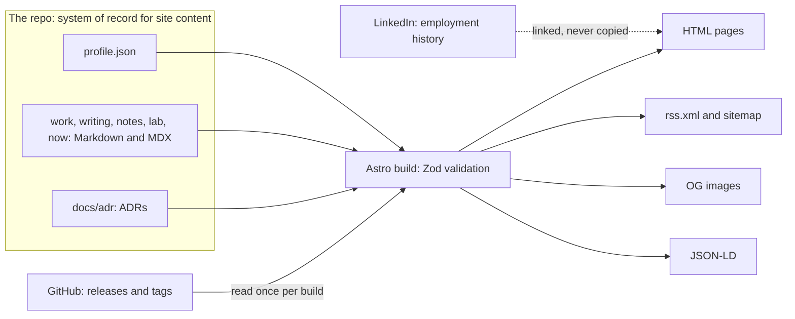

# Content

This document plans the words on ihaveasegway.com: who reads them and how fast, which pages exist and when, what Home says and in what order, the template every case study follows, how content is stored and validated, the voice, how the content firewall applies to copy, which owned work the site features, and the writing habit that keeps the site alive. Two of these choices are hard to reverse and have their own records: where content lives ([ADR 0004](adr/0004-content-as-code.md)) and the URL scheme ([ADR 0005](adr/0005-url-scheme.md)).

Status: Draft for review in PR 1 · 2026-10-22

Policy: [product.md](product.md#content-firewall) · Enforcement: [ADR 0007](adr/0007-content-firewall.md), [security.md](security.md#content-firewall-design) · Visual design: [design-system.md](design-system.md) · Sequence: [roadmap.md](roadmap.md)

## Who reads and how fast

Most visitors arrive through a link Joseph handed out: the résumé, LinkedIn, GitHub, a shared post, a Slack unfurl. Few arrive by searching a name that many other engineers share. So the first job is to convert a link within seconds. [product.md](product.md) says who the readers are; this section says how long they give the page.

| Finding | Number | Source |
|---|---|---|
| A recruiter's first pass over a résumé | 6 s in 2012 (30 recruiters, 10 weeks, eye tracking); 7.4 s in 2018 | Ladders, ["Keeping an eye on recruiter behavior"](https://www.bu.edu/com/files/2018/10/TheLadders-EyeTracking-StudyC2.pdf) (2012); [HR Dive on the 2018 study](https://www.hrdive.com/news/eye-tracking-study-shows-recruiters-look-at-resumes-for-7-seconds/541582/) |
| Where that time goes | almost 80% on six data points: name, current title and company, previous title and company, previous position dates, current position dates, education | Ladders (2012) |
| How long a web visitor gives a page | often 10–20 s; the value proposition has to land within 10 s | Nielsen, ["How long do users stay on web pages?"](https://www.nngroup.com/articles/how-long-do-users-stay-on-web-pages/) (NN/g, 2011) |
| Where attention goes | 57% of viewing time above the fold, 74% in the first two screenfuls (120 participants, 130,000+ fixations) | Fessenden, ["Scrolling and attention"](https://www.nngroup.com/articles/scrolling-and-attention/) (NN/g, 2018) |
| How often text is hard to read | low-contrast text, below WCAG 2 AA, on 83.9% of the top 1,000,000 home pages | [WebAIM Million](https://webaim.org/projects/million/) (2026) |

What follows for the site:

- The content firewall removes one of the six fields: current company. The first screen has to carry the rest and replace the missing one. Name and title stay. A one-line arc stands in for the dates. Proof stands in for the company's signal: owned work, with a number a stranger can check.
- For most visitors the first screen is the whole site. Rows 1–3 of Home must be visible without scrolling ([Home page](#home-page)).
- Low contrast is the most common failure on the web's home pages. Every token pair on this site passes WCAG 2.2 AA ([design-system.md](design-system.md)), so the few seconds go to reading.
- Depth is for the visitors who stay past 10 seconds: case studies, decisions, demos. It sits one click down. That is progressive disclosure, and each page is written as an inverted pyramid: conclusion first, evidence after.

These studies are directional. Ladders is a vendor study, and NN/g measured the web at large, not portfolios. The test that would show Home is wrong: before PR 3 merges, show Home for 7 seconds to five recruiters or hiring managers. If two or more cannot recall the name, the title, one proof point and how to make contact, rewrite the hero.

## Sitemap and phases

Phases follow [roadmap.md](roadmap.md): P1 is Phase 1 (PR 2), P2 is Phase 2 (PR 3), P3 is Phase 3 (PR 4 and PR 5), P4 is Phase 4 (PR 6–8). "Later" waits on Joseph's decisions.

```
ihaveasegway.com
├── /                                      Home                                P1 minimal · P2 v1
├── /404                                   Not found, served with status 404   P1
├── /.well-known/security.txt              Contact and Expires                 P1
├── /sitemap-index.xml                     Generated at build                  P1
├── /robots.txt                            Sitemap line; crawlers per Q15      P1
├── /favicon.ico · /apple-touch-icon.png   Root icons, asked for by name       P1
├── /colophon/                             How it is built, what it costs      P2
│   └── /colophon/decisions/               Published ADRs                      P2
│       └── <nnnn-slug>/                   One ADR, rendered from docs/adr     P2
├── /work/                                 Case studies                        P3 (PR 4)
│   ├── /work/stillhere/                                                       P3 (PR 4)
│   └── /work/gitops/                                                          P3 (PR 4)
├── /about/                                Arc, how I work                     P3 (PR 4)
├── /now/                                  What I am doing now, dated          P3 (PR 4)
├── /writing/ · /writing/<slug>/           Essays                              P3 (PR 5, at 3+ posts)
├── /notes/ · /notes/<slug>/               Field notes                         P3 (PR 5, at 3+ posts)
├── /rss.xml                               Essays and notes                    P3 (PR 5)
├── /privacy/                              Before the first lab                P4 (PR 6)
├── /lab/ · /lab/<slug>/                   Demo write-ups, static pages        P4 (PR 6–8)
│   └── /lab/api/*                         Lab Worker API, not pages           P4 (PR 6)
└── /resume/                               Public edition (Q-resume)           later
```

Render rules:

- **A section exists when it has content.** No "coming soon" pages and no empty nav items: a reserved prefix with nothing in it builds nothing. Empty or stale sections read as abandonment; `/now/` carries freshness instead.
- **Every prefix of a page URL is itself a page.** A visitor who trims `/work/gitops/` to `/work/` gets the index (Nielsen, ["URL as UI"](https://www.nngroup.com/articles/url-as-ui/), 1999). `/lab/api/` is the exception: it is an API.

| Section | In the header and on Home when | Phase |
|---|---|---|
| Work | at least 1 case study is published | P3 |
| About | the page exists | P3 |
| Writing (with `/notes/` and `/rss.xml`) | at least 3 posts, essays and notes together | P3 |
| Lab | at least 1 demo has `lifecycle: live` | P4 |
| Résumé | the public edition exists | later |

Header: Work · Lab · Writing · About, each only when its rule holds. Footer: Email · GitHub · LinkedIn (Q-threat-model) · RSS · Now · Colophon · ⌘K. This is recognition over recall: the navigation is always visible, and ⌘K is a shortcut, never the only way in.

## URL scheme

[ADR 0005](adr/0005-url-scheme.md) owns the rationale. This is what a writer needs.

| Pattern | What lives there |
|---|---|
| `/` | Home |
| `/work/` · `/work/<slug>/` | Case studies |
| `/writing/` · `/writing/<slug>/` | Essays |
| `/notes/` · `/notes/<slug>/` | Field notes |
| `/lab/` · `/lab/<slug>/` | Demo write-ups, static pages |
| `/lab/api/*` | The lab Worker's API, the only path that runs code ([ADR 0009](adr/0009-lab-worker-same-origin.md)) |
| `/about/` · `/now/` · `/colophon/` · `/privacy/` | Single pages |
| `/colophon/decisions/` · `/colophon/decisions/<nnnn-slug>/` | Published ADRs; the slug is the ADR's file name |
| `/resume/` | Public résumé, later; its PDF is `/resume/joseph-peterson-resume.pdf` |
| `/rss.xml` · `/sitemap-index.xml` · `/robots.txt` · `/.well-known/security.txt` · `/favicon.ico` · `/apple-touch-icon.png` | Files; they keep their extensions, and the root ones sit where clients ask for them by name |
| `/404` | Not-found page |

- Page URLs always end in `/`. Internal links, canonical tags, `og:url`, the sitemap and the feed all use that form.
- A slug is the content file's name: lowercase ASCII words joined by hyphens. No dates, no file extensions, no words about how the page is built, no status words (`new`, `draft`, `v2`).
- A slug never changes once published. A rename adds a 301 to `apps/web/public/_redirects`, and CI fails when a URL leaves the sitemap without one.
- Nothing moves between sections. A note that grows into an essay is published as a new essay that links back; the note keeps its URL.

## Home page

Budget: 7 seconds. Rows 1–3 must be visible without scrolling at 390×844 (a phone) and 1440×900 (a laptop). Copy that waits on an open decision is a placeholder naming that decision ([product.md](product.md) lists them). Lines about owned work are drafted here; Joseph's wording wins.

| # | Section | Fold | Copy intent | Draft or placeholder | Renders when |
|---|---|---|---|---|---|
| 1 | Hero | above | The recruiter's fields minus company: name, title, arc, proof, contact | **Joseph Peterson** · `<title line — Q-title>` · `<arc line — Q-career-arc>` · proof line: "Author of stillhere and gitops. This site's hard-to-reverse decisions are written down." · `<location line — Q-location>` · `<availability line — Q-availability>` · buttons: Work (scrolls to row 4) · Email · GitHub · `<LinkedIn — Q-threat-model>` | always |
| 2 | Status line | above; one mono line, two on a phone | "Cyber" as real data: the telemetry strip, which sits in the footer on other pages | `build <sha> · deployed <ISO date> · served from <colo> · <weight> KB` | always |
| 3 | At a glance | above | Stands in for the previous titles and dates | `<role titles and years — Q-career-arc>` · "Full history on LinkedIn." (Q-threat-model) · `<stack line — skills in profile.json>` | always |
| 4 | Selected work | below | Proof through owned, checkable artifacts | three cards, below | per card: its repo passed the [readiness checklist](#repo-readiness-checklist) |
| 5 | How I work | below | Architect signal in four lines, each linked to its evidence | four lines, below | always |
| 6 | Lab | below | Invite play; be plain about state | "Try `<demo>`. Its state is deleted within 15 minutes. How it works →" (logs are covered on `/privacy/`) | a demo has `lifecycle: live` |
| 7 | Writing | below | Thinking and recency | the three latest posts (title, date, one line) · All writing · RSS | at least 3 posts |
| 8 | Footer | bottom | One click to contact; freshness | `hello@ihaveasegway.com` (Q-mail) · GitHub · `<LinkedIn — Q-threat-model>` · RSS · Now · Colophon · ⌘K. No separate "Updated" line: on Home, row 2 carries the deploy date; on every other page, the telemetry strip closes the footer and carries it | always |

Selected work (row 4). Numbers are re-measured at publish time. The decision count and the page's JavaScript weight are computed at build, so they cannot drift.

| Card | Line | Proof | Links to |
|---|---|---|---|
| stillhere | "What landed, what lasted, who knows the code. Every number traces back to its commits." | 15 decision records · 181 tests · publishes its own failed metric | `/work/stillhere/` (P3) |
| gitops | "One git command across every repository in a directory. A TUI for people, a CLI for scripts." | v1.2.1 · signed checksums · CI on Linux, macOS and Windows | `/work/gitops/` (P3) |
| This site | "How it is built, what it costs, and why." | `<n>` decision records · `<js>` KB of JavaScript on this page · `<monthly cost — cost.md>` | `/colophon/` (P2) |

How I work (row 5). Each line links to evidence that exists when the row ships; a slogan without evidence waits.

| Line | Evidence it links to |
|---|---|
| "Write the decision down." | `/colophon/decisions/` |
| "One owner per piece of data." | [ADR 0004](adr/0004-content-as-code.md), rendered on the site |
| "Measure before building." | `/work/stillhere/`: profiling put 97% of a scan's CPU in git, so the blame cache was deferred; commit-graph filters cut a 30-repository scan from 297.7 s to 104.0 s |
| "Fail closed." | the content firewall ([ADR 0007](adr/0007-content-firewall.md)) and the Free plan's hard cap ([ADR 0008](adr/0008-workers-free-with-guardrails.md)) |

"Apply only what was reviewed." joins the list when the Migration Lab or its essay exists.

Fold rules:

- Rows 1–3 are visible without scrolling at both sizes: the bottom edge of row 3 is at or above the bottom of the viewport at 390×844 and at 1440×900. The vertical budgets in [design-system.md](design-system.md) fit with room to spare: about 670 px of 900 on a laptop and about 726 px of 844 on a phone. An e2e check loads Home at both sizes and fails if row 3's bottom edge falls below the viewport. That is a fitness function: the rule is tested on every pull request instead of argued in review. A Playwright viewport is the whole screen, while a phone's browser bars hide part of it, so PR 3 also checks the fold once in Safari on a real phone and records the visible height.
- Nothing above the fold waits for JavaScript. Home is static HTML. The status line's `<colo>` is the one value filled in after load, and it reserves its width so nothing shifts. How it is read, and the PR 3 check that reading it runs no Worker code: [design-system.md](design-system.md).
- A value that cannot be read is left out, never faked.
- No photo in the hero (Q-photo), no intro animation, and no city, coordinates or UTC offset anywhere.
- If a placeholder is still open when PR 3 ships, its line is omitted, not filled with a guess.

## Case-study template

One file per case study, `apps/web/src/content/work/<slug>.md` (or `.mdx`), rendered at `/work/<slug>/`. The shape borrows from two kinds of writing that hiring loops already trust. Design docs at Google treat "Alternatives considered" as one of the most important sections (Ubl, ["Design docs at Google"](https://www.industrialempathy.com/posts/design-docs-at-google/), 2020). Promotion packets keep the summary short and link out to design documents ([StaffEng](https://staffeng.com/guides/promo-packets/)).

```markdown
---
title: "gitops: one git command across every repository"
summary: "At most 160 characters. Becomes the meta description and og:description."
published: <YYYY-MM-DD>
role: "Author and maintainer, with outside contributions"
period: "2026-03 to 2026-09"
status: shipped                  # shipped | in-progress | archived
stack: [Go, Bubble Tea, GoReleaser, cosign]
outcome: "<one number, its unit, how it was measured>"
repo: "https://github.com/IHaveASegway/gitops"
decisions: []                    # ids from the decisions collection, e.g. 0004-content-as-code
tags: [go, tools]
firewall_reviewed: <YYYY-MM-DD>  # set by hand after the human review
---

> **At a glance.** Problem · Constraint · Decision · Result · My role · Links. Readable in 30 seconds.

## Problem
Who had it, what it cost them, what happens if nothing is done.

## Constraints
Time, money, people, what already existed, non-goals.

## Options considered
| Option | What it trades | Verdict |
|---|---|---|
Two or three real options. Name the quality attributes: consistency, availability,
latency, cost, operability, security, evolvability.

## Decision
What was chosen and why. One-way or two-way door. Link the ADR.

## Architecture
One diagram. For each piece of data: system of record, who writes it, who reads it,
how it crosses a boundary.

## Build notes
Two or three details worth a reviewer's time. Short snippets are fine.

## Numbers
Before and after. Each number has a unit, a method and a link to public evidence.

## What I'd do differently
Specific. The strongest senior signal on the page.

## What's next
```

Rules:

- 800–1,500 words and one diagram (mermaid, or a static SVG in the site's tokens).
- Every number has a unit, a method and a link to public evidence: a commit, a pull request, a CI run, a line in the repo's docs. Résumé metrics are not published until cleared.
- Owned work only. The role line states the credit boundary: outside contributions are called outside contributions, and nothing they built is claimed.
- Recommended, pending Joseph's wording (Q27 · Q-agent-credit in [product.md](product.md)): say how the work was built, including any tool that wrote code (a coding agent, for example), and what the author owned: decisions, specs, tests. A reader who opens the history will work it out anyway; saying it first turns a question into a strength.
- Lead with the decision and the evidence, including what failed. A published failure, such as stillhere's own metric, is worth more than one more success.
- The [firewall classes](#firewall-classes-for-copy) apply to every surface: text, diagrams, alt text, screenshots, code samples.
- Screenshots show owned work only, cropped to the content: no browser chrome, tabs, bookmarks or account names. The telemetry strip's colo is hidden or cropped in any screenshot or recording of the live site, because it names the data center nearest the person taking it. Images are stripped of metadata before they are committed, because a public repository publishes a file at `git push`, before any build runs: the pre-commit hook and `verify` reject an image or PDF that still carries EXIF, XMP or IPTC, and the build strips again ([security.md](security.md)).
- `firewall_reviewed` is the date a person last read the whole page, images and alt text included. Every collection a person writes carries it: case studies, essays, notes, lab write-ups, `/now/` and `profile.json`. `profile.json` keeps it inside JSON Resume's `meta` object, the place the schema leaves for tooling, so the file stays valid JSON Resume. CI fails a pull request that changes an entry's body, or any field of `profile.json`, without changing that date. The check needs no secret, so it runs in `verify` ([delivery.md](delivery.md#quality-gates-and-budgets-as-fitness-functions)).
- The OG image is generated from the title at build. Nobody hand-makes one.

## Content model

Content is code: Markdown, MDX and JSON in the repo, validated when the site builds ([ADR 0004](adr/0004-content-as-code.md)). Validation is schema-on-write. A malformed entry fails the build before it can be published, the same move as validating an event at the producer instead of in every consumer.

| Collection | Source | Loader | Renders | Fields |
|---|---|---|---|---|
| `profile` | `apps/web/src/content/profile.json` | `file()` | `/about/`, Home rows 1 and 3, JSON-LD; later `/resume/` | A JSON Resume subset, with `firewall_reviewed` in `meta`. No field exists for an employer, a city, an address, an email or a phone number |
| `work` | `apps/web/src/content/work/*.{md,mdx}` | `glob()` | `/work/<slug>/` | The case-study front matter above |
| `writing` | `apps/web/src/content/writing/*.{md,mdx}` | `glob()` | `/writing/<slug>/`, `/rss.xml` | title, summary, published, updated, kind (essay, pattern, postmortem), tags, draft, firewall_reviewed |
| `notes` | `apps/web/src/content/notes/*.md` | `glob()` | `/notes/<slug>/`, `/rss.xml` | title, summary, published, tags, source (optional link), draft, firewall_reviewed |
| `lab` | `apps/web/src/content/lab/*.{md,mdx}` | `glob()` | `/lab/<slug>/` | title, summary, lifecycle (building, live, retired), recording, cost, state TTL (at most 15 minutes), decisions, firewall_reviewed |
| `now` | `apps/web/src/content/now.md` | `glob()` | `/now/` | updated, firewall_reviewed |
| `decisions` | `docs/adr/NNNN-*.md`, outside `apps/web` | a small custom loader | `/colophon/decisions/<nnnn-slug>/` | None in the file. Number, title, status, date and deciders are parsed from the heading and the Status line |



Configuration sketch (sketch — confirm against current docs when building). Astro 7 imports Zod 4 from `astro/zod`, and the loaders from `astro/loaders` ([Astro content collections](https://docs.astro.build/en/guides/content-collections/), as of 2026-10-22).

```ts
// apps/web/src/content.config.ts
import { defineCollection, reference } from 'astro:content';
import { glob, file } from 'astro/loaders';
import { z } from 'astro/zod';
import { adrLoader } from './lib/adr-loader'; // about 40 lines; see the rules below

const day = z.coerce.date();
const TAGS = ['architecture', 'data', 'go', 'cloudflare', 'durable-objects',
  'platform', 'testing', 'security', 'tools', 'writing'] as const;

const post = {
  title: z.string().max(70),
  summary: z.string().max(160), // meta description and og:description
  published: day,
  updated: day.optional(),
  draft: z.boolean().default(false),
  tags: z.array(z.enum(TAGS)).max(3).default([]),
  firewall_reviewed: day, // set by hand after the human review
};

const work = defineCollection({
  loader: glob({ base: './src/content/work', pattern: '*.{md,mdx}' }),
  schema: z.strictObject({
    ...post,
    role: z.string(),
    period: z.string().regex(/^\d{4}-\d{2} to (\d{4}-\d{2}|present)$/),
    status: z.enum(['shipped', 'in-progress', 'archived']),
    stack: z.array(z.string()).max(6),
    outcome: z.string(),
    repo: z.url().optional(),
    decisions: z.array(reference('decisions')).default([]),
  }),
});

const writing = defineCollection({
  loader: glob({ base: './src/content/writing', pattern: '*.{md,mdx}' }),
  schema: z.strictObject({ ...post, kind: z.enum(['essay', 'pattern', 'postmortem']) }),
});

const notes = defineCollection({
  loader: glob({ base: './src/content/notes', pattern: '*.md' }),
  schema: z.strictObject({ ...post, source: z.url().optional() }),
});

const lab = defineCollection({
  loader: glob({ base: './src/content/lab', pattern: '*.{md,mdx}' }),
  schema: z.strictObject({
    ...post,
    lifecycle: z.enum(['building', 'live', 'retired']),
    recording: z.string(), // the recorded run (NDJSON), a static asset
    cost: z.string(),      // one line, with units
    state_ttl_minutes: z.number().int().positive().max(15),
    decisions: z.array(reference('decisions')).default([]),
  }),
});

const now = defineCollection({
  loader: glob({ base: './src/content', pattern: 'now.md' }),
  schema: z.strictObject({ updated: day, firewall_reviewed: day }),
});

const month = z.string().regex(/^\d{4}(-\d{2})?$/);
const profile = defineCollection({
  // one JSON Resume document; the parser gives it the id "profile"
  loader: file('src/content/profile.json', { parser: (text) => ({ profile: JSON.parse(text) }) }),
  schema: z.strictObject({
    basics: z.strictObject({
      name: z.string(),
      label: z.string(),             // title line (Q-title)
      summary: z.string().optional(), // arc line (Q-career-arc)
      url: z.url(),
      location: z.strictObject({ region: z.string(), countryCode: z.string().length(2) }).optional(), // Q-location
      profiles: z.array(z.strictObject({ network: z.enum(['GitHub', 'LinkedIn']), url: z.url() })),
    }),
    work: z.array(z.strictObject({ position: z.string(), startDate: month, endDate: month.optional() })).default([]),
    // [] until Joseph clears it together with Q-location: an institution can name a region
    education: z.array(z.strictObject({ institution: z.string(), area: z.string().optional() })).default([]),
    skills: z.array(z.strictObject({ name: z.string(), keywords: z.array(z.string()).default([]) })).default([]),
    projects: z.array(z.strictObject({ name: z.string(), description: z.string(), url: z.url().optional() })).default([]),
    meta: z.strictObject({ firewall_reviewed: day }), // JSON Resume's tooling object; set by hand after the human review
  }),
});

const decisions = defineCollection({
  loader: adrLoader({ dir: '../../docs/adr', publish: [] }), // allowlist of ADR numbers
  schema: z.strictObject({
    number: z.string().regex(/^\d{4}$/),
    title: z.string(),
    status: z.string().regex(/^(Proposed|Accepted|Superseded by \d{4})$/),
    date: day,
    deciders: z.string(),
  }),
});

export const collections = { profile, work, writing, notes, lab, now, decisions };
```

Rules the sketch encodes:

- **`profile` has no slot for the forbidden fields.** This is "make illegal states unrepresentable" applied to a data file. Every object in its schema is strict, so JSON Resume's own employer field (`work[].name`), a `city`, an `address`, an `email` or a `phone` in `profile.json` fails the build. Free text is different: the title, the arc or a project description can still carry a name, and there the firewall scan is the only automated check. `education` stays `[]` until Joseph clears it together with Q-location, because an institution can name a region. The file stays valid JSON Resume ([schema](https://jsonresume.org/schema), MIT), so other résumé tools can read it.
- **The slug is the file name.** There is no `slug` field: it would be a second source for the same fact. Renaming a file changes a URL, and the sitemap check catches that.
- **`api` is reserved under `/lab/`.** The lab Worker owns `/lab/api/*` ([ADR 0009](adr/0009-lab-worker-same-origin.md)), so no lab entry may be named `api`: the URL check in `verify` fails on `apps/web/src/content/lab/api.*`.
- **Drafts** (`draft: true`) build in dev and in pull-request previews, which the firewall job scans first, and never in production. A draft is hidden from the site, not from the repository: once the repository is public, a committed draft is public at `git push` ([ADR 0012](adr/0012-public-repository.md)).
- **MDX stays thin.** `.md` by default; `.mdx` only to use one of at most 5 shared components; no `client:*` in posts ([ADR 0003](adr/0003-astro-static-first.md)).
- **Tags come from a fixed list** of 10. Adding one is a pull request. There are no tag pages: they are not in the URL scheme, and adding them is an amendment to ADR 0005, best made with search (Pagefind) at about 20 posts.
- **A lab write-up does not copy runtime state.** `lifecycle` says whether a demo is published. Whether it is taking live sessions right now belongs to the lab's control object and is read when the page is viewed ([lab.md](lab.md)). A hand-edited `status: live` field that someone forgets to flip would be a second owner of that fact.
- **Decisions render from the same files; nothing is copied.** The loader reads `docs/adr/NNNN-*.md`, parses the `# ADR NNNN: <decision>` heading and the `Status:` line, validates them with Zod, and renders the body. It rewrites links: one ADR to another becomes `/colophon/decisions/<nnnn-slug>/`; an ADR to another doc becomes the file on GitHub once the repo is public ([ADR 0012](adr/0012-public-repository.md)), and plain text before that. Publication is an allowlist in the loader's options. An ADR renders only when its number is listed, so a new ADR cannot reach the site by accident. Astro's `glob()` loader can read `docs/adr` directly, but it validates only YAML front matter, which the ADR template does not have; the custom part is the parser for the heading and the Status line. The weaker alternative, front matter in every ADR, would store the number, title and status twice in one file.
- **Project facts** (latest release, tag dates) are read from GitHub's API once per build, never when a visitor loads a page. If GitHub does not answer, the card drops the line; the build neither fails nor guesses. The unattended weekly rebuild is the exception: it fails instead, so the live page keeps its facts ([delivery.md](delivery.md#pipeline)). The build reads with the job's own `GITHUB_TOKEN` (`contents: read`), which adds no secret and allows 1,000 requests an hour per repository. Unauthenticated reads allow 60 an hour per IP address, and GitHub-hosted runners share their addresses with other customers' jobs, so an unauthenticated build could find the limit already spent (as of 2026-10-22, [GitHub](https://docs.github.com/en/rest/using-the-rest-api/rate-limits-for-the-rest-api)). A build needs a handful.

## Voice

Joseph's register: short declarative sentences; numbers over adjectives; named systems over category nouns; dry and understated. A sample of the register, not copy for the site:

> I write the decision down before I build. I still spend time on the boring details. They tend to matter.

- Replace an adjective with the number it stands for. Not "fast" but "300 posts built in 1.72 s"; not "battle-tested" but "5 releases, CI on 3 operating systems".
- Name the system. "SQLite through modernc.org/sqlite", not "a lightweight database".
- First person for owned work. Say what you did, not what "we" did, unless there was a we.
- Conclusion first. If the opening paragraph only warms up, cut it.
- ISO dates (2026-10-22), US English, sentence-case headings, link text that says where it goes.
- No emojis. No exclamation marks.

Banned, because each claims a quality instead of showing it: "seamless", "robust", "blazing", "leverage", "cutting-edge", and their cousins "world-class", "best-in-class", "game-changing", "revolutionary", "next-generation", "synergy", "passionate", "rockstar", "ninja". The pull-request template asks for a pass over this list. A prose linter such as Vale can enforce it later, if the list keeps getting broken.

| Weaker | In the register |
|---|---|
| "A robust, scalable CLI that seamlessly manages all your repositories." | "gitops runs one git command across every repository in a directory. 5 releases; the last three ship checksums signed with cosign." |
| "Analytics that leverage advanced statistics to surface insights." | "stillhere publishes its own failed metric: `durable@1` scored an AUC of 0.42 where change size alone scored 0.82." |

## Firewall classes for copy

The policy is in [product.md](product.md#content-firewall); enforcement is in [ADR 0007](adr/0007-content-firewall.md) and [security.md](security.md#content-firewall-design). This is how a writer applies it. When unsure, use the stricter class. An item moves to a looser class only when Joseph clears that exact wording in writing in the private record ([product.md](product.md#content-firewall)).

| Class | What belongs | Generic examples | What happens |
|---|---|---|---|
| SAFE | A job title on its own; role names without company or city; owned-project facts with public evidence; the skills line's mainstream technology names (languages, databases, clouds) | "`<role name>`"; "5 releases, CI on 3 operating systems" | Published |
| ASK | A generic industry noun; an exact title that few people hold; a description of an employer's system without its name; role years, or anything else that shows how long someone stayed with one employer (Q-career-arc); an education institution, which can name a region; a demo or essay that restates a résumé line with neutral nouns | "`<industry noun>`"; "`<rare title>`"; "`<role name>`, `<year>`–`<year>`"; "built the company's `<system type>`" | Treated as NEVER until cleared |
| NEVER, by default | Employer names, products, internal system names, colleagues, internal metrics, industry-specific words that narrow to one company, the city | "`<employer>` `<product>`"; "the `<internal system>` project"; "`<teammate>` and I"; "cut `<internal metric>` by N%"; "`<city>`" | Not published. CI blocks the known terms; review catches paraphrase |

Résumé metrics are not published until cleared.

The mosaic rule: two facts that are harmless alone can identify together ([product.md](product.md#content-firewall) says why the policy rests on it). So two ASK items anywhere on the site count as one NEVER until they are cleared together.

The classes cover every surface: body text, headings, alt text, image contents and metadata, OG images, code samples and test fixtures, slugs and URLs, file names, front matter, commit messages, pull-request text.

Published means permanent. Crawlers, the Wayback Machine and the LinkedIn and Slack preview caches keep copies. Start strict and loosen later; the reverse is a one-way door.

## Owned work

The site features three things and nothing else. The numbers below were measured on 2026-10-22 from public sources: the repositories, their docs, issues and CI. Re-measure each one at publish time. Never cite adoption (stars, downloads).

### stillhere (lead)

Change analytics for git and GitHub: what landed, what lasted, who knows the code. Every number traces back to its commits. Apache-2.0, pre-release (no tagged release on 2026-10-22).

What it shows a hiring manager:

| Competency | Evidence in the repo |
|---|---|
| Decisions in writing | 15 ADRs with Door and Revisit-if fields; an open-decisions table with a baseline, a recommendation and the evidence that would settle each |
| Data ownership | A per-fact system-of-record table and no second owner of any fact; a disposable derived store beside an append-only record that is not disposable |
| Boundaries | CQRS, bounded contexts, an anti-corruption layer over GitHub's GraphQL model, a published language (`report.json` v1) |
| Enforced architecture | Ports and adapters, with depguard in CI as an architectural fitness function |
| Reliability | Bulkheads (a run is marked partial when one repository fails), idempotent and resumable sync, byte-identical reruns |
| Privacy and security | An append-only record of what left the machine, a 3-person floor, a loopback server behind a capability URL with a Host check against DNS rebinding, a CSP with no inline script, hardened git subprocesses |
| Measurement validity | Blinded labels, AUC with intervals, Krippendorff's alpha, and a failing metric published as such |
| Measuring before building | Profiling put git at 97% of CPU and commit-graph filters gave 2.85×, so the blame cache was deferred |

Publishable numbers (measured 2026-10-22; re-measure at publish time):

| Number | Where it comes from |
|---|---|
| 39,160 non-test and 11,277 test lines of Go | cloc over the tracked files |
| 181 tests, 17 commands, 9 MCP tools, 11 SQL migrations, 15 ADRs | `go test`, `stillhere help`, the repo tree |
| 30 public repositories: cold scan 297.7 s, or 104.0 s with commit-graph changed-path filters; 30,155 git blame processes; two runs byte-identical | stillhere issue #16 |
| First sync of the `cli` organization in 135 s (2 min 15 s); go-chi's 20 repositories in 28 s | stillhere ADR 0013 |
| 143 changes from 4 public repositories, labelled blind by a panel of three model raters, Krippendorff's alpha 0.851: `durable@1` AUC 0.42 against 0.82 for change size alone; `simplifying@1` 0.76 against 0.87; `reviews_given@1` 0.55 against 0.89 | stillhere `docs/validation.md` |

Only numbers from public repositories and public benchmarks are published.

Framing: lead with its limits statement and its published failed metric. stillhere ranks people on properties of their changes; without the limits up front, a hiring manager could read it as surveillance tooling. On the site, show repository-level aggregates only, never per-person output, because per-person output names other contributors.

### gitops (second)

One git command across every repository in a directory, in parallel. A TUI for people, a CLI for scripts. MIT; v1.2.1; 5 releases from 2026-03 to 2026-09. Role: author and maintainer, with outside contributions.

What it shows a hiring manager:

| Competency | Evidence in the repo |
|---|---|
| Concurrency | A bounded worker pool with cancellation: Ctrl-C kills in-flight git, and results keep input order |
| Safety contracts | Destructive operations confirm in a terminal and refuse without one; exit codes 0, 1, 2 and 130 |
| A CLI threat model | Tokens scoped to their host, API responses validated, pagination pinned to one host, paths and refs guarded against traversal and injection |
| Reconcile, don't infer | Only a 404 counts as deleted, and the safety check runs again right before each deletion |
| Release engineering | GoReleaser, cosign keyless signing, and a Homebrew formula instead of a cask, which dropped the quarantine-stripping hook |
| Testing discipline | A flaky test (1.4% of runs under `-race`) fixed by asserting what the code actually guarantees |

Publishable numbers (measured 2026-10-22; re-measure at publish time): v1.2.1, 5 releases, 6 platform archives per release from v1.0.0, cosign-signed checksums from v1.1.0, 8 commands, 66 tests, CI on 3 operating systems.

Credit boundary:

- Claim: the 1.0 rewrite (TUI, `init`, duplicate detection), the 1.1.0 hardening, org reconcile (1.2.0) and the submodule fix (1.2.1).
- Do not claim: the blocklist, recursive discovery, branch preservation or submodule detection. They came from outside contributions. The site says "with outside contributions"; the repository keeps the contributors' credit.

### Upstream contribution: capacitor

capacitor is someone else's open-source Go library. Joseph's credit is one merged upstream pull request (+27/−4, merged 2025-12-29). It fixed back-pressure handling: a server that asked for zero concurrency got more requests, not fewer. Zero now clamps to the floor, negative values fail at parse time, and the library reports when a suggestion was overridden.

Site line (draft): "Upstream: fixed zero-concurrency handling in capacitor (one merged pull request)." It links to the merged pull request. It never says "my project".

### Everything else

Off the site. Older private repos stay private and unlinked (Q-other-repos). Mission-AI, an earlier project of Joseph's, is not on the site at launch (Q-mission). Q-projects confirms this list.

## Repo readiness checklist

A link from the site sends readers to everything a repository holds, so linking one is checked like a deploy. Before the site links a repository, or a profile page that lists it:

- [ ] **The content firewall scan is clean** over the tracked tree, the full history (every branch, every tag, and every pull request head under `refs/pull/`, which stays public after its branch is deleted), and the text around the code: issue and pull-request titles, bodies and comments, release notes and their attached files ([ADR 0007](adr/0007-content-firewall.md)).
- [ ] **Published artifacts are known.** Package registries and module mirrors keep every version ever published; a fix there is a new version, not an edit.
- [ ] **Commit identity is checked.** List every author, committer and `Co-authored-by` address in the history. Any address outside the allowed public identities (the GitHub noreply address, known bots) is Joseph's call under Q-threat-model before the link goes up: accept it, or rewrite the history, which changes every later commit SHA and breaks the tags and links that point at them. New commits use the noreply address ([security.md](security.md)).
- [ ] **No secrets in history.** A secret scan with default rules over the full history is clean. A secret that was ever committed is rotated first; rewriting history comes second, if at all.
- [ ] **Numbers come from public sources**: a public benchmark, a CI run, a line in the repo's docs. Each number the site cites is re-measured at publish time and links to its evidence.
- [ ] **Credit is explicit.** Outside contributions are described as such, and nothing they built is claimed.
- [ ] **It works for a stranger.** The README's install path works on a clean machine, from a tagged release or, for a pre-release project, from source; tests pass on a fresh clone without the author's machine-wide configuration; CI is green.
- [ ] **A license file is present.**
- [ ] **The linked GitHub profile passes too.** Its name, bio, company and location fields, profile README, public organization memberships, gists, pinned items, and every public repository and fork pass the firewall classes above; the profile's local-time field is off; and it pins the featured repositories. Anything else is made private or deleted before the link ships; archiving is not enough, because an archived repository stays public.
- [ ] **The check is recorded**: the date and the commit SHA checked go in the pull request that adds the link.

## Résumé

| When | What the site offers | System of record |
|---|---|---|
| Launch | A LinkedIn link (Q-threat-model) and "Full résumé on request" by email | LinkedIn and Joseph's private résumé |
| Later (Q-resume, after the firewall questions) | A public edition at `/resume/`: HTML with print CSS, and a PDF rendered from that page | `profile.json`, the file that already renders `/about/` and the JSON-LD |

- **The current résumé file is never hosted and never committed.** It names the employer, which the site never does.
- **Generate, don't redact.** The public edition comes from a source that never held the employer's name. Redacting a file that holds it fails open: one missed text layer, metadata field or earlier revision leaks it. Generating from a clean source fails closed, and `profile.json` has no field meant for the employer.
- **The PDF is built, not uploaded.** Playwright, already in the toolchain for e2e tests, prints `/resume/` at build. Title and Author are set explicitly; no metadata field names a machine, a path or an account. The firewall job reads the metadata with `pdfinfo`, scans the text with `pdftotext`, and fails on anything unexpected. The file is `/resume/joseph-peterson-resume.pdf`.
- One printed page. Links appear as text so the PDF works on paper.
- **Publishing it is a one-way door.** Crawlers and recruiters keep copies of a PDF after it is taken down, so the edition waits for Q-resume, and its first version is the strict one.

## Structured data and link previews

JSON-LD is generated at build from `profile.json`, so it cannot disagree with the page.

Home, a `WebSite`. Google reads it only on the home page at the domain root, where it lets results show "Joseph Peterson" as the site name ([Site names](https://developers.google.com/search/docs/appearance/site-names)):

```json
{
  "@context": "https://schema.org",
  "@type": "WebSite",
  "name": "Joseph Peterson",
  "alternateName": "IHaveASegway",
  "url": "https://ihaveasegway.com/"
}
```

`/about/`, a `ProfilePage` whose main entity is a `Person`, with no `worksFor`. "An 'About Me' page on a blog site" is one of Google's listed uses ([Profile page](https://developers.google.com/search/docs/appearance/structured-data/profile-page)):

```json
{
  "@context": "https://schema.org",
  "@type": "ProfilePage",
  "dateCreated": "<first publish date>",
  "dateModified": "<last change to profile.json>",
  "mainEntity": {
    "@type": "Person",
    "@id": "https://ihaveasegway.com/#person",
    "name": "Joseph Peterson",
    "alternateName": "IHaveASegway",
    "jobTitle": "<Q-title>",
    "description": "<arc line — Q-career-arc>",
    "url": "https://ihaveasegway.com/about/",
    "sameAs": ["https://github.com/IHaveASegway"]
  }
}
```

- No `worksFor`, `affiliation`, `workLocation` or `address`, and no location beyond what Q-location allows. The generator emits only allowlisted keys, so a new key takes a code change, not just a data change. `alumniOf` stays off the allowlist, because an institution can name a region.
- `sameAs` lists GitHub. LinkedIn joins it only if Q-threat-model allows a link to a profile that names the employer.
- `rel="me"` goes on the GitHub link, and on LinkedIn when allowed. The GitHub profile's website field points back to the site, and GitHub renders that link with `rel="nofollow me"` (checked on a public profile, 2026-10-22), so the identity link runs both ways (microformats, ["rel-me"](https://microformats.org/wiki/rel-me)).

Open Graph: one template per page type, rendered at build for each page as a 1200×630 PNG from the title and the section label in the site's tokens. No photos and no screenshots: nothing in an OG image that a reviewer has not read as text. Each page sets `og:title`, `og:description` (the front matter's `summary`), `og:url` (the canonical URL, trailing slash included), `og:image`, `og:image:alt` and `twitter:card` = `summary_large_image`.

| Page type | Image shows |
|---|---|
| Home | the name and `<title line — Q-title>` |
| Work, Writing, Notes, Lab | the section label and the entry's title |
| About, Now, Colophon, Decisions | the section label and the page title |

| Consumer | Requirement or behavior (as of 2026-10-22) | Source |
|---|---|---|
| LinkedIn | needs `og:title`, `og:image`, `og:description`, `og:url`; image at least 1200×627 px, 1.91:1 recommended, at most 5 MB; under 401 px wide it shows as a thumbnail | [LinkedIn help](https://www.linkedin.com/help/linkedin/answer/a521928) |
| Slack | reads oEmbed, Twitter Card and Open Graph tags; caches an unfurl globally for about 30 minutes; does not honor `robots.txt` | [Slack robots](https://api.slack.com/robots) |

A generated PNG of text sits far below LinkedIn's 5 MB limit. LinkedIn does not document how long it caches a card, so re-inspect a changed page in its [Post Inspector](https://www.linkedin.com/post-inspector/) before sharing it. If Slack unfurled a link shortly before a change, it shows the old card for up to about 30 minutes.

## Writing plan

Budget: about 8–10 hours a month. Q-writing-budget asks whether that is realistic.

| Item | Per month | Time box |
|---|---|---|
| Essay | 1 | 6 h, across two sessions |
| Field notes | 2 | 30 min each, published within 48 h of learning the thing |
| `/now/` update | 1 | 15 min |
| ADRs | as decisions happen | part of the work, not extra |

That is 7.25 h of writing; editing and review make up the rest.

- "Write about it" is part of the definition of done (Willison, ["What to blog about"](https://simonwillison.net/2022/Nov/6/what-to-blog-about/), 2022). Every roadmap pull request from PR 2 on yields at least one note.
- A short post beats an unpublished one: "You actually just need to know 1-2 interesting things that the reader doesn't" (Evans, ["Some blogging myths"](https://jvns.ca/blog/2023/06/05/some-blogging-myths/), 2023). No apology posts.
- Missing a month is fine; `/now/` carries freshness.
- Measure two things: did I publish, and did a post come up in a conversation.
- If three months pass without a post, drop to notes only and hide Writing from Home.

Why write at all: "Your goal is to be known for good things while minimizing the organizational bandwidth you consume to do so" (Larson, ["Being visible"](https://lethain.com/being-visible/), 2020). The same essay: "There are a huge number of successful Staff-plus engineers with no external presence, but many find external visibility contributes to their career." Writing is a lever, not a requirement, which is why the fallback above is notes only rather than a forced schedule.

First 90 days, counted from PR 1's merge and assuming about 40 hours a month for the site ([roadmap.md](roadmap.md), time budget). At 20 hours a month the same steps take about 6–8 months:

| Days | Ships ([roadmap.md](roadmap.md)) | Writing |
|---|---|---|
| 1–30 | PR 2 Foundation; PR 3 Home v1 and Colophon, with the ADRs rendered | Two notes drafted from the build, held until Writing renders |
| 31–60 | PR 4: `/work/stillhere/`, `/work/gitops/`, `/about/`, `/now/` | The case studies are the long writing; the first essay is drafted |
| 61–90 | PR 5: `/writing/`, `/notes/`, `/rss.xml` | Writing renders with the first essay and at least two notes |

Backlog. Owned work and general architecture only; nothing about the day job.

| Title | Drawn from | Pattern it teaches | Kind |
|---|---|---|---|
| My metric failed its own test | stillhere's blinded validation: `durable@1` AUC 0.42 against 0.82 for size alone | measurement validity | essay |
| I didn't build the cache | stillhere: profiling, then commit-graph filters, 297.7 s to 104.0 s | measure before building | essay or note |
| Only a 404 counts as deleted | gitops org reconcile | reconcile, don't infer; fail-safe default | note |
| Apply exactly what you reviewed | saved plans on synthetic data (the Migration Lab, P4) | saved-plan semantics | essay |
| How this site is built | this repo's docs and ADRs | static by default; bulkhead | essay series |
| Durable Objects as a per-visitor sandbox | the lab platform (P4) | virtual actor; admission control | essay |
| The transactional outbox, explained by breaking it | the Outbox Lab (P4) | transactional outbox; why dual writes lose events | essay |
| Assert what the code guarantees | gitops' flaky test, 1.4% of runs under `-race` | deterministic tests | note |
| Signing releases with no key to lose | gitops' cosign keyless signing | supply-chain integrity | note |
| A content check that fails closed | [ADR 0007](adr/0007-content-firewall.md) | policy as code; fail-safe default | essay |
| Zero Worker invocations per page view | [ADR 0002](adr/0002-host-on-workers-static-assets.md), [ADR 0008](adr/0008-workers-free-with-guardrails.md) | bulkhead; denial of wallet | note |
| The fix was zero | the capacitor upstream pull request | back-pressure | note |
| Cool URIs, with trailing slashes | [ADR 0005](adr/0005-url-scheme.md) | cool URIs | note |

## Patterns and further reading

- Inverted pyramid and progressive disclosure: Schade, ["Inverted Pyramid: Writing for Comprehension"](https://www.nngroup.com/articles/inverted-pyramid/) (NN/g, 2018); Nielsen, ["Progressive Disclosure"](https://www.nngroup.com/articles/progressive-disclosure/) (NN/g, 2006).
- Recognition over recall: Budiu, ["Memory Recognition and Recall in User Interfaces"](https://www.nngroup.com/articles/recognition-and-recall/) (NN/g, 2024).
- Cool URIs and hackable URLs: Berners-Lee, ["Cool URIs don't change"](https://www.w3.org/Provider/Style/URI) (1998); Nielsen, ["URL as UI"](https://www.nngroup.com/articles/url-as-ui/) (1999).
- Single source of truth: Hunt and Thomas, *The Pragmatic Programmer*, the DRY principle: "Every piece of knowledge must have a single, unambiguous, authoritative representation within a system."
- Schema-on-write: Kleppmann, *Designing Data-Intensive Applications*, chapter 2.
- Make illegal states unrepresentable (the strict `profile` schema): Minsky, ["Effective ML Revisited"](https://blog.janestreet.com/effective-ml-revisited/) (Jane Street, 2011).
- Fail-safe defaults (generate, don't redact; the ADR publish allowlist): Saltzer and Schroeder, ["The Protection of Information in Computer Systems"](https://web.mit.edu/Saltzer/www/publications/protection/) (1975).
- Mosaic effect: OMB Memorandum M-13-13, "Open Data Policy: Managing Information as an Asset" (2013).
- Fitness functions (the fold check, the sitemap check): Ford, Parsons, Kua and Sadalage, *Building Evolutionary Architectures*, 2nd ed., ch. 2.
- Case studies shaped like design docs: Ubl, ["Design docs at Google"](https://www.industrialempathy.com/posts/design-docs-at-google/) (2020).

The full list, one source per pattern: [reading-list.md](reading-list.md).
