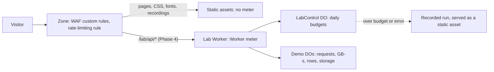

# Cost

What ihaveasegway.com costs to run, what breaks first on each Cloudflare plan under a spike or an attack, and the guardrails that keep both the bill and the breakage bounded. This doc owns the price sheet, the formulas, scenarios A–E, the guardrails, the upgrade triggers and the annual totals. [ADR 0008](adr/0008-workers-free-with-guardrails.md) owns the plan decision and its rationale; [lab.md](lab.md) owns how the lab's controls work.

Status: Draft for review in PR 1 · 2026-10-22

## The core trade

Cloudflare's two Workers plans fail in opposite directions.

- **Workers Free fails closed on cost.** The bill stops at $0 and features go down. Each daily cap belongs to the whole account and resets at 00:00 UTC. Past 100,000 Worker requests, Worker routes return Error 1027; Durable Object (DO), KV and D1 operations of an exhausted kind throw errors. Nobody is billed. Somebody is turned away.
- **Workers Paid fails open.** $5 a month buys included usage, then everything is metered, and there is no hard spend cap. Budget alerts only notify, once per billing cycle, and usage is processed once a day, so an alert arrives the day after spend crosses its threshold. Features stay up, the bill grows, and the first anyone hears of it is that email.

Free is safe for this site because of one structural fact. Requests to static assets are free and unlimited on both plans and never invoke a Worker, and every page here is a static asset ([ADR 0002](adr/0002-host-on-workers-static-assets.md), [ADR 0003](adr/0003-astro-static-first.md)). A cap can take down the lab's API, never a page. That separation is a bulkhead: the meters that can run out sit in a different compartment from the content.



At launch only the static-assets path exists; the lab ([ADR 0009](adr/0009-lab-worker-same-origin.md)) adds the rest in Phase 4. One exception to the $0 ceiling: R2 has its own free tier and its own meter, and nothing in its pricing ties it to the Workers plan, so treat R2 overage as billable even on Free. The site keeps its images as static assets.

## Price sheet

As of 2026-10-22. "Free" and "Paid" are the Workers plans. The WAF row belongs to the zone plan, which stays Free either way.

| Item | Workers Free | Workers Paid ($5/month minimum per account) | Source |
|---|---|---|---|
| Worker requests | 100,000/day per account, reset 00:00 UTC; past it, Error 1027 | 10M/month included, then $0.30/M | [pricing](https://developers.cloudflare.com/workers/platform/pricing/), [limits](https://developers.cloudflare.com/workers/platform/limits/) |
| Worker CPU | 10 ms per invocation; past it, Error 1102 | 30M CPU-ms/month included, then $0.02/M; 30 s per invocation by default, capped with `limits.cpu_ms` (up to 300,000) | [pricing](https://developers.cloudflare.com/workers/platform/pricing/), [limits](https://developers.cloudflare.com/workers/platform/limits/) |
| Static assets | Free, unlimited, never invoke the Worker; 20,000 files per version, 25 MiB each | Same; 100,000 files per version | [billing](https://developers.cloudflare.com/workers/static-assets/billing-and-limitations/), [limits](https://developers.cloudflare.com/workers/platform/limits/) |
| Workers Cache (`cache.enabled`) | Not stated for Free; assume every request then counts | Every request billed at the request rate, static assets included | [Workers Cache](https://developers.cloudflare.com/workers/cache/) |
| DO requests | 100,000/day | 1M/month included, then $0.15/M | [DO pricing](https://developers.cloudflare.com/durable-objects/platform/pricing/) |
| DO WebSocket messages | Each incoming message counts as 1/20 of a request; outgoing messages and protocol pings are free | Same | [DO pricing](https://developers.cloudflare.com/durable-objects/platform/pricing/) |
| DO duration | 13,000 GB-s/day (28.2 hours of one active object) | 400,000 GB-s/month included (868 object-hours), then $12.50 per million GB-s | [DO pricing](https://developers.cloudflare.com/durable-objects/platform/pricing/) |
| DO hibernation | An object that is idle and eligible for hibernation is not billed for duration, even before it hibernates (after 10 s). Pending `setTimeout` or `setInterval` callbacks, an open outbound connection, or the standard WebSocket API (`ws.accept()`) make it ineligible | Same | [DO pricing](https://developers.cloudflare.com/durable-objects/platform/pricing/), [lifecycle](https://developers.cloudflare.com/durable-objects/concepts/durable-object-lifecycle/) |
| DO SQLite rows | 5M read and 100,000 written per day | 25B read and 50M written per month included; then $0.001/M read, $1.00/M written | [DO pricing](https://developers.cloudflare.com/durable-objects/platform/pricing/) |
| DO stored data | 5 GB per account in total; no daily reset | 5 GB-month included, then $0.20/GB-month | [DO pricing](https://developers.cloudflare.com/durable-objects/platform/pricing/) |
| KV | 100,000 reads; 1,000 each of writes, deletes and lists per day; 1 GB | 10M reads, then $0.50/M; 1M each of writes, deletes and lists, then $5.00/M; 1 GB, then $0.50/GB-month | [KV pricing](https://developers.cloudflare.com/kv/platform/pricing/) |
| D1 | 5M rows read and 100,000 written per day; 5 GB; enforced since 2026-09-01 | 25B read, then $0.001/M; 50M written, then $1.00/M; 5 GB, then $0.75/GB-month | [D1 pricing](https://developers.cloudflare.com/d1/platform/pricing/), [changelog](https://developers.cloudflare.com/changelog/post/2026-09-01-d1-free-tier-limit-enforcement/) |
| Queues | 10,000 operations/day (one per 64 KB) | 1M/month, then $0.40/M | [Queues pricing](https://developers.cloudflare.com/queues/platform/pricing/) |
| R2, its own meter | 10 GB-month, 1M Class A and 10M Class B operations per month | $0.015/GB-month; $4.50/M Class A; $0.36/M Class B; egress $0 | [R2 pricing](https://developers.cloudflare.com/r2/pricing/) |
| Containers | Not available | 25 GiB-hours of memory, 375 vCPU-minutes and 200 GB-hours of disk included; then $0.0000025/GiB-s, $0.000020/vCPU-s (active use only), $0.00000007/GB-s; billed per 10 ms awake. Defaults: `sleepAfter` 10 min (every request resets it), `max_instances` 20, `instance_type` lite | [pricing](https://developers.cloudflare.com/containers/pricing/), [limits](https://developers.cloudflare.com/containers/platform-details/limits/), [class](https://developers.cloudflare.com/containers/container-package/), [Wrangler](https://developers.cloudflare.com/workers/wrangler/configuration/) |
| Workers Builds | 3,000 min/month, 1 concurrent | 6,000 min/month, then $0.005/min; 6 concurrent | [Builds](https://developers.cloudflare.com/workers/ci-cd/builds/limits-and-pricing/) |
| Workers Logs, through 2026-11-30 | 200,000 events/day, 3-day retention | 20M events/month, then $0.60/M; 7-day retention | [Workers Logs](https://developers.cloudflare.com/workers/observability/logs/workers-logs/) |
| Observability, from 2026-12-01 | 0.5 GB/day of logs and traces; ingestion stops at the cap until 00:00 UTC; 7-day retention | 50 GB of ingestion and 10 GB-month of storage per cycle, then $0.25/GB and $0.10/GB-month | [Observability](https://developers.cloudflare.com/observability/pricing/) |
| Turnstile | Free; unlimited challenges; 20 widgets, 10 hostnames each | Same | [Turnstile](https://developers.cloudflare.com/turnstile/plans/) |
| Web Analytics | Free; the previous 6 months of data; ad blockers block its beacon | Same | [about](https://developers.cloudflare.com/web-analytics/about/), [FAQ](https://developers.cloudflare.com/web-analytics/faq/) |
| Email Routing, inbound | Free, unlimited | Same | [Email pricing](https://developers.cloudflare.com/email-service/platform/pricing/) |
| Email sending | Free to verified addresses in the account | Also to any recipient: 3,000/month included, then $0.35 per 1,000 | [Email pricing](https://developers.cloudflare.com/email-service/platform/pricing/) |
| WAF on the Free zone | 5 custom rules (no regex); 1 rate-limiting rule: IP only, 10 s period, 10 s block | Same: a zone feature, not a Workers one | [custom rules](https://developers.cloudflare.com/waf/custom-rules/), [rate limiting](https://developers.cloudflare.com/waf/rate-limiting-rules/) |
| Spend cap and alerts | The plan is the cap | No cap. Alerts on the cycle's usage-based spend, processed daily, so they arrive the day after the threshold is crossed; one email per alert per cycle; notify only. A default $10 alert has been rolling out in cohorts since July 2026; the plan fee is excluded | [budget alerts](https://developers.cloudflare.com/billing/manage/budget-alerts/), [launch](https://developers.cloudflare.com/changelog/post/2026-04-13-billable-usage-dashboard-and-budget-alerts/), [default](https://developers.cloudflare.com/changelog/post/2026-06-15-budget-alerts-default-on/) |
| Registrar, .com | $10.46/year through 2026-10-31; about $11.17 from 2026-11-01 | Same | [at cost](https://www.cloudflare.com/products/registrar/), [price list](https://cfdomainpricing.com/), [Verisign](https://domainnamewire.com/2026/04/23/breaking-verisign-raising-wholesale-com-prices/) |
| GitHub Actions | Private repo on GitHub Free: 2,000 min/month, then $0.006/min (Linux, 2 cores); public repos free | Not a Cloudflare plan | [GitHub](https://docs.github.com/en/billing/concepts/product-billing/github-actions) |

Notes on the sheet:

- DO overage rounds up to the next billable unit, which is a million: the first request past the allowance costs $0.15 and the first GB-s past it costs $12.50. R2 rounds the same way (1,000,001 operations bill as 2M).
- The .com price from 2026-11-01 is derived. Cloudflare passes on the registry and ICANN fees with no markup. Verisign's wholesale fee rises from $10.26 to $10.97 on 2026-11-01; with the $0.20 ICANN fee, that is about $11.17. Cloudflare's price list still showed $10.46 on 2026-10-21.
- Conflicts and gaps in Cloudflare's docs, with the value to plan for (the spikes are in [roadmap.md](roadmap.md)):
  - DO CPU on Free: the DO limits page gives 30 s per request with no plan split; the Workers limits page gives Free 10 ms. Plan for 10 ms until spike S3 measures it.
  - Static assets after the Free cap trips: implied ("Only requests that hit a Worker will count against your limits and your bill"), not stated. Spike S1.
  - WAF rules before the Worker: likely, not documented. Spike S2.
  - Rate Limiting binding: no published price, and Free availability is not stated. Spike S4. Never a budget either way: it counts approximately and per location.
  - Budget alerts: the April 2026 launch post says they fire on projected spend; the budget alerts page and the July 2026 default-alert post say cumulative spend, processed a day late. Plan for cumulative and a day late.
  - `deleteAll()`: deletes count as rows written, but how `deleteAll()` is billed is not stated. Plan for one row written per row removed until the first lab deploy measures it (scenario C shows the effect).
  - Route fail mode at the Free cap: a route either fails closed (Error 1027) or fails open (the request skips the Worker), and the docs do not state the default ([limits](https://developers.cloudflare.com/workers/platform/limits/)). Plan to set it explicitly ([guardrails](#guardrails)).
- Re-check the affected rows whenever Cloudflare's changelog announces a pricing or limits change, and the whole sheet once a year ([operations.md](operations.md)). Every scenario below can be recomputed from the formulas.

## Formulas

R is Worker requests that run code (static assets excluded), c is CPU milliseconds per request, M is 1,000,000.

```text
Workers Paid $    = 5 + max(0, R − 10M)/M × 0.30 + max(0, R × c − 30M)/M × 0.02
Workers Free      fails when R per day > 100,000 (Error 1027) or c > 10 ms (Error 1102)

DO requests       = HTTP + RPC + WebSocket upgrades + alarm runs + incoming WebSocket messages ÷ 20
DO GB-s           = active seconds × 0.128
                      ws.accept():       active = the whole connection
                      acceptWebSocket(): active ≈ messages × handler time + setup
DO Paid $         = ceil(max(0, DO requests − 1M)/M) × 0.15
                  + ceil(max(0, GB-s − 400,000)/M) × 12.50
                  + max(0, rows written − 50M)/M × 1.00
                  + max(0, GB stored − 5) × 0.20
DO Free           fails when, in one day, DO requests > 100,000, GB-s > 13,000,
                  rows written > 100,000 or rows read > 5M; or stored data > 5 GB (no reset)

Container wall    = cold start + work + sleepAfter, per wake (sleepAfter default 600 s)
Container Paid $  = max(0, wall × GiB − 90,000) × 0.0000025
                  + max(0, active vCPU-s − 22,500) × 0.000020
                  + max(0, wall × disk GB − 720,000) × 0.00000007

WAF rate-limit pass-through for one IP ≈ T ÷ (T/r + 10) requests per second
                  (T = threshold per 10 s period, r = the sender's rate; an estimate)
```

**Why 0.128.** Cloudflare bills duration for the 128 MB each active object is allocated, whatever it uses, and its own worked example converts that as 0.128 GB ("1,000,000 seconds * 128 MB / 1 GB = 128,000 GB-s"), not the binary 0.125. Using 0.125 puts every duration figure 2.3% low. One always-on, non-hibernating object uses 11,059 GB-s a day, 85% of Free's 13,000, and 331,776 GB-s in a 30-day month, 83% of Paid's included 400,000. Past the allowance that is $0.00576 per object-hour, or $4.15 per always-on object-month, charged in steps of $12.50.

**Assumptions** (estimates, used in every scenario): 5 ms of CPU per dynamic Worker request; a DO handler takes 10 ms per message plus 50 ms of setup; one DO holds about 16 KB (an empty SQLite database is about 12 KB, plus state); a container cold-starts in 2 s; a month has 30 days.

## Scenarios

Each scenario prices both plans and says what fails first and what a visitor sees. Prices and limits as of 2026-10-22, from the [price sheet](#price-sheet).

### A. A quiet month

2,000 visitors, 10,000 page views, 80,000 asset requests. At launch no Worker runs at all. Once the lab is live, assume 10,000 lab API requests and 300 demo sessions at about 500 rows written each ([lab.md](lab.md) has per-demo figures).

| | Free | Paid |
|---|---|---|
| Asset requests | 80,000: $0, not counted | 80,000: $0, not counted |
| Worker requests at launch | 0 | 0 |
| Worker requests with the lab | 333/day: 0.33% of the cap (1.0% on a 3× day) | 0.1% of the 10M included |
| CPU | 5 ms, under the 10 ms limit | 0.17% of the 30M included |
| DO rows written with the lab | About 5,000/day: 5% of the cap | 0.3% of the 50M included |
| **Bill** | **$0.00** | **$5.00** |
| Fails first | Nothing. The nearest cap is rows written, 20× away | Nothing |
| Visitors see | Normal | Normal |

### B. A viral day

100,000 visitors in 24 hours at 5 page views each: 500,000 page views and 4,000,000 asset requests. The comparison is the weaker design that renders HTML in a Worker, one request per page view at 5 ms.

| | This site, Free | Worker-rendered, Free | Worker-rendered, Paid |
|---|---|---|---|
| Asset requests | 4,000,000: $0 | 4,000,000: $0 | 4,000,000: $0 |
| Worker requests | 0 | 500,000: 100,000 served, 400,000 refused (80%) | 510,000 this month with scenario A's traffic: inside the 10M included |
| Cap reached | Never | After 4.8 h if traffic is even; after 1.6 h if half the day arrives in the first 4 h | No cap |
| CPU | 0 | 5 ms, under the limit | 2.55M of the 30M CPU-ms included |
| **Bill** | **$0.00** | **$0.00** | **$5.00** |
| Fails first | Nothing | Worker requests | Nothing |
| Visitors see | Normal | About 80% get a Cloudflare 1027 page | Normal |

On Paid, this site's month still bills $5.00: assets cost nothing on either plan. For Worker-rendered pages, Paid overage starts at 10M dynamic requests a month at 2 ms of CPU, at 6M at 5 ms, and at 3M at 10 ms (above 3 ms, CPU runs out before requests do). Once both allowances are used up, each extra million costs $0.34, $0.40 or $0.50. A 10× viral day, 5M dynamic requests, still has no overage at 5 ms.

The site survives because the bulkhead holds, not because the plan is generous. Page views never touch the cap. If something else on the account trips it that day, the docs imply but do not state that assets keep serving (spike S1). A live element on Home, such as a view counter or a "N here now" badge, puts page views back on the meters: each view adds 1 Worker request, 1 DO request and usually 1 row written, and all three caps trip together. If one ships, it is an enhancement that degrades to "--", so the page never depends on a cap. Q28 · Q-live-count in [product.md](product.md) recommends against a site-wide one.

### C. Demo usage: hibernation on vs off

500 sessions a month, 180 s each, 20 incoming messages a minute (30,000 messages). One DO per session; one row written per message plus one alarm per session.

| | Hibernation off (`ws.accept()`) | Hibernation on (`acceptWebSocket()` with `setWebSocketAutoResponse`) |
|---|---|---|
| Worker requests (upgrades) | 500 | 500 |
| DO requests: 500 upgrades + 30,000 ÷ 20 + 500 alarm runs | 2,500 | 2,500 |
| DO active seconds | 90,000 | 325 |
| DO GB-s | 11,520 | 41.6 (−99.6%) |
| Rows written | 30,500 | 30,500 |
| Free, average day (16.7 sessions) | 384 GB-s: 3.0% of the duration cap | 1.4 GB-s |
| Free, 5× day (83 sessions) | 1,920 GB-s: 14.8% | 6.9 GB-s |
| Free capacity per day | 564 sessions; duration binds | 1,639 sessions; rows written bind (DO requests alone would allow 20,000) |
| LabControl budget (70%) trips after | 395 sessions | 1,147 sessions |
| Paid, included per month | 17,361 sessions; duration binds | 200,000 sessions; DO requests bind |
| **Bill, Free / Paid** | **$0 / $5.00** | **$0 / $5.00** |
| Fails first on Free | DO duration | DO rows written |
| Visitors see past the budget | The demo's recorded run until 00:00 UTC | The same |

Hibernation cuts duration by 99.6%, and the binding constraint moves to the next meter: rows written. A demo that writes nothing per message is bound by DO requests instead, at 20,000 sessions a day. Counting only DO requests for this demo would overstate its Free capacity twelvefold (20,000 against 1,639). LabControl's admission check adds about one DO request and a row or two per session; it does not change which limit binds. The TTL cleanup might: if `deleteAll()` bills one row written per row it removes, each session writes about 121 rows, not 61, and Free capacity falls to about 826 sessions a day (578 at LabControl's 70%).

Idle tabs are the real cost driver:

| Case | Hibernation off | Hibernation on |
|---|---|---|
| 1 tab left open for 24 h | 11,059 GB-s: 85% of Free's daily duration | About 0: pings are auto-answered and not billed |
| 2 tabs left open | Free's daily duration gone in 14.1 h | About 0 |
| Paid, tabs left open all month: 1 / 2 / 10 / 100 | $0 / $12.50 / $37.50 / $412.50 | About $0 |
| With the planned TTL (15 min hard, 3–5 min idle) | At most 115.2 GB-s per session | About 0 |

Two guards, two jobs. Hibernation makes an idle socket free; the TTL makes sure no socket stays idle. Either alone leaves a hole: a stray `setInterval` silently cancels hibernation, and a TTL bug leaves sockets open for good.

### D. Abuse

A bot sends 1,000,000 requests a day for 3 days, 11.6 a second, to a lab endpoint that reaches a DO on every request: Worker 5 ms, then DO 20 ms with 2 rows written. This is the naive design, with no admission control. Scenario A's normal traffic runs alongside.

| | Free | Paid |
|---|---|---|
| Worker requests | Capped at 100,000/day, reached after 2.4 h | 3.0M of the 10M included: $0 |
| CPU | 5 ms, under the limit | 15M of the 30M CPU-ms included: $0 |
| DO requests | Capped at 100,000/day | 3,009,000 with scenario A's: 2,009,000 past the allowance, billed as 3M: $0.45 |
| DO GB-s | Inside the cap | 7,680: $0 |
| Rows written | Capped at 100,000/day, reached after 50,000 requests (1.2 h) | 6.0M of the 50M included: $0 |
| **Bill, 3 days** | **$0.00** | **$5.45** |
| Bill, the same for 30 days | $0.00, lab dark about 22 h a day | $28.05 |
| Fails first | DO rows written at 1.2 h, then Worker requests at 2.4 h | Nothing |
| Visitors see | Recordings from 1.2 h; from 2.4 h every Worker route on the account returns 1027 until 00:00 UTC; pages unaffected | Normal |

The same bot against the planned design:

| Control in front of the bot | Free | Paid, 3 days | Paid, 30 days |
|---|---|---|---|
| Admission path only: no Turnstile-backed session, so the Worker refuses in about 1 ms and no DO runs | The Worker cap still trips after 2.4 h; the lab plays recordings; DO quotas untouched; pages unaffected | $5.00 | $11.00 |
| Plus the zone's rate-limiting rule at 20 requests per 10 s | About 147,000 requests a day still get through, past the cap (thresholds of 5, 10 and 50 let through about 41,000, 80,000 and 302,000) | $5.00 | $5.00 |
| Plus the WAF kill rule (kill switch L3), if WAF runs first (spike S2) | 0 Worker requests; lab off; pages unaffected | $5.00 | $5.00 |

On Free, only a rule that runs before the Worker saves quota, and the one rate-limiting rule counts per IP, so a botnet walks around it. The working defense on Free is structural: nothing that matters depends on the quota, and the lab degrades to recordings. On Paid, a flood the Worker refuses is cheap at $0.30 per extra million. The expensive meters are the ones a bot can hold open or leave behind:

| Variant | Free | Paid | Planned guard |
|---|---|---|---|
| D2: every request creates a session DO (about 16 KB) that nothing cleans up | The 5 GB account cap fills in 3.1–6.2 days, then every DO write on the account fails until data is deleted; no midnight reset | 48 GB after 3 days: $8.60/month until deleted | No DO before admission; a TTL alarm, then `deleteAll()` |
| D3: a bot holds 1,000 non-hibernating sockets for 72 h | The day's DO duration is gone in 102 s | 33.2M GB-s: $412.50 | Hibernation API only; a 15-minute hard TTL; a new session needs a new Turnstile token |
| D4: a container endpoint kept busy for 72 h with `max_instances` 20 (the default), standard-2 | Not available | $185.07 | `max_instances` 1 and `sleepAfter` "30s": $8.56 on standard-2, $1.29 on basic |

### E. A container-backed solver

300 solves a month, 5 s each at 1 vCPU (5 vCPU-seconds of work plus 1 of start-up, 2 s of cold start). No planned demo needs this: the lab keeps solvers in the visitor's browser ([lab.md](lab.md)). The scenario prices the alternative, which would also fire upgrade trigger 1.

The obvious shape, 1 vCPU with 1 GiB, is not valid. Custom instance types need at least 1 vCPU and at least 3 GiB per vCPU, and anything under 1 vCPU must use a predefined type. The valid shapes nearest to it:

| Shape | `sleepAfter` "10m" (default) | `sleepAfter` "30s" |
|---|---|---|
| 1 vCPU, 1 GiB, 4 GB (not valid; for comparison) | 182,100 GiB-s, 202% of the included memory: $0.23 | 11,100 GiB-s, 12%: $0 |
| basic: 1/4 vCPU, 1 GiB, 4 GB (a solve takes about 20 s) | $0.24 | $0 |
| custom: 1 vCPU, 3 GiB, 4 GB | $1.14 | $0 |
| standard-2: 1 vCPU, 6 GiB, 12 GB | $2.61 | $0 |
| CPU, any shape | 1,800 vCPU-s: 8% of the included | The same |
| The DO in front of the container (upper bound) | 23,309 GB-s: 5.8% of the included | Less |
| Free | Not available; the demo cannot deploy | Not available |
| **Paid total** | **$5.23–$7.61** | **$5.00** |

Idle time is the bill. With the default, each solve bills 2 s of cold start, 5 s of work and 600 s of waiting: the work is 0.8% of what is billed. With "30s", the included memory covers 1,731 (basic), 811 (custom) or 405 (standard-2) isolated solves a month. An uptime monitor is the trap: a ping every 5 minutes keeps resetting the 10-minute `sleepAfter`, so one instance stays awake all month, $40.78 on standard-2, $19.89 on custom or $6.93 on basic, before CPU. A solver that needs a large data set may not fit the 12 GiB and 20 GB maximums at all.

## The plan decision

Stay on Workers Free. Keep every page a static asset, build the lab's guardrails as if the account were already on Paid, and upgrade when the first trigger below fires. Use SQLite-backed DOs only, which keeps the decision a two-way door. At this traffic the plans differ by $60 a year; what differs more is how each fails. The rationale, the alternatives and the evidence that would show this wrong are in [ADR 0008](adr/0008-workers-free-with-guardrails.md).

## Guardrails

Each control arrives with the work that needs it. PR 2 is the foundation; Phase 4 is the lab platform (PR 6, [roadmap.md](roadmap.md)). Limits as of 2026-10-22.

| When | Control | Setting | Protects |
|---|---|---|---|
| PR 2 | Every page is a static asset; visit counts come from the Web Analytics beacon, which goes to Cloudflare, not to a Worker | 0 Worker invocations per page view | Site availability on Free (the bulkhead) |
| PR 2 | Workers Cache stays off on the site Worker; CI fails if `cache.enabled` appears in its config | — | Free asset requests |
| PR 2 | Images ship as static assets, never from R2 | — | Every byte under the $0 ceiling |
| Phase 4 | The lab Worker's route covers `/lab/api/*` only; write-up pages stay static | — | Page views never count toward a cap |
| Phase 4 | The lab route's fail mode at the Free cap, set explicitly | Fail closed: Error 1027, never a pass-through to the site Worker | The upgrade signal: a 1027 shows in Workers metrics, and a pass-through to the site's 404 would hide it. Visitors get the recording either way ([lab.md](lab.md)) |
| Phase 4 | A pre-built, disabled WAF custom rule blocking `/lab/api/` (kill switch L3) | 1 of 5 Free custom rules | Quota and dollars, if WAF runs first (spike S2) |
| Phase 4 | Turnstile before a session is minted, then an HMAC-signed session cookie | Single-use token valid 300 s; cookie 15 min | DO creation and storage |
| Phase 4 | Rate Limiting binding on minting | Approximate and per location; never a budget | Session churn |
| Phase 4 | LabControl DO: per-demo daily budgets, then recorded mode; if LabControl errors, recorded, never live | 70% of each Free cap | The account-wide Free caps; a bounded Paid bill |
| Phase 4 | WebSocket Hibernation API only: `acceptWebSocket`, `setWebSocketAutoResponse` for pings; a lint rule bans `setInterval` in DO classes | — | Idle duration |
| Phase 4 | TTL alarm, then `deleteAll()` | 15 min hard, 3–5 min idle | Duration and storage leaks |
| Phase 4 | Alarm loop guard: an alarm re-arms only for a time in the future, and only up to a daily count per object | For example, 100 re-arms per object per day | Alarm loops (see [denial of wallet](#denial-of-wallet)) |
| Phase 4 | SQLite-backed DO classes only | — | The Free-to-Paid door, both ways |
| Phase 4 | Every demo ships a recorded run; the client plays it on any non-2xx answer, a network error, a timeout or close code 4003 ([lab.md](lab.md#graceful-degradation-and-recordings)) | — | What visitors see when anything above trips |
| Upgrade day | Budget alerts | Joseph's thresholds (Q-budget in [product.md](product.md)), for example $10, $25 and $50 | Notice within a day |
| Upgrade day | `limits.cpu_ms` on every Worker | For example, 50 ms | CPU runaway |
| Upgrade day | The zone's one rate-limiting rule on `/lab/api/*` | IP, 10 s period, 10 s block; for example 20 requests per period | Dollars per flooding IP |
| Upgrade day | A cron Worker reads analytics every 15 minutes and enables the WAF kill rule above a threshold; it gets its own scoped token, never the deploy token | Thresholds from Q-budget | Closes the one-day lag of the alerts |
| Any container | `max_instances`, `sleepAfter`, the smallest shape that fits; Turnstile before a wake; no uptime pings | 1 and "30s" | Wake cost |

The Free caps belong to the account, not to a demo. With more than one live demo, LabControl's budgets have to share each cap: either the per-demo budgets add up to 70%, or LabControl also keeps one account-level ceiling at 70%. Otherwise two busy demos at 60% each trip the cap for every Worker on the account.

Why the rate-limiting rule waits for the upgrade: on Free, the plan already bounds the bill, and one IP-based rule with a 10 s block only slows a single sender (at 20 per 10 s, one IP still gets more requests through than the whole daily cap). On Paid, the same rule bounds dollars per IP.

What the guardrails buy on Paid is a number in place of "no cap". Suppose LabControl keeps a Free-sized budget for each demo after the upgrade (70% of every Free cap per demo; Paid has no account cap to share). Three DO-backed demos spending their full budgets every day for 30 days cost $5.93 a month with hibernation working, or $18.43 if hibernation silently broke and duration ran to its budget. Budget alerts count usage, not the $5 fee, and the designed worst case with hibernation working is under $1 of usage a month, so a $10 alert means a guardrail failed. That is what an alert should mean. A flood the Worker refuses costs $0.30 per extra million requests ($11.00 in total for scenario D's 30-day flood). What stays unbounded is code that goes around the guardrails, such as a loop in a handler, which is why the cron breaker reads the account's real usage from analytics instead of trusting LabControl's counters.

## Upgrade triggers

Upgrade to Workers Paid when any one fires. Thresholds as of 2026-10-22.

| # | Trigger | Read from | Why it forces the move |
|---|---|---|---|
| 1 | The first Container-backed demo | The PR that adds it | Containers are Paid-only |
| 2 | The first Error 1027, or any day above 50% of a Free daily cap: 50,000 Worker requests, 6,500 DO GB-s or 50,000 rows written | Workers and DO metrics (GraphQL Analytics API); 1027s show as the `exceededResources` invocation status ([metrics](https://developers.cloudflare.com/workers/observability/metrics-and-analytics/)) | The cap is account-wide, and a day at 50% is one doubling, one more shared link, away from it |
| 3 | A route that needs more than 10 ms of CPU | Workers CPU metrics; Error 1102 | Free's per-invocation CPU limit |
| 4 | A dated moment where demo uptime matters: a talk, a meetup or a launch post | The calendar | A dark lab that day costs more than $5 |
| 5 | Email to arbitrary recipients, or more than 10,000 Queues operations a day | Design review | Email sending to arbitrary recipients is Paid-only; Free Queues stop at 10,000 a day |

Read the triggers from Workers and DO metrics, never from Web Analytics: ad blockers block its beacon, so it undercounts a developer audience.

On upgrade day, apply the four "Upgrade day" guardrails above, in table order. The runbook is in [operations.md](operations.md).

## Annual totals

Year 1 runs from 2026-10-22. Prices as of 2026-10-22.

| Item | Free path | Paid path |
|---|---|---|
| Workers plan | $0 | $60.00 |
| .com renewal (auto-renew runs about 30 days before the 2027-10-18 expiry) | $11.17 | $11.17 |
| GitHub Actions: about 865 of the 2,000 included minutes a month, about 1,312 in a busy month, modelled from job times measured on 2026-10-23 ([delivery.md](delivery.md)); $0 if the repo is public ([ADR 0012](adr/0012-public-repository.md)) | $0 | $0 |
| Workers Builds: disconnected ([ADR 0006](adr/0006-github-actions-owns-deploys.md)) | $0 | $0 |
| Turnstile, Web Analytics, Email Routing, DNS, certificates | $0 | $0 |
| **Year 1** | **$11.17** | **$71.17** |

Renewing before 2026-11-01 (Q-renew in [product.md](product.md)) locks $10.46 for each year added and saves $0.71 per year added. Renewals are final; Cloudflare issues no refunds ([renewals](https://developers.cloudflare.com/registrar/account-options/renew-domains/)).

## Weaker designs

- **Worker-rendered HTML.** Every page view becomes a Worker request. On Free, about 80% of a viral day's visitors get a 1027 page (scenario B). On Paid, the site pays for compute a page of text does not need, and its availability now hangs on the same meter as the lab's. A live widget on Home is the same mistake in miniature.
- **A rate limiter inside the Worker as the only defense on Free.** By the time the Worker says no, it has already run and been counted. A bot at 11.6 requests a second still spends the 100,000-request day in 2.4 hours. Only WAF rules sit in front of the Worker, and on Free the one rate-limiting rule is per IP with a 10 s block (scenario D).
- **A kill-switch flag read from KV on every request.** On Free, KV allows 100,000 reads a day, so the flag runs out at the same moment as the Worker requests it guards. On Paid it adds a read to every request, and a changed value can take 60 s or more to reach other locations ([how KV works](https://developers.cloudflare.com/kv/concepts/how-kv-works/)). Use the WAF rule, LabControl (one DO request per session minted, not per request), or a flag cached in memory for 30–60 s.
- **KV as a counter.** 1,000 writes a day on Free and $5.00 per million on Paid, the most expensive storage operation on the price sheet. KV also takes one write per second per key ([KV limits](https://developers.cloudflare.com/kv/platform/limits/)) and is eventually consistent, so concurrent increments overwrite each other. KV writes were the largest line, $15,635, in one of the 2026 bills below. Count in a DO (SQLite rows at $1.00 per million past 50M) or in Analytics Engine.

## Denial of wallet

Denial of wallet is an attack on the bill rather than on availability. Kelly, Glavin and Barrett (2021) define it as "forced financial exhaustion" of a serverless account. Autoscaling is what defends a service against a denial of service, and it is exactly what a denial-of-wallet attack uses: the platform absorbs the load and sends the invoice. Cloudflare's pricing page names the threat when it recommends capping CPU per invocation "to prevent accidental runaway bills or denial-of-wallet attacks".

The two plans turn it into different problems:

- **On Free it turns back into a denial of service.** An attacker cannot cost a cent, but can darken every Worker route on the account until 00:00 UTC, day after day. The bulkhead keeps the pages out of it, and the recordings let the lab degrade instead of break.
- **On Paid there is no ceiling, only the guardrails.** An attacker aims at the expensive meters: sockets held open, objects that persist, containers that wake (scenario D). A plain flood of Worker requests is the cheap case: a billion requests in a month at 1 ms comes to about $321.

The author's own code is the more likely culprit. In both five-figure Cloudflare bills reported in 2026, it was the cause or the multiplier:

- A DO alarm handler that re-armed itself for the current time ran about 600 times a second from 2026-09-23 to 2026-10-06: a $10,811.41 invoice, of which $10,701.41 was refunded after escalation. The loop needed no outside traffic ([report](https://aiidelist.com/blog/cloudflare-10811-bill-codex-durable-objects-alarm-loop)).
- Bot traffic, which a rate limiter that was written but never wired in should have stopped, met three multipliers: a queue consumer that re-enqueued its own writes (5 to 10 round trips each), 12 unbatched `storage.put()` calls per write, and a full KV key scan on about 95% of requests. One month produced 3.13 billion KV writes ($15,635, the largest line) in a bill reported at about $36,000 ([report](https://ppc.land/developer-faces-36-000-cloudflare-bill-after-queue-loop-post-says/)).

Both reports rest on the developers' own screenshots and posts. At 600 invocations a second, a loop makes 51.8 million calls a day before a daily alert can arrive. The alarm loop guard and the 15-minute breaker bound how long a mistake runs; admission control and batched writes bound what each request can cost, whoever sends it.

## Patterns and further reading

- Bulkhead (pages and the lab on separate meters): Michael Nygard, *Release It!* (2nd ed.), "Bulkheads".
- Admission control (Turnstile, the session cookie, LabControl): Google, *Site Reliability Engineering*, chapter 21, "Handling Overload".
- Load shedding and graceful degradation (recorded mode): the same chapter; Nygard, "Shed Load".
- Circuit breaker (LabControl's budgets; the cron breaker and the WAF rule): Nygard, "Circuit Breaker"; Martin Fowler, "CircuitBreaker" (bliki).
- Lease and TTL (sessions that end unless renewed, then `deleteAll()`): Gray and Cheriton, "Leases: An Efficient Fault-Tolerant Mechanism for Distributed File Cache Consistency" (SOSP 1989).
- Fail-safe default (LabControl errors fall back to recorded, never live): Saltzer and Schroeder, "The Protection of Information in Computer Systems" (1975).
- Fitness function (the CI check on `cache.enabled`): Ford, Parsons, Kua and Sadalage, *Building Evolutionary Architectures*, 2nd ed., ch. 2.
- Denial of wallet: Kelly, Glavin and Barrett, ["Denial of Wallet—Defining a Looming Threat to Serverless Computing"](https://arxiv.org/abs/2104.08031) (2021).
- Budget-to-action breakers on other platforms: [Vercel Spend Management](https://vercel.com/docs/spend-management) pauses production deployments, checked every few minutes; Google Cloud's ["Disable billing usage with notifications"](https://docs.cloud.google.com/billing/docs/how-to/disable-billing-with-notifications) wires a budget to Pub/Sub to a function, and warns that it "doesn't guarantee that you won't spend more than your budget".

Every pattern named across these docs has one canonical source in [reading-list.md](reading-list.md).
