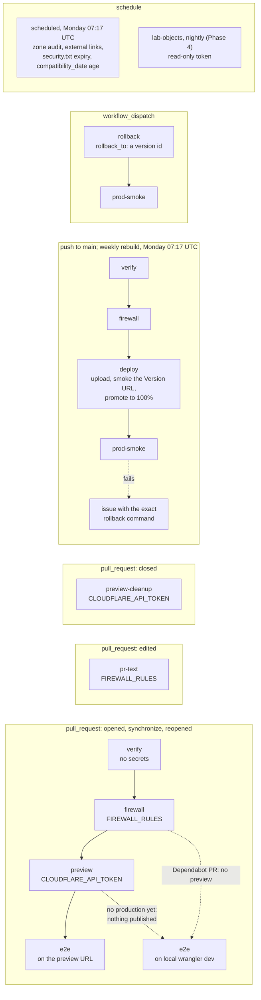

# Delivery

How a commit becomes the site: the repository layout, the toolchain pins, the pipeline that builds, gates, previews and deploys, the environments it writes to, and how a deploy is verified and undone. It is written for one maintainer with one PR in flight. The deploy owner is decided in [ADR 0006](adr/0006-github-actions-owns-deploys.md); everything else on this page is a two-way door without an ADR. Header and CSP policy, zone settings and the firewall's design are in [security.md](security.md); access setup and runbooks are in [operations.md](operations.md); the budget numbers are in [design-system.md](design-system.md).

Status: Draft for review in PR 1 · 2026-10-22

## Shape

One pipeline, one writer per environment. GitHub Actions builds `dist/` once per pipeline run, runs every gate against that artifact, runs the content firewall, and only then publishes: a Worker Preview for a pull request, or a new version of the production Worker for `main`. Nothing reaches a public URL without `verify` and `firewall` passing. GitHub Free cannot protect `main` on a private repository, so the gate is the job graph itself: the publishing jobs `needs:` both checks.

| Data | System of record | Only writer | Readers | How it crosses |
|---|---|---|---|---|
| Source, content, config | git: `main` on GitHub | merged PRs | CI, Dependabot | `actions/checkout` |
| Build output, `dist/` | the `verify` job's artifact for that run | `verify` | `firewall`, `preview`, `deploy`, `e2e`, `prod-smoke` | uploaded once, downloaded by each job; never rebuilt |
| Production versions and deployments | Cloudflare, Worker `ihaveasegway-web` | the pipeline: `deploy`, and `rollback`; the dashboard's Rollback is the break-glass path | visitors | Wrangler and the Cloudflare API |
| PR previews | Cloudflare Worker Previews | `preview` creates, `preview-cleanup` deletes | `e2e`, the reviewer | Wrangler |
| Tool versions | `.nvmrc`, `packageManager`, the pnpm catalog | PRs, from Dependabot or Joseph | every job | files in the repo |

The site's own data (content, profile, analytics, lab state) is in [architecture.md](architecture.md). The second row is "build once". In the weaker design every job runs its own build, so the bytes the firewall scanned and the bytes that went live can differ (a build that reads the clock, an environment variable, or a dependency published an hour ago), and the scan proves nothing about production. Here the scanned artifact is the published artifact.

One trap sits in the upload. `actions/upload-artifact` skips hidden files unless `include-hidden-files: true` is set, and a file inside a folder whose name starts with a dot counts as hidden ([upload-artifact](https://github.com/actions/upload-artifact#uploading-hidden-files), as of 2026-10-23). Without the setting, `.well-known/security.txt` would have dropped out of every deploy with no error. `verify` sets it.

## Repository layout

```text
website/
├── .github/workflows/{ci.yml,pr-text.yml,preview-cleanup.yml,scheduled.yml}
├── .github/dependabot.yml · .github/pull_request_template.md
├── .githooks/{pre-commit,pre-push}
├── apps/web/            Astro site → assets-only Worker "ihaveasegway-web" (wrangler.jsonc, src/, public/, icons/, e2e/, test/, published-urls.txt; lighthouserc.json from PR 3)
├── workers/lab/         LATER (Phase 4): Worker "ihaveasegway-lab" with all DO classes
├── packages/            LATER: created only when a second consumer exists (e.g. packages/security-headers when the lab ships)
├── scripts/firewall/{check.sh,test.sh,install-gitleaks.sh,allowed-identities.txt,gitleaks.version,sync-secrets.sh}
├── scripts/{verify-zone.sh,image-metadata.mjs,check-hooks.sh}
├── docs/
├── .nvmrc (26) · package.json ("packageManager": "pnpm@11.28.6") · pnpm-workspace.yaml (packages + catalog + allowBuilds) · pnpm-lock.yaml
└── AGENTS.md · README.md
```

- **A pnpm workspace from day one.** It costs one YAML file. Starting as a single package would mean moving every path, and every CI path, when the lab arrives.
- **`workers/lab/` is LATER (Phase 4).** One Worker holds every Durable Object (DO) class ([ADR 0009](adr/0009-lab-worker-same-origin.md), [lab.md](lab.md)).
- **`packages/` is LATER: it is created when a second consumer exists.** A package with one consumer is indirection without reuse: another `package.json`, another place for versions to drift, and an interface designed before anyone knows what the second consumer needs. The first candidate is `packages/security-headers`. When the lab ships, the site's `_headers` file and the lab Worker's responses need the same policy, and `_headers` never applies to responses a Worker generates. Until then `_headers` is a hand-edited file in `apps/web/public/` ([security.md](security.md)). Extract on the second real use, not in anticipation of it (YAGNI).
- **No Turborepo.** At this size `pnpm --filter '...[origin/main]'` selects the changed packages and their dependents. What Turborepo would add is a task cache. Add it when `verify` takes more than 5 minutes.

## Toolchain pins

One source per tool. A version written in two places has two owners, and they drift: `.nvmrc` says 26 while a workflow says `node-version: 24`, or `packageManager` says 11 while `pnpm/action-setup` installs whatever its `version:` input says. So `actions/setup-node` reads `.nvmrc` through `node-version-file`, and `pnpm/action-setup` gets no `version:` input, which makes it read `packageManager`. What each tool owns, and what lost to it, is in [stack.md](stack.md).

Pins as of 2026-10-22:

| Tool | Pin | Single source | Why | Source |
|---|---|---|---|---|
| Node.js | 26 | `.nvmrc` | Active LTS from 2026-10-28, end of life 2029-04-30. Node 24 is in maintenance until 2028-04-30; 25 reached end of life on 2026-06-01. If 26 misbehaves in the scaffold, fall back to 24 | [nodejs/Release](https://github.com/nodejs/Release) |
| pnpm | 11.28.6 | `"packageManager": "pnpm@11.28.6"` in the root `package.json` | pnpm reads the field and switches itself to that version, so nothing else installs pnpm | [npm](https://www.npmjs.com/package/pnpm), [pnpm 11](https://pnpm.io/blog/releases/11.0) |
| TypeScript | 6.0.3 | pnpm catalog | The newest major the lint and check tools accept (traps below) | [npm](https://www.npmjs.com/package/typescript) |
| Wrangler | ^4.152.0 | pnpm catalog | Worker Previews need 4.135.0 or later. CI runs `pnpm exec wrangler`, the lockfile's copy | [npm](https://www.npmjs.com/package/wrangler), [Worker Previews](https://developers.cloudflare.com/workers/previews/) |
| Astro | 7.4.x (7.4.2), exact | `apps/web/package.json` | Majors are adopted on x.1 ([ADR 0003](adr/0003-astro-static-first.md)) | [npm](https://www.npmjs.com/package/astro) |
| Tailwind CSS | 4.3.x (4.3.3) | `apps/web/package.json` | | [npm](https://www.npmjs.com/package/tailwindcss) |
| Vitest and `@cloudflare/vitest-plugin` | 5 (5.0.5) and 1.4.7 | pnpm catalog | The plugin, renamed from vitest-pool-workers on 2026-08-19, runs Worker and DO tests inside workerd. It joins the catalog with the lab (Phase 4): until then no Worker code exists to test | [changelog](https://developers.cloudflare.com/changelog/post/2026-08-19-vitest-plugin/) |
| Playwright and `@axe-core/playwright` | 1.64.x (1.64.1) and 4.14.0 | pnpm catalog | CI installs Chromium only. From Phase 4 it adds WebKit for the lab's one live-socket test ([lab.md](lab.md)) | [npm](https://www.npmjs.com/package/@playwright/test) |
| `@lhci/cli` | 0.15.1 | `apps/web/package.json`, from PR 3 | No release since 2025-06-26, so it is watched. If it falls behind Chrome, Lighthouse runs from Playwright instead | [releases](https://github.com/GoogleChrome/lighthouse-ci/releases) |
| lychee | `lycheeverse/lychee-action@v2` (v2.9.0) | workflow file | A third-party action, so it runs only in jobs without secrets, and with `token: ''`: by default the action passes the job's `GITHUB_TOKEN`, which can read this private repository, and neither check needs it | [releases](https://github.com/lycheeverse/lychee-action/releases) |
| gitleaks | 8.30.1, sha256-pinned | `scripts/firewall/gitleaks.version` | Dependabot does not manage it. Upstream calls the project feature complete, with security patches only. Checked quarterly ([operations.md](operations.md)) | [gitleaks](https://github.com/gitleaks/gitleaks) |
| Actions | `actions/checkout@v7`, `actions/setup-node@v7`, `actions/upload-artifact@v7`, `actions/download-artifact@v8`, `pnpm/action-setup@v6` | workflow files | Major version tags, bumped by Dependabot's `github-actions` updates | [checkout releases](https://github.com/actions/checkout/releases) |

Three traps, each silent when it fires:

- **pnpm 12.** npm's `latest` tag is pnpm 12.15.0. A project that pins pnpm 12 gets a lockfile written as two YAML documents, which GitHub's dependency graph cannot read yet: "Dependabot alerts and security updates won't be created for those dependencies", and "existing alerts for them may close" ([GitHub changelog, 2026-10-20](https://github.blog/changelog/2026-10-20-dependabot-now-supports-npm-12-pnpm-11-and-12-and-bun-1-4/)). Nothing errors. Declaring `devEngines.packageManager` produces the same lockfile, so that field is never added. A global `npm i -g pnpm` installs 12; the `packageManager` pin makes it run 11.28.6 in this repo anyway.
- **TypeScript 7.** npm's `latest` is 7.0.2, and Dependabot will propose it. typescript-eslint 8.72.0 declares `typescript >=4.8.4 <6.1.0`, and `@astrojs/check` 0.9.12 declares `^5.0.0 || ^6.0.0` ([registry](https://registry.npmjs.org/typescript-eslint/latest)), so the first CI run would fail. Dependabot ignores TypeScript majors until both accept 7 (7.1 is in beta).
- **Corepack.** Node stopped distributing it with v25 ([Node 25 docs](https://nodejs.org/download/release/v25.8.0/docs/api/corepack.html)), so `corepack enable` is in no setup step. pnpm manages its own version.

Two more rules for the root `package.json`:

- **No `engines.node`.** pnpm 11 fails an install when the root project's `engines` does not match the running Node, whatever `engineStrict` says, and Dependabot runs its own Node, so a tight range can break its updates (inferred from pnpm's docs, not observed). `.nvmrc` is the only Node pin.
- **No `"pnpm": { "onlyBuiltDependencies": [...] }`.** pnpm 11 removed that setting in favor of `allowBuilds` ([pnpm build settings](https://pnpm.io/settings/build)).

```yaml
# pnpm-workspace.yaml (sketch — confirm against current docs when building)
packages:
  - apps/*
  - workers/*          # empty until Phase 4
  - packages/*         # empty until a second consumer exists

catalog:               # one version per shared tool; a package depends on "typescript": "catalog:"
  typescript: 6.0.3
  wrangler: ^4.152.0
  vitest: ^5.0.5
  # '@cloudflare/vitest-plugin': ^1.4.7   # Phase 4, with the lab's Worker tests
  '@playwright/test': 1.64.1
  '@axe-core/playwright': 4.14.0

allowBuilds:           # strictDepBuilds is on by default: any other install script fails the install
  esbuild: true
  workerd: true
  # sharp: true        # only if the image pipeline uses it

# minimumReleaseAge stays unset: the pnpm 11 default, 1440 minutes, in loose mode.
# Setting it, even to 1440, also turns on minimumReleaseAgeStrict.
# Escape hatch for one urgent version: dated, and removed within 7 days.
# minimumReleaseAgeExclude:
#   - <package>@<x.y.z>   # <date>: <reason>; remove by <date + 7 days>
```

**The release-age gate.** pnpm 11 prefers versions published at least 1,440 minutes ago ([pnpm settings](https://pnpm.io/settings/dependency-resolution)). It is a dependency cooldown. In 8 of the 10 supply-chain attacks William Woodruff tabulated, the window between a malicious release and its removal was under a week ([2025-11-21](https://blog.yossarian.net/2025/11/21/We-should-all-be-using-dependency-cooldowns)). Dependabot's 3-day cooldown sits on top. As of 2026-10-22 the gate behaves in two ways that matter here ([pnpm 11.1.3 release notes](https://github.com/pnpm/pnpm/releases/tag/v11.1.3)):

- **Resolving is loose by default.** When no version in a range is old enough, pnpm installs the newest one anyway and writes it into `minimumReleaseAgeExclude` in `pnpm-workspace.yaml`. Wrangler 4.152.0 was published at 14:43 UTC on 2026-10-22, so PR 2's install added `wrangler@4.152.0` to that list without asking, and with it `miniflare@5.20261019.2-beta`, which Wrangler 4.152.0 pins exactly. Both carry a date and are removed by 2026-10-30. Review treats a generated entry like a hand-written one: it gets a date and is removed within 7 days. Setting `minimumReleaseAge` explicitly, even to 1440, switches to strict mode, where CI fails with `ERR_PNPM_NO_MATURE_MATCHING_VERSION` instead. That is why the sketch leaves it unset.
- **Installs from the lockfile are checked.** Every `pnpm install` re-validates the lockfile's entries against the policy before fetching anything, and a frozen install aborts on a violation. A lockfile Dependabot regenerated can carry a transitive version published hours earlier, so CI fails with `ERR_PNPM_MINIMUM_RELEASE_AGE_VIOLATION`. The fix is a re-run after 24–48 hours, or a dated exclusion. The runbook is in [operations.md](operations.md).

## Pipeline



Estimated billable minutes per job are rounded up, as GitHub bills them (below).

| Job | Trigger | `needs` | Secrets (in step `env:` only) | `permissions` | Does | Billable min (est.) |
|---|---|---|---|---|---|---|
| `verify` | PR; push to `main`; the weekly rebuild; from Phase 4, the `redeploy_lab` dispatch | none | none; the build step reads project facts with the job's own `GITHUB_TOKEN` ([content.md](content.md)) | `contents: read` | `pnpm install --frozen-lockfile`, `pnpm dedupe --check`, format, lint, typecheck, build, unit tests (the design-token contrast tests, the URL checks and the published-URL ledger, the Worker config checks, no JavaScript in the build), the image-metadata check, lychee `--offline` on `dist/`, the firewall self-test (`scripts/firewall/test.sh`, no real rules); from PR 3, the byte budgets and the glyph check; uploads `dist/` with `include-hidden-files: true`, and from Phase 4 the lab bundle | 3 |
| `firewall` | As `verify` | `verify` | `FIREWALL_RULES` (on a Dependabot PR, the Dependabot copy) | `contents: read` | Full-history checkout; downloads `dist/`; installs gitleaks 8.30.1 after checking its sha256; runs `scripts/firewall/check.sh`. Exit 0 passes; 1 (a finding) and 2 (cannot prove clean) fail ([security.md](security.md)). The weekly rebuild has no commit range, so it scans the tree and `dist/` | 1 |
| `preview` | PR from this repository, not opened by Dependabot | `firewall` | `CLOUDFLARE_API_TOKEN`; the secret `CLOUDFLARE_ACCOUNT_ID` | `contents: read`, `pull-requests: write` | Downloads `dist/`; runs `wrangler deployments status` first, and publishes nothing until a deploy from `main` has created production: it posts a notice, and `e2e` runs on `wrangler dev` (routes and custom domains, below). Then `wrangler preview --name pr-<n> --tag <sha8> --message <sha> --ignore-base-config`, so `wrangler.jsonc` is the only owner of the preview's settings; reads `deployment_urls` (this commit) and `preview_urls` (the stable link) from the `preview` entry Wrangler writes to `WRANGLER_OUTPUT_FILE_PATH`; waits until the preview answers, and fails unless it sends `X-Robots-Tag: noindex`; posts or updates one PR comment with both links | 2 |
| `e2e` | PR | `firewall` and `preview`; runs when `preview` succeeded or was skipped | none | `contents: read` | Playwright on Chromium, against the preview, or `wrangler dev` serving the same `dist/` when there is none: the smoke on every page and file, axe with zero violations in dark, light, more contrast and forced colors, response headers, zero CSP violations plus a known-answer test, no sideways scrolling at 320 px, and a visible outline on every control Tab reaches. From PR 3: theme before first paint, reduced motion, the fold, and LHCI, 3 runs per URL, with assertions. Reports stay as run artifacts, never on public upload storage | 4 |
| `preview-cleanup` | PR closed, not opened by Dependabot | none | `CLOUDFLARE_API_TOKEN`; the secret `CLOUDFLARE_ACCOUNT_ID` | `contents: read` | `wrangler preview delete --name pr-<n> --skip-confirmation`, best effort, with `main`'s lockfile. It shares `ci.yml`'s concurrency group for the PR, so closing cancels a run that may still be publishing, and the delete waits for it to stop | 1 |
| `pr-text` (`pr-text.yml`) | PR title or body edited | none | `FIREWALL_RULES` (on a Dependabot PR, the Dependabot copy) | `contents: read` | `check.sh --pr-text`: the title, body and branch name again, so text edited after the last push is scanned before the merge commit carries it to `main`. A workflow of its own, so an edit never cancels the main run | 1 |
| `deploy` | push to `main`; the weekly rebuild, site only; from Phase 4 also `workflow_dispatch` with `redeploy_lab` (kill-switch L2) | `verify`, `firewall`. A dispatch runs them too, since a skipped `needs` job skips this one | `CLOUDFLARE_API_TOKEN`; the secret `CLOUDFLARE_ACCOUNT_ID`; the job's `GITHUB_TOKEN` in the two steps that read `main`'s tip | `contents: read` | Concurrency group `deploy-production`, never cancelled. Stops unless the run's commit is `main`'s tip, and checks again before promotion. Records the live version; on the weekly rebuild, stops there unless the live deployment's message starts with `main@` (the guards below); site: `versions upload`, smoke the Version URL, `versions deploy <id>@100% --message main@<sha>`. While production does not exist, a push runs `wrangler deploy` instead, which creates the Worker and attaches the domain (below). Lab (Phase 4): `wrangler deploy` of the scanned bundle, and on the `redeploy_lab` dispatch only that, unconditionally | 3 |
| `prod-smoke` | push to `main`; the weekly rebuild; a rollback dispatch | `deploy` and `rollback`, with an `if:` that runs it after whichever one succeeded, but not after a deploy a newer commit superseded | none | `contents: read`, `issues: write` | Waits up to two minutes for `https://ihaveasegway.com` to answer, then runs two Playwright specs through the zone: the smoke every preview gets, and the zone-level checks. The byte-for-byte check runs only in the run attempt that promoted. On failure, opens an `Incident:` issue, or comments on the open one, with the exact `wrangler rollback <previous-id>` command and the one-line dispatch that runs it. If production did not answer at all, the issue says instead that a rollback cannot help: the custom domain is not attached, or the zone is not serving. A failure after `main` has moved on opens no issue, since the newer run's `prod-smoke` owns the verdict. After a weekly rebuild the guard stopped, comments on the open incident issue, or opens one | 1 |
| `rollback` | `workflow_dispatch` with `rollback_to: <version-id>`, and a `reason` that defaults to "prod-smoke failed" | none: the target was scanned when it was uploaded | `CLOUDFLARE_API_TOKEN`; the secret `CLOUDFLARE_ACCOUNT_ID` | `contents: read` | Fails unless it runs from `main`, and unless `rollback_to` is a version id. In the `deploy-production` group, so it never races a deploy: `wrangler rollback <id> --message "rollback: <reason>" --yes`, since CI cannot answer a prompt | 1 |
| `scheduled` | Monday 07:17 UTC; `workflow_dispatch` | none | none | `contents: read` | `scripts/verify-zone.sh` (registration, DNSSEC, TLS, HSTS, redirects, mail records, and `security.txt` with an `Expires` more than 30 days out); lychee online against production; `compatibility_date` younger than 180 days (a warning; a missing date fails) | 3 |
| `lab-objects` (Phase 4) | nightly | none | `CLOUDFLARE_READ_TOKEN`, read-only ([operations.md](operations.md)) | `contents: read`, `issues: write` | Lists each sandbox namespace's objects and opens an issue for any object with stored data on two nights running: a cleanup bug ([lab.md](lab.md)) | 1 |

Six notes on the graph:

- **The firewall sits before the preview** because a preview is public the moment it exists.
- **The weekly rebuild** runs the `main` path again every Monday at 07:17 UTC (`schedule` in `ci.yml`), so project facts read from GitHub at build time are at most a week old while it succeeds ([ADR 0004](adr/0004-content-as-code.md)). It redeploys the site only, behind the guards below; the lab still deploys only when `workers/lab/` changed. Each run that deploys adds a version, which the rollback reach below counts.
- **A rollback runs in CI too.** The deploy token exists only as a GitHub secret, so a rollback from the laptop would need a second edit credential at rest there. The `rollback` job uses the same scoped token, cannot race a deploy, and leaves a record in Actions. The dashboard's Rollback button is the fallback when GitHub is down ([operations.md](operations.md)).
- **Dependabot PRs** run with only Dependabot secrets and a read-only `GITHUB_TOKEN`. `firewall` reads the Dependabot copy of `FIREWALL_RULES`. `preview` is skipped, because the deploy token is not a Dependabot secret and never will be, and `e2e` runs against `wrangler dev` serving the same `dist/`. Whether `wrangler dev` applies `_headers` is not documented. PR 2 found that `wrangler dev` 4.152.0 applies every rule, so every header assertion holds on that target. It is still not the edge: it adds `charset=utf-8` to text types and production's asset server does not, which running e2e against production found on 2026-10-23 for `security.txt` (`_headers` now sets it). A header check that passes on `wrangler dev` proves the rule; only a preview proves what the edge sends.
- **Worker Previews ignore `not_found_handling`.** The first preview, on 2026-10-23, answered an unknown path with a bare "Not found" and none of the `_headers` values, although Cloudflare had stored the preview with `not_found_handling: "404-page"`. The page itself is there: `/404` serves it. Version URLs and production serve the 404 page, so the deploy job's smoke and `prod-smoke` keep checking it on the versions that take traffic. On a preview, `e2e` sets `E2E_TARGET=worker-preview`: axe and the CSP check read the 404 page at `/404`, and the two checks of the 404 response are expected failures (`test.fail`). The day Cloudflare fixes it, they pass, Playwright reports that, and the flag goes. Worker Previews were in open beta at the time.
- **Fork PRs**, possible only once the repository is public, receive no secrets, so `firewall` exits 2 and the run fails. That is the intended fail-closed result.
- **The schedule runs at 07:17, not on the hour**, because GitHub says scheduled runs are delayed most, and sometimes dropped, at the top of the hour ([GitHub](https://docs.github.com/en/actions/reference/workflows-and-actions/events-that-trigger-workflows)).

**Guards on the weekly rebuild** (sketch — confirm against current docs when building). The rebuild runs unattended, so it must never make things worse:

- **It never undoes a rollback.** `deploy` sets the deployment message to `main@<sha>`, and the `rollback` job sets `rollback: <reason>`. The first deploy is stamped too: `wrangler deploy --message` annotates only the version, so the job then runs `versions deploy <id>@100%` with the same message, which creates a deployment that carries it. On a scheduled run, `deploy` reads the live deployment's message before it uploads anything, and goes on only if the message starts with `main@`. Otherwise it stops, and `prod-smoke` comments on the open incident issue, or opens one. The check looks for the known-good state rather than for the word "rollback", so a dashboard rollback, or any message nobody planned for, stops it too: a fail-safe default. The first merge after the fix deploys with `main@` again, which re-arms it, and so does re-running the `deploy` job of `main`'s tip ([operations.md](operations.md#rollback)).
- **It never ships a page with facts missing.** On a push, a project fact GitHub does not return drops its line ([content.md](content.md)). On a scheduled run, the build fails instead, so the live site stays as it was, and the failed run emails.

The comment comes from `prod-smoke`, which already holds `issues: write`, so the job that holds the deploy token keeps a read-only `GITHUB_TOKEN`. A stopped or failed run costs fewer minutes than a deploy, so the budget below still holds.

### Actions minutes budget

| Event | Jobs, billable minutes | Per event | Typical month | Busy month |
|---|---|---|---|---|
| PR push | `verify` 3, `firewall` 1, `preview` 2, `e2e` 4 | 10 | 40 pushes: 400 | 65 pushes: 650 |
| Dependabot PR push | `verify` 3, `firewall` 1, `e2e` 4 on the local target | 8 | 8: 64 | 10: 80 |
| Merge to `main`: Joseph's PRs, plus Dependabot's every other Monday | `verify` 3, `firewall` 1, `deploy` 3, `prod-smoke` 1 | 8 | 15 + 4: 152 | 22 + 5: 216 |
| Weekly rebuild | the same four jobs | 8 | 4: 32 | 5: 40 |
| PR closed, not Dependabot's | `preview-cleanup` 1 | 1 | 15: 15 | 22: 22 |
| Weekly | `scheduled` 3 | 3 | 4: 12 | 5: 15 |
| **Total** | | | **675** | **1,023** |

As of 2026-10-22, GitHub Free includes 2,000 minutes a month for private repositories (Pro: 3,000), and public repositories on standard runners pay nothing ([GitHub](https://docs.github.com/en/billing/concepts/product-billing/github-actions)). The model uses about a third of that in a typical month and about half in a busy one. GitHub "rounds the minutes and partial minutes each job uses up to the nearest whole minute" ([runner pricing](https://docs.github.com/en/enterprise-cloud@latest/billing/reference/actions-runner-pricing)), so a job that runs 10 seconds costs a full minute, and the budget counts jobs as much as runtime. With no payment method on file, "usage is blocked once you use up your quota"; beyond it, Linux minutes would cost $0.006 each. Phase 4 adds the nightly `lab-objects` job, about 30 minutes a month; a rollback costs about 2. A hung job at GitHub's default 360-minute timeout would burn 18% of the month, which is why every job sets `timeout-minutes`. `pr-text` adds 1 minute for each edit of a pull request's title or body; the model does not count edits. [ADR 0006](adr/0006-github-actions-owns-deploys.md) revisits the deploy owner above 1,500 minutes a month.

### Hardening rules

Actions are pinned by version tag, not commit SHA (Joseph's preference), and tags can be moved. [security.md](security.md) tells the tj-actions story and names the residual risk. These are the workflow rules that compensate. Each is a line or two of YAML or one setting:

1. **Top-level `permissions: {}`**, and each job grants only what its row above says. Closes: a compromised step using a write-scoped `GITHUB_TOKEN`.
2. **A secret appears only in the `env:` of the steps that use it**, never at job or workflow level. Closes: every other step and action in the job reading the token from the environment.
3. **PR titles, bodies and branch names reach scripts through `env:`**, never as `${{ }}` inside `run:`. Closes: script injection, where a PR titled `"; curl …` becomes shell code ([GitHub Security Lab](https://securitylab.github.com/resources/github-actions-untrusted-input/)).
4. **Jobs that hold a secret use only GitHub-created actions plus `pnpm/action-setup`.** Wrangler runs from the lockfile with `pnpm exec`, not through a deploy action. Third-party actions, such as lychee, run only in secret-free jobs. Closes: a retargeted third-party tag running next to the deploy token.
5. **Repository setting: allow actions created by GitHub, plus an explicit list** (`pnpm/action-setup@*`, `lycheeverse/lychee-action@*`). Closes: a new third-party action arriving in a PR without a settings change ([operations.md](operations.md), access setup).
6. **No `pull_request_target`, and no `workflow_run` that hands secrets to PR code.** Closes: the "pwn request", where a privileged workflow checks out and runs untrusted code ([GitHub Security Lab](https://securitylab.github.com/resources/github-actions-preventing-pwn-requests/)).
7. **`actions/checkout` with `persist-credentials: false`.** Closes: the `GITHUB_TOKEN` staying in git's config for later steps to read.
8. **`concurrency`: PR runs cancel superseded runs; the deploy group never cancels.** Closes: wasted minutes, and a deploy killed halfway.
9. **`timeout-minutes` on every job.** Closes: a hung job billing 360 minutes.
10. **SHA-pin an action the day it gets a tag-retarget advisory**, and rotate any secret a job using it could read.
11. **No shared cache in a job that holds the deploy token.** `preview`, `preview-cleanup`, `deploy` and `rollback` set `package-manager-cache: false`; `verify`, `e2e` and `prod-smoke` keep the pnpm cache. Closes: a poisoned cache entry running next to the token. `verify` runs build-time code and writes the shared pnpm store cache on `main`, and pnpm trusts a store once it is restored. A cold install costs seconds.

The weaker design is the common one: secrets at the workflow level, third-party actions in every job, and `${{ github.event.pull_request.title }}` inside `run:`. One retargeted tag then reads every secret the workflow has. Rules that live only in review decay; zizmor and actionlint check most of these statically, and are worth adding to `verify` the first time a rule is broken in review.

## Environments

| Environment | URL | Built from | Data | Secrets | Writer | Lifetime |
|---|---|---|---|---|---|---|
| local | `http://localhost:4321` (`astro dev`); `http://127.0.0.1:8787` (`wrangler dev` serving `dist/`) | the working tree | none for the site; local state for the lab | lab only: `.dev.vars`, git-ignored, with names in `.dev.vars.example` | Joseph | a session |
| preview, one per PR | on the account's workers.dev subdomain, as Wrangler reports it; public, with `X-Robots-Tag: noindex` | the PR head's `dist/` | site: none. Lab: no previews until spikes S5 and S6 pass, since a workers.dev preview would sit outside the zone's WAF and spend the same quota ([lab.md](lab.md)) | none at launch | the `preview` job only | until the PR closes; Free keeps 100 per Worker and deletes the least recently deployed |
| production | `https://ihaveasegway.com` | `main`'s `dist/` | site: none. Lab: production DOs, all state disposable within 15 minutes | lab secrets, Phase 4 ([security.md](security.md)) | the `deploy` and `rollback` jobs (the dashboard's Rollback only when GitHub is down) | permanent; the last 100 versions are rollback targets |

Preview limits as of 2026-10-22: [Worker Previews](https://developers.cloudflare.com/workers/previews/).

**No long-lived staging.** A staging environment is a second copy of production to keep in sync (config, secrets, DNS, data). It drifts, and unless promotion moves the same artifact, it tests a different build from the one that ships. Two cheaper things cover what staging would: a preview per PR tests each change in isolation on the same platform, and the Version URL smoke tests the exact production artifact on the edge before it takes traffic. With one author and one PR in flight, there is no integration queue for staging to serve. Wrangler environments (`--env staging`) would create separate Workers and are not used. Revisit if two changes ever have to be tested together before release, such as a protocol change that spans the site and the lab. Even then the first move is a named preview (`wrangler preview --name integration`), not a permanent environment.

## Deploy, verify, roll back

### The site: blue/green in miniature

1. Stop unless the run's commit is still `main`'s tip, read with the job's `GITHUB_TOKEN`. Deploys queue in the order their runs arrive, not in commit order, and a re-run can come days later, so only `main`'s tip deploys and production only moves forward. The newer commit's own run deploys it.
2. Record the live version's id from `wrangler deployments status --json`, extracted with `jq -r`. Only the id goes into the job summary and into any rollback issue, because the full output carries the author's email ([Scrubbing evidence](security.md#scrubbing-evidence)). On a scheduled run, the guard reads the same output and stops here unless the live deployment's message starts with `main@`. If production does not exist yet, a push takes the first deploy below instead.
3. `wrangler versions upload --tag <sha8> --message <sha>`. The new version gets a Version URL and no traffic. The job reads `version_id` and `preview_url` from the `version-upload` entry that Wrangler writes to `WRANGLER_OUTPUT_FILE_PATH` ([field definitions](https://github.com/cloudflare/workers-sdk/blob/main/packages/workers-utils/src/output.ts)). It never builds a URL by hand, the rule Cloudflare's own docs pipeline follows.
4. Wait up to a minute for the Version URL to answer, then smoke it: every page and file answers 200, each page with its own canonical link and no robots meta tag; an unknown path answers 404 with the 404 page, which is `noindex`, as is `/404` itself; each page's other form (`/index.html` for Home, the slashless form of every other page) redirects to it; and the `_headers` values are present. Home has carried its build commit since PR 2, in the readout row; from PR 3 the smoke also requires it to equal the commit being deployed.
5. Check `main`'s tip again, then `wrangler versions deploy <id>@100% --yes --message main@<sha>`. The `main@` prefix is what the weekly rebuild's guard looks for. If the apex then does not answer at all, the job runs `wrangler triggers deploy` to apply the routes again (below).
6. `prod-smoke` runs against `https://ihaveasegway.com`.

The live version is blue. The uploaded one is green: reachable at its own URL and serving no one. Promotion moves all traffic in one call, and a rollback moves it back. Classic blue/green pays for two full environments; here the platform keeps every version, so the second environment costs nothing. What a Version URL cannot show is anything set at the zone, because it is served from workers.dev: HSTS, the `www` redirect, Email Address Obfuscation staying off. `prod-smoke` checks those after promotion, and the weekly audit checks them again.

```yaml
# .github/workflows/ci.yml, the deploy job, condensed: the full job, with its job summary lines, is in the file
permissions: {}                                    # rule 1

jobs:
  deploy:
    needs: [verify, firewall]                      # the gate
    # A scheduled run also has to pass the guard in the upload step.
    if: (github.event_name == 'push' || github.event_name == 'schedule') && github.ref == 'refs/heads/main'
    runs-on: ubuntu-latest
    timeout-minutes: 15                            # rule 9
    permissions: { contents: read }
    concurrency: { group: deploy-production, cancel-in-progress: false }   # rule 8; rollback shares it
    outputs:                                       # prod-smoke reads these
      skipped: ${{ steps.upload.outputs.skipped }}
      superseded: ${{ steps.current.outputs.superseded || steps.still-current.outputs.superseded }}
      previous: ${{ steps.upload.outputs.previous }}
      version: ${{ steps.upload.outputs.id || steps.first.outputs.id }}
      promoted_attempt: ${{ steps.promote.outputs.attempt || steps.first.outputs.attempt }}
    steps:
      - uses: actions/checkout@v7
        with: { persist-credentials: false }       # rule 7
      - uses: pnpm/action-setup@v6                 # no version input: reads packageManager
      - uses: actions/setup-node@v7
        with: { node-version-file: .nvmrc, package-manager-cache: false }   # rule 11: no cache next to the token
      - run: pnpm install --frozen-lockfile        # no token in this step's environment
      - uses: actions/download-artifact@v8         # the dist/ that verify built and firewall scanned
        with: { name: dist, path: apps/web/dist }
      - name: Stop unless this is main's tip (production only moves forward)
        id: current
        env:
          GH_TOKEN: ${{ github.token }}            # contents: read, to read main's tip
          SHA: ${{ github.sha }}
        run: |
          tip="$(gh api "repos/$GITHUB_REPOSITORY/commits/main" --jq .sha)"
          [ "$tip" = "$SHA" ] || echo "superseded=true" >> "$GITHUB_OUTPUT"
      - name: Record the live version, then upload the new one with no traffic
        id: upload
        if: steps.current.outputs.superseded != 'true'
        working-directory: apps/web
        env:                                       # rule 2: only the steps that call Cloudflare
          CLOUDFLARE_API_TOKEN: ${{ secrets.CLOUDFLARE_API_TOKEN }}
          CLOUDFLARE_ACCOUNT_ID: ${{ secrets.CLOUDFLARE_ACCOUNT_ID }}
          SHA: ${{ github.sha }}
          EVENT: ${{ github.event_name }}
        run: |
          status="$RUNNER_TEMP/status.ndjson"
          live="$RUNNER_TEMP/live.json"            # carries the author's email: read with jq, never printed
          if ! WRANGLER_OUTPUT_FILE_PATH="$status" pnpm exec wrangler deployments status --json > "$live" 2> /dev/null; then
            # Bootstrap: only a push creates production, and only when it is missing. Anything else stops here.
            if [ "$EVENT" = push ] && jq -se 'any(.[]; .type == "command-failed" and (.code == 10007
                or ((.message // "") | test("does not exist|not found|has no deployments"; "i"))))' "$status" > /dev/null 2>&1; then
              echo "first=true" >> "$GITHUB_OUTPUT"; exit 0
            fi
            exit 1
          fi
          echo "previous=$(jq -r '[.versions[] | select(.percentage == 100)][0].version_id // empty' "$live")" >> "$GITHUB_OUTPUT"
          if [ "$EVENT" = schedule ]; then                 # the guard: promote only over a deploy from main
            case "$(jq -r '.annotations["workers/message"] // ""' "$live")" in
              main@*) ;;
              *) echo "skipped=true" >> "$GITHUB_OUTPUT"; exit 0 ;;
            esac
          fi
          out="$RUNNER_TEMP/upload.ndjson"
          WRANGLER_OUTPUT_FILE_PATH="$out" pnpm exec wrangler versions upload --tag "${SHA:0:8}" --message "$SHA"
          echo "id=$(jq -r 'select(.type == "version-upload") | .version_id // empty' "$out" | tail -n 1)" >> "$GITHUB_OUTPUT"
          echo "url=$(jq -r 'select(.type == "version-upload") | .preview_url // empty' "$out" | tail -n 1)" >> "$GITHUB_OUTPUT"
      - name: First deploy, which creates the Worker and attaches ihaveasegway.com
        id: first
        if: steps.upload.outputs.first == 'true'
        working-directory: apps/web
        env:
          CLOUDFLARE_API_TOKEN: ${{ secrets.CLOUDFLARE_API_TOKEN }}
          CLOUDFLARE_ACCOUNT_ID: ${{ secrets.CLOUDFLARE_ACCOUNT_ID }}
          SHA: ${{ github.sha }}
        run: |
          out="$RUNNER_TEMP/deploy.ndjson"
          WRANGLER_OUTPUT_FILE_PATH="$out" pnpm exec wrangler deploy --message "main@$SHA"   # nothing is served yet: no Version URL smoke
          id="$(jq -r 'select(.type == "deploy") | .version_id // empty' "$out" | tail -n 1)"
          pnpm exec wrangler versions deploy "$id@100%" --yes --message "main@$SHA"   # deploy --message annotates only the version
          echo "id=$id" >> "$GITHUB_OUTPUT"
          echo "attempt=$GITHUB_RUN_ATTEMPT" >> "$GITHUB_OUTPUT"
      # (A step waits up to a minute for the Version URL to answer.)
      - name: Smoke the Version URL before it takes traffic (no token in this step)
        if: steps.upload.outputs.id != ''
        working-directory: apps/web
        env: { BASE_URL: "${{ steps.upload.outputs.url }}" }
        run: pnpm run smoke
      # (still-current: the same tip check again. If main moved on, the upload stays, with no traffic.)
      - name: Promote to 100%
        id: promote
        if: steps.upload.outputs.id != '' && steps.still-current.outputs.superseded != 'true'
        working-directory: apps/web
        env:
          CLOUDFLARE_API_TOKEN: ${{ secrets.CLOUDFLARE_API_TOKEN }}
          CLOUDFLARE_ACCOUNT_ID: ${{ secrets.CLOUDFLARE_ACCOUNT_ID }}
          ID: ${{ steps.upload.outputs.id }}
          SHA: ${{ github.sha }}
        run: |
          pnpm exec wrangler versions deploy "$ID@100%" --yes --message "main@$SHA"   # the prefix the guard reads
          echo "attempt=$GITHUB_RUN_ATTEMPT" >> "$GITHUB_OUTPUT"
          # Routes are not part of a version. If the apex does not answer at all, apply them again:
          curl -fsS -o /dev/null --max-time 15 --retry 2 https://ihaveasegway.com/ || pnpm exec wrangler triggers deploy
```

**Routes and custom domains are not part of a version.** They change only through `wrangler deploy` or `wrangler triggers deploy`, which Wrangler marks experimental as of 2026-10-22 ([deployment management](https://developers.cloudflare.com/workers/versions-and-deployments/deployment-management/), [Wrangler commands](https://developers.cloudflare.com/workers/wrangler/commands/workers/)). PR 2's first deploy therefore runs `wrangler deploy`, which creates the Worker and attaches `ihaveasegway.com`. It runs only on a push, and only when `wrangler deployments status` says production is missing: error 10007, "does not exist" or "not found" for a missing Worker, or "has no deployments" for a Worker with none. None of these answers has been seen from the live API yet, so the job accepts each. Any other error stops it, and the log shows only the API's numeric error code. The weekly rebuild never creates the Worker. That one deploy goes live without a Version URL smoke, because the domain serves nothing yet; `prod-smoke` checks it next. After every promotion, if the apex does not answer at all, the job runs `wrangler triggers deploy`, which applies the routes in `wrangler.jsonc` again. That is idempotent and runs only while nothing is being served, so re-running the deploy job retries a failed attach. A later change to `routes` in `wrangler.jsonc` adds an unconditional `wrangler triggers deploy` to the same job. Whether the minimal token can attach the custom domain is spike S7 ([roadmap.md](roadmap.md)).

PR 2 also settled whether a Worker Preview can be created before the Worker exists. It can, and that is the problem. Cloudflare says "You do not need to deploy a Worker to production before creating its first Preview" ([Previews, get started](https://developers.cloudflare.com/workers/previews/get-started/)), and in CI `wrangler preview` creates the missing Worker without asking: Wrangler 4.152.0's `provisionParentWorker` answers its own prompt yes, "so CI and Workers Builds can create Previews unattended" ([wrangler 4.152.0](https://www.npmjs.com/package/wrangler/v/4.152.0)). Both as of 2026-10-23. The Worker it creates has no routes, no domain and no deployment, and only `deploy` may create production (the Shape table above). So `preview` publishes nothing until a deploy from `main` has created production, and `e2e` runs on `wrangler dev` until then. `deploy`'s bootstrap treats a Worker with no deployments like a missing one, since both need `wrangler deploy`, the only command that attaches the custom domain. Spike S7's preview leg moves to the first pull request after the first deploy ([roadmap.md](roadmap.md#spikes)).

### The lab (Phase 4)

`wrangler deploy`, then `prod-smoke`. Version URLs are not generated for Workers that implement a Durable Object ([Version URLs](https://developers.cloudflare.com/workers/configuration/previews/)), and any change that creates, deletes, renames or transfers a DO class must go through `wrangler deploy`. The consequences:

- There is no smoke test on the edge before traffic arrives. The workerd tests in `verify` and `wrangler dev` carry that load, since the lab gets no previews until spikes S5 and S6 pass.
- Build once holds for the lab too. `verify` bundles it with `wrangler deploy --dry-run --outdir`, `firewall` scans that bundle, and `deploy` uploads those files with `--no-bundle`. Re-bundling at deploy time would ship bytes the firewall never saw (confirm the flags when building).
- Every deploy drops every live WebSocket. Kill-switch level L2 uses that on purpose ([operations.md](operations.md)).
- The lab deploys only when `workers/lab/` changed since the commit the lab is running, read from the live deployment's message, not since the previous push. The deploy group never cancels a running deploy, but GitHub replaces a pending run with a newer one, so "changed since the previous push" can skip a change.
- DO class changes go expand, migrate, contract, in separate PRs, each deployed alone, because every class change is a rollback boundary.

### Rollback

`wrangler rollback <version-id> --message "rollback: <why>" --yes`, run by the `rollback` job from `main` only (`gh workflow run ci.yml -f rollback_to=<version-id>`, plus `-f reason=<why>` when the reason is not the default, "prod-smoke failed"). `--yes` because CI cannot answer a prompt. If GitHub is down, the dashboard does the same: Workers & Pages → `ihaveasegway-web` → Deployments → ⋯ → Rollback. As of 2026-10-22 ([rollbacks](https://developers.cloudflare.com/workers/configuration/versions-and-deployments/rollbacks/)):

- **Reach:** the 100 most recently published versions. At 23 deploys a month (19 merges and 4 weekly rebuilds in the typical month above), that is about four months of the site's history.
- **Blocked** across a DO class lifecycle change (`exports` or the legacy `migrations`) between the live and the target version, and when the target binds a KV namespace, R2 bucket or queue that no longer exists.
- **Data is not rolled back.** Lab state is disposable, so today this costs nothing.
- **Always pass the id.** Without one, Wrangler picks "the version uploaded before the latest version" ([Wrangler commands](https://developers.cloudflare.com/workers/wrangler/commands/workers/)). That counts uploads, not what served traffic. Once an upload has failed its smoke and stayed unpromoted, the pick can be the live version, which makes the rollback a no-op, or that broken upload.

A rollback changes what serves traffic, not what `main` holds. The Monday rebuild skips while a rollback is live, but the next merge deploys `main` again, so a revert or a fix on `main` comes first.

### Gradual deployments: off at launch

A canary sends a slice of traffic to the new version and compares it with the old one. That needs enough traffic for a difference to show, and a signal to compare. At the traffic a personal site gets (assumed to be tens to hundreds of page views a day, until Web Analytics says otherwise), a 10% canary sees a handful of requests. An assets-only Worker has no error rate to compare either: its failures are wrong pages, which the Version URL smoke catches before any visitor sees them. For DO Workers, "only one version of each Durable Object can run at a time" anyway ([gradual deployments](https://developers.cloudflare.com/workers/configuration/versions-and-deployments/gradual-deployments/)). Revisit for a lab with real traffic and a server-side error rate.

### Automatic rollback: after evidence

Not at launch. A flaky smoke test plus automatic rollback produces deploy ping-pong: a good version is rolled back, the next merge redeploys it, and the history fills with noise. Automatic rollback turns on after `prod-smoke` has passed 20 consecutive runs with no re-runs.

What 20 runs prove: with zero failures in 20 runs, the flake rate is below about 14% at 95% confidence (1 − 0.05^(1/20) = 0.139; the rule of three gives 3/20 = 15%). That rules out a badly flaky test, not an occasional one. So the automatic rollback also requires the failure to repeat: when `prod-smoke` fails, it runs once more, and the job rolls back only if both runs fail. If flakes are independent, a flake rate at that 14% bound then causes a false rollback on about 2% of deploys (0.14² ≈ 0.02). The automatic rollback runs `wrangler rollback <recorded-id>` and still opens the issue.

### compatibility_date

- A new Worker gets the scaffold date.
- The date is bumped quarterly, in a PR that changes only that date for one Worker, after reading the compatibility flags that changed in between ([runbook](operations.md)).
- "The Workers runtime will support old compatibility dates forever" ([Cloudflare](https://developers.cloudflare.com/workers/configuration/compatibility-dates/)). A stale date is a missing feature, not an outage risk, which is why quarterly is enough. The weekly job warns at 180 days.
- `compatibility_flags`: none for the site. The lab adds `nodejs_compat` only if a dependency needs it.

## Config as code

```jsonc
// apps/web/wrangler.jsonc, as PR 2 ships it (comments shortened)
{
  "$schema": "./node_modules/wrangler/config-schema.json",
  "name": "ihaveasegway-web",
  "compatibility_date": "2026-10-22",         // the scaffold date; bumped quarterly in a PR of its own
  // No "main": an assets-only Worker. No request runs Worker code.
  "assets": {
    "directory": "./dist",
    "not_found_handling": "404-page",
    "html_handling": "auto-trailing-slash"   // the default, set explicitly (ADR 0005)
  },
  "routes": [{ "pattern": "ihaveasegway.com", "custom_domain": true }],
  "workers_dev": false,      // one public origin
  "preview_urls": true,      // Version URLs for the deploy smoke; explicit, because it otherwise follows workers_dev
  "previews": {},            // Worker Previews; the site has no bindings to re-bind
  "observability": { "enabled": true },
  "send_metrics": false      // no Wrangler usage metrics from CI or laptops
  // Never "cache": { "enabled": true }. With it, every asset request is billed at the
  // Workers request rate (https://developers.cloudflare.com/workers/cache/). CI fails if it appears, at any depth.
}
```

`send_metrics: false` stops Wrangler's usage reports, but only for the commands that read it: `versions deploy` falls back to Wrangler's global default, and reported usage on the first deploy (2026-10-23). So CI also sets `WRANGLER_SEND_METRICS=false`, which outranks both, and `ASTRO_TELEMETRY_DISABLED=1` for Astro's, so the build talks to no one it does not need. There is no `account_id` in the file. It comes from the `CLOUDFLARE_ACCOUNT_ID` Actions secret, which keeps the account identifier out of a repository that may become public, and out of its logs: GitHub masks secrets there, and the logs go public with the repository ([ADR 0012](adr/0012-public-repository.md)).

```text
# apps/web/public/_headers, cache part (sketch — confirm against current docs when building)
/_astro/*
  Cache-Control: public, max-age=31536000, immutable
```

The cache rule is cache-busting by content hash. Astro writes its bundled scripts and styles, and fonts that go through its Fonts API, under `/_astro/` with a content hash in each file name, so a changed file gets a new URL and an old URL never changes content: a year and `immutable` are safe. HTML keeps Cloudflare's default for assets, `public, max-age=0, must-revalidate`, so a promoted version is what the next page view gets. The security part of the same file belongs to [security.md](security.md). As of 2026-10-22, `_headers` allows 100 rules and applies only to asset responses ([Cloudflare](https://developers.cloudflare.com/workers/static-assets/headers/)).

```jsonc
// workers/lab/wrangler.jsonc, LATER (Phase 4): only the fields that change how it ships.
// (sketch — confirm against current docs when building; the full sketch is in lab.md)
{
  "name": "ihaveasegway-lab",
  "main": "src/index.ts",
  // A zone route, API only: /lab/<slug>/ pages stay static assets on the site Worker.
  // Route changes ship with wrangler deploy or wrangler triggers deploy, never with a version upload.
  "routes": [{ "pattern": "ihaveasegway.com/lab/api/*", "zone_name": "ihaveasegway.com" }],
  "workers_dev": false,      // the zone, with its WAF rules, is the only way in
  "preview_urls": false,     // a Worker with Durable Objects gets no Version URLs anyway
  "exports": {               // declarative class lifecycle: every change here is a wrangler deploy and a rollback boundary
    "LabControl": { "type": "durable-object", "storage": "sqlite" },
    "PresenceRoom": { "type": "durable-object", "storage": "sqlite" }
  }
  // No "previews" block until spikes S5 and S6 pass.
}
```

Compared with the site, three things change how the lab ships: it has code (`main`), so it deploys with `wrangler deploy` and has no Version URL to smoke; its route belongs to the zone, so the zone's WAF rule is its kill switch; and its `exports` turn every class change into a rollback boundary ([changelog](https://developers.cloudflare.com/changelog/post/2026-06-30-declarative-do-class-exports/)). Bindings, limits and secrets are in [lab.md](lab.md).

```yaml
# .github/dependabot.yml (sketch — confirm against current docs when building)
version: 2
updates:
  - package-ecosystem: npm            # covers pnpm: the root lockfile, the workspace and the catalog
    directory: /
    schedule: { interval: weekly, day: monday, time: "06:00" }
    cooldown:
      default-days: 3
      semver-major-days: 14
    groups:
      minor-and-patch:
        update-types: [minor, patch]
        patterns: ["*"]
    ignore:
      - dependency-name: typescript
        update-types: ["version-update:semver-major"]   # until typescript-eslint and @astrojs/check accept 7
  - package-ecosystem: github-actions
    directory: /
    schedule: { interval: weekly, day: monday, time: "06:00" }
    cooldown:
      default-days: 7                 # setup-node and pnpm/action-setup run in every job that holds the deploy token
    groups:
      actions:
        patterns: ["*"]
```

- Version tags, not SHAs, for actions; the hardening rules above compensate.
- The cooldown applies to version updates only. Security updates arrive at once ([options reference](https://docs.github.com/en/code-security/dependabot/working-with-dependabot/dependabot-options-reference)).
- Dependabot runs see only Dependabot secrets, so `FIREWALL_RULES` exists there too ([operations.md](operations.md), access setup step 5).

What stays out of code: zone settings live in the Cloudflare dashboard with a checked-in checklist and a weekly token-free audit ([security.md](security.md)), and move to OpenTofu only when a trigger in [operations.md](operations.md) fires. Repository settings, such as the allowed actions, are set by hand once ([operations.md](operations.md)).

## Quality gates and budgets as fitness functions

A fitness function is an executable check of an architectural property. A budget written only in a doc erodes one PR at a time; as a CI check, a regression fails the PR that causes it. The limits live with their owners: budgets in [design-system.md](design-system.md#budgets-as-ci-fitness-functions), header and CSP rules in [security.md](security.md), URL rules in [ADR 0005](adr/0005-url-scheme.md). This table owns where each check runs and what it fails on.

| Check | Job | Fails when | Rule owner |
|---|---|---|---|
| Install | `verify` | the lockfile is stale (`--frozen-lockfile`) or would deduplicate (`pnpm dedupe --check`) | this doc |
| Format | `verify` | a file differs from Prettier's output | this doc |
| Lint | `verify` | an ESLint or typescript-eslint rule fails | this doc |
| Typecheck | `verify` | `tsc --noEmit` or `astro check` reports an error | this doc |
| Unit | `verify` | a Vitest test fails; the lab's tests run inside workerd | this doc |
| Tokens | `verify` | a token pair misses WCAG AA contrast, a value leaves sRGB, or a color literal appears outside `tokens.css` | design-system.md |
| Build | `verify` | Astro fails, including Zod rejecting front matter (schema-on-write) | [content.md](content.md) |
| URL scheme | `verify` | an internal link lacks its trailing slash, a page URL carries a date, an extension or a capital, the sitemap lists anything but the built pages, a built page is missing from the published-URL ledger (`apps/web/published-urls.txt`) or a URL in it is neither a page nor the source of a 301, or a lab entry is named `api`, a path the lab Worker's route owns ([content.md](content.md)) | ADR 0005 |
| No JavaScript (PR 2) | `verify` | a built page holds a `<script>`, or `dist/` holds a JavaScript file. PR 3's byte budgets replace it | design-system.md |
| Bundle bytes (PR 3) | `verify` | eager JS on a content page, lazy JS per feature, CSS or preloaded fonts exceed their budgets, measured as gzip -9 bytes in `dist/` | design-system.md |
| Glyph coverage (PR 3) | `verify` | a character in mono text is missing from the HUD font subset | design-system.md |
| Internal links | `verify` | lychee `--offline` finds a link in `dist/` that points nowhere | this doc |
| Worker config | `verify` | `cache.enabled` appears anywhere in a Worker's `wrangler.jsonc`, `previews` included; the file carries an `account_id`; or the site Worker loses its assets-only shape, `workers_dev: false` or its Version URLs | this doc |
| `_headers` regeneration (Phase 4) | `verify` | the committed `_headers` differs from what `packages/security-headers` writes | security.md |
| Firewall self-test | `verify` | `scripts/firewall/test.sh` does not get exits 0, 1 and 2 where it expects them | security.md |
| Image metadata | `verify` | a tracked image or PDF carries EXIF, XMP, IPTC or C2PA, or PDF Info fields other than Title and Author | security.md |
| Review stamp | `verify` | a PR changes anything other than the stamp in a work, writing, notes, lab or now entry, or in `profile.json`, without changing its `firewall_reviewed` date | content.md |
| Content firewall | `firewall` | exit 1 (a finding) or exit 2 (cannot prove clean) | security.md |
| Smoke | `deploy`, `e2e`, `prod-smoke` | a page or file answers with the wrong status or content, a page lacks its own canonical link or carries a robots meta tag, the 404 page or its `noindex` misbehaves, or a page's other form does not redirect to it | this doc |
| Accessibility | `e2e` | axe reports any violation, in light, dark, forced colors and high contrast; a page scrolls sideways at 320 px; or a control Tab reaches shows no visible outline | design-system.md |
| CSP | `e2e`, `prod-smoke` | any `securitypolicyviolation` event or CSP console message, or an injected inline script runs (the known answer, in `e2e`) | security.md |
| Headers | `e2e`, `prod-smoke` | a `_headers` value is missing (preview); HSTS is not a step of the ramp, or a forbidden header appears (production) | security.md |
| Served bytes | `prod-smoke` | served HTML differs from the build artifact, byte for byte, because a zone feature rewrote it. Only the run attempt that promoted the artifact checks | security.md |
| Theme and motion (PR 3) | `e2e` | `data-theme` is not set before first paint, a stored choice is not labelled "saved in this browser", or an animation runs under `reducedMotion: 'reduce'` | design-system.md |
| Fold (PR 3) | `e2e` | the bottom edge of Home's row 3 is below the bottom of the viewport at 390×844 or 1440×900 ([content.md](content.md#home-page)) | content.md |
| Synthetic performance (PR 3) | `e2e` | an LHCI assertion fails: Home transfer, and LCP and CLS on simulated mobile, 3 runs per URL | design-system.md |

Each check sees one layer, so each property is checked where it lives:

- `verify` sees the build output, with no network. Byte budgets are checked here, on files, so the numbers are deterministic.
- `e2e` on a preview sees Cloudflare's asset routing and what `_headers` sends, but no zone setting, because previews are served from workers.dev. Lighthouse's crawlability audit fails there by design (`noindex`), so the SEO checks (no `noindex`, the canonical URL, the sitemap) run only in `prod-smoke`.
- `prod-smoke` sees the zone: HSTS, redirects, and HTML that no zone feature has rewritten.
- The weekly audit sees DNS, TLS, registration and drift.
- Only real visitors produce field data. Web Analytics rates LCP, INP and CLS from real page loads as Good, Needs Improvement or Poor, and its debug view lists the worst elements at P75 ([Cloudflare](https://developers.cloudflare.com/web-analytics/data-metrics/core-web-vitals/)). Its docs do not say whether it gives a site-wide p75 to compare with the hard limits, so PR 3 settles how that number is read. Field data is reviewed monthly, because it cannot gate a PR.

What no check sees: paraphrased identifying details, what an image shows, and keyboard and screen-reader flows that axe cannot judge. In Deque's own audit data, automated axe tests found about 57% of accessibility issues by volume ([Deque, 2021](https://www.deque.com/blog/automated-testing-study-identifies-57-percent-of-digital-accessibility-issues/)). So the PR template adds a keyboard and screen-reader pass to the firewall checklist that [security.md](security.md) describes.

## Dependency policy

- One root `pnpm-lock.yaml`, always committed. CI installs with `--frozen-lockfile` and runs `pnpm dedupe --check`. Nobody edits the lockfile by hand.
- Dependabot opens version updates weekly (configuration above): one grouped PR for minor and patch, majors one at a time after a 14-day cooldown. The grouped PRs are merged every other Monday, which halves the review sittings in the maintenance budget ([operations.md](operations.md)). Security updates skip the cooldown and merge as soon as CI passes.
- Astro majors wait for x.1 ([ADR 0003](adr/0003-astro-static-first.md)). TypeScript majors wait for the lint and check tools.
- A new dependency comes with one line in its PR: what it replaces, its weight if it ships to the browser, its license, and when it last released.
- Install scripts run only for packages in `allowBuilds`. Adding one is a reviewed change.
- Dependabot's pnpm 11 support is new (2026-10-20). Its first four runs get a close review. Renovate is the fallback if Dependabot fails on the lockfile more than twice in a month.
- The procedure for each update, and the release-age escape hatch, are in [operations.md](operations.md).

## Patterns and further reading

Canonical sources are collected in [reading-list.md](reading-list.md).

- **Deployment pipeline, and building the artifact once:** Jez Humble and David Farley, *Continuous Delivery* (2010), ch. 5, "Anatomy of the Deployment Pipeline".
- **Single writer:** Martin Thompson, "Single Writer Principle" (2011). Two deployers writing one Worker's version history behave like multi-leader replication with last-write-wins: Martin Kleppmann, *Designing Data-Intensive Applications* (2017), ch. 5.
- **Blue/green deployment:** Martin Fowler, "BlueGreenDeployment" (bliki).
- **Canary release:** Danilo Sato, "CanaryRelease" (martinfowler.com); Google, *The Site Reliability Workbook*, "Canarying Releases".
- **Expand/contract:** Danilo Sato, "ParallelChange" (martinfowler.com).
- **Fitness functions:** Neal Ford, Rebecca Parsons, Patrick Kua and Pramod Sadalage, *Building Evolutionary Architectures*, 2nd ed. (2022), ch. 2.
- **Untrusted input in workflows:** GitHub Security Lab, "Keeping your GitHub Actions and workflows secure Part 2: Untrusted input".
- **Dependency cooldowns:** William Woodruff, "We should all be using dependency cooldowns" (2025).
- **Evidence from zero failures (the rule of three):** James Hanley and Abby Lippman-Hand, "If nothing goes wrong, is everything all right?" (*JAMA*, 1983).
- **YAGNI:** Martin Fowler, "Yagni" (bliki).
