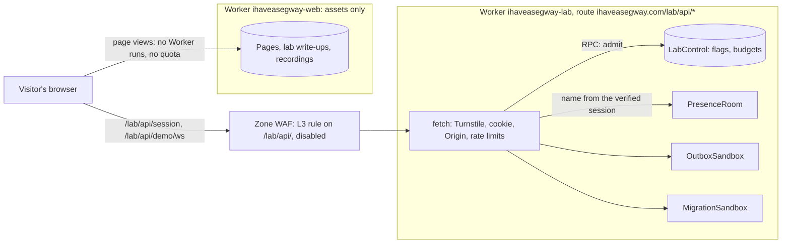
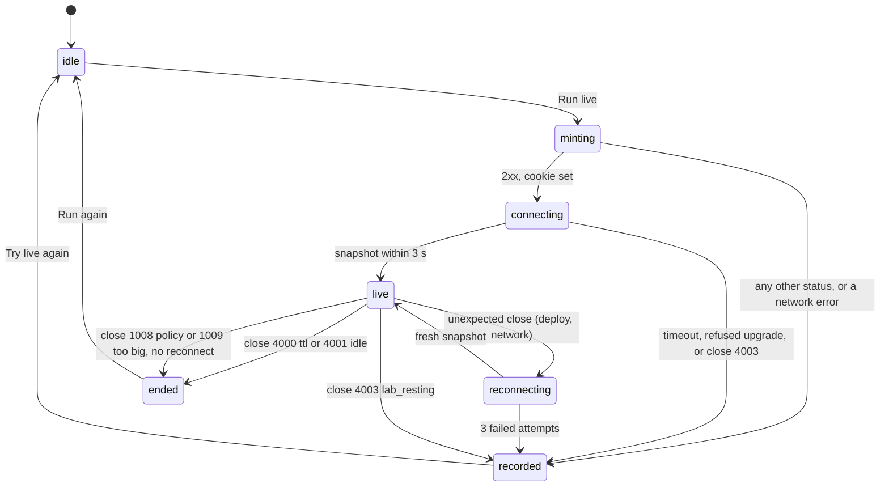

# Lab

How the live demos work. One Worker holds every Durable Object (DO) class behind `ihaveasegway.com/lab/api/*`. Admission and daily budgets keep the account inside the Workers Free plan. Every demo has a recorded run to fall back to. Four demos are designed far enough to estimate and build. The lab platform is Phase 4 ([roadmap.md](roadmap.md)), after the work and writing pages, and only once the spikes at the end of this page pass.

The Route Lab is the exception, and the first demo to ship: since 2026-10-25 it runs VROOM in the visitor's browser from static files, with no Worker, no Durable Object and no recording ([ADR 0016](adr/0016-route-lab-in-the-browser.md); [Route Lab](#route-lab-built-2026-10-25)). It needs none of the platform below.

Status: Draft for review in PR 1 · 2026-10-22; the Route Lab built as a static demo · 2026-10-25

Decision: [ADR 0009](adr/0009-lab-worker-same-origin.md) · Plan and spend: [ADR 0008](adr/0008-workers-free-with-guardrails.md), [cost.md](cost.md) · Request flow: [architecture.md](architecture.md) · Headers and privacy: [security.md](security.md) · Runbooks: [operations.md](operations.md)

Prices, limits and versions are as of 2026-10-22, with sources under each table.

## Why a lab

The question to answer first is what a live demo adds over a recording. Two things:

- **Inputs the visitor chooses.** A recording shows the run Joseph picked. A live demo runs the one the visitor asks for, including the failure they inject.
- **Proof that the system runs**, on infrastructure Joseph operates, inside limits he set.

Anything without visitor input ships as static assets, such as a resilience simulator that runs in the browser. It costs $0, uses no quota, and [content.md](content.md) owns it. The stillhere-on-stillhere report and gitops' terminal recordings were parked on 2026-10-23, when owned work became cards that link to repositories.

A live demo is a small production service, with a quota, an abuse surface and one person on call. So the static-by-default principle in [product.md](product.md) applies here too: code runs at the edge only where a visitor's input matters. An unexplained or broken demo is worse than none, so every demo ships with a write-up and a recorded run. A demo with fewer than 20 live sessions a month after three months keeps its recording and loses its live mode.

## Topology



Two Workers share one hostname:

- **`ihaveasegway-web`** ([ADR 0002](adr/0002-host-on-workers-static-assets.md)) has no script. It serves every page, including the write-ups at `/lab/<slug>/` and the recorded runs. Asset requests never invoke a Worker and never count toward the Free plan's 100,000 Worker requests a day.
- **`ihaveasegway-lab`** (`workers/lab/`) holds every DO class. Its only entry is the zone route `ihaveasegway.com/lab/api/*`. A route Worker runs before the custom-domain Worker on the same hostname, which Cloudflare treats as the origin ([custom domains](https://developers.cloudflare.com/workers/configuration/routing/custom-domains/)).

**The route covers only the API.** A route on `/lab/*` would capture the write-ups too. Every view of a lab page would become a Worker invocation: billed on Paid, and counted against the 100,000-a-day cap on Free, where it fails with Error 1027 once the cap trips. That is the failure the static-first design exists to avoid. Because the route owns `/lab/api/`, `api` is a reserved slug under `/lab/`, and the URL check in `verify` rejects a lab entry by that name ([content.md](content.md)).

**The site never calls the lab.** The browser composes the two (client-side composition), so a lab outage leaves every page up. This is a bulkhead for code and deploys, not for quota: Free caps belong to the account. The site stays outside the quota only because its pages invoke no Worker. Spike S1 checks that before the lab ships.

**One enforcement point.** A DO has no public URL. Only the lab Worker holds the bindings, so every request passes the same checks. Object names come from the verified session, never from the request.

### Same origin, and what follows from it

| Consequence | Why | Setting |
|---|---|---|
| No CORS | Pages and API share `https://ihaveasegway.com` | The lab sends no `Access-Control-*` headers, so no other origin can read its responses |
| CSP `connect-src 'self'` | Fetches and the WebSocket go to the same host. WebKit fixed `'self'` matching same-host `wss:` in April 2022 ([bug 235873](https://bugs.webkit.org/show_bug.cgi?id=235873)); one live-socket test in Playwright's WebKit project keeps that checked | Lab pages also allow Turnstile (`script-src` and `frame-src https://challenges.cloudflare.com`). [security.md](security.md) owns the policy |
| A cookie only the API sees | No page needs the session | `Path=/lab/api; HttpOnly; Secure; SameSite=Strict; Max-Age=900`. The `__Host-` prefix would force `Path=/`, so the cookie gives it up for the narrower path |
| An Origin check on every upgrade | Browsers apply no CORS to WebSocket handshakes, so any site can try to open a socket here (cross-site WebSocket hijacking). `SameSite=Strict` keeps the cookie off those requests; the Origin check refuses the upgrade itself | Upgrade only when `Origin` is exactly `https://ihaveasegway.com` |

### Who owns what

| Data | System of record | Writer | Lifetime |
|---|---|---|---|
| Demo flags (`live`, `recorded`, `off`) and the daily usage ledger | `LabControl`, one DO named `control` | The admission path; Joseph, for flags | Flags persist; the ledger is keyed by UTC date |
| One session's or room's state | That session's DO | Only that DO (single writer) | Until the session's deadline, at most 15 minutes, then `deleteAll()` |
| Who a session is | The signed cookie; there is no session table | The lab Worker | 15 minutes |
| Curated recordings | The repo, beside each write-up, served as static assets | Joseph, by pull request | Versioned with the site |
| Usage telemetry | Workers Logs and Analytics Engine | The lab Worker and its DOs | Platform retention ([Observability](#observability)) |

No DO stores anything personal. Deleting is not erasing here: SQLite-backed objects keep 30 days of point-in-time recovery, so a deleted row can be restored for a month ([SQLite storage API](https://developers.cloudflare.com/durable-objects/api/sqlite-storage-api/)). The site-wide table is in [architecture.md](architecture.md).

## Durable Object rules

1. **SQLite storage only.** The Free plan offers only SQLite-backed DOs, and a KV-backed namespace would block a later move from Paid back to Free ([ADR 0008](adr/0008-workers-free-with-guardrails.md)).
2. **Declare classes with `exports`, never the legacy `migrations` array.** `exports` (changelog, 2026-06-30) gives each class a `state`: `created` by default, the tombstones `deleted`, `renamed` (with `renamed_to`) and `transferred`, and `expecting-transfer` on the receiving side. The two "are mutually exclusive within a single Worker", so the lab starts on `exports` and never adds `migrations`. Rollback is blocked across a class lifecycle change, so a class change ships alone, at 100%, with its demo flagged `off` until it is healthy.
3. **The WebSocket Hibernation API only.** Sockets are accepted with `ctx.acceptWebSocket()`, which PartyServer's `hibernate: true` uses. Never `ws.accept()`, which bills duration for the whole connection.
4. **Pings never wake an object.** `setWebSocketAutoResponse` answers them without running the object's code.
5. **No timers.** No `setInterval` or `setTimeout` in a DO. A pending timer prevents hibernation and keeps duration billing on. Anything that must happen later is an alarm.
6. **Every sandbox and room has a cleanup alarm, and ends with `deleteAll()`.** The hard deadline is the demo's TTL or the session cookie's expiry, whichever comes first, and never more than 15 minutes; the idle close comes after 3–5 minutes. With `compatibility_date` 2026-02-24 or later, `deleteAll()` also deletes the alarm, so a finished object holds nothing and costs nothing. All demo state is disposable. The two long-lived objects, `LabControl` and `presence:home`, are the exceptions by design.
7. **Alarms run at least once, so handlers are idempotent.** A handler that throws is retried up to 6 times with exponential backoff from 2 s, and a retry starts from the top. Handlers re-read state and act from cursors and ledgers, never from in-memory counters, so a second run changes nothing. An alarm re-arms only for a later time and at most 100 times a day per object. That loop guard is the cheap defense against the runaway bills in [cost.md](cost.md).
8. **Names come from the server.** Shared rooms are addressed by name (`presence:home`), private sandboxes by the verified session id (`outbox:<sid>`). A client can never name an object into existence. Leaked objects would fill the Free plan's 5 GB account storage cap, which has no daily reset.
9. **Handlers stay O(n) and short** until spike S3 settles whether a DO handler on Free gets 30 s or 10 ms of CPU.

What the rules look like in a sandbox, on PartyServer:

```ts
// workers/lab/src/outbox.ts: sketch; confirm against current docs when building
import { Server, type Connection, type ConnectionContext } from "partyserver";

export class OutboxSandbox extends Server<Env> {
  static options = { hibernate: true };                        // acceptWebSocket underneath (rule 3)

  async onStart() {                                            // first start and every wake
    this.ctx.setWebSocketAutoResponse(new WebSocketRequestResponsePair("ping", "pong")); // rule 4
    if ((await this.ctx.storage.getAlarm()) === null)          // rule 6: stored data always has a cleanup alarm
      await this.ctx.storage.setAlarm(Date.now() + 60_000);
  }

  onConnect(conn: Connection, { request }: ConnectionContext) {
    if ([...this.getConnections()].length > 2) return conn.close(4002, "room_full");
    openSession(this.ctx.storage, request);                    // schema, seed, deadline = cookie expiry; idempotent
    conn.setState({ tokens: 5, at: Date.now() });              // token bucket; survives hibernation
    conn.send(JSON.stringify(snapshot(this.ctx.storage.sql))); // every join gets a full snapshot
  }

  onMessage(conn: Connection, raw: string) {
    // size cap → spend a token → parse the envelope → drop a command id already seen
    // events = decide(cmd, state) → ctx.storage.transactionSync(persist events) → broadcast
  }

  async onAlarm() {                                            // rule 7: a second run must change nothing
    const s = readSession(this.ctx.storage.sql);               // null once cleaned up
    if (!s || s.expired(Date.now())) {
      for (const c of this.getConnections()) c.close(s?.closeCode ?? 4000);
      if (s) await settle(this.env, s).catch(() => {});        // best effort: cleanup never waits on a remote call
      await this.ctx.storage.deleteAll();                      // compatibility_date ≥ 2026-02-24: the alarm goes too
      return;
    }
    relayDue(this.ctx.storage.sql);                            // driven by cursors, so a rerun is a no-op
    await this.ctx.storage.setAlarm(s.nextWake());             // always later than now
  }
}
```

PartyServer caps connection state at 2 KB; the platform's own limit for a socket attachment is 16,384 bytes. PartyServer also writes a small name record when an object starts, so even a room with no data of its own holds a few bytes.

Sources (as of 2026-10-22): [`exports` changelog](https://developers.cloudflare.com/changelog/post/2026-06-30-declarative-do-class-exports/) · [`deleteAll()` changelog](https://developers.cloudflare.com/changelog/post/2026-02-24-deleteall-deletes-alarms/) · [alarms](https://developers.cloudflare.com/durable-objects/api/alarms/) · [WebSockets](https://developers.cloudflare.com/durable-objects/best-practices/websockets/) · [DO pricing](https://developers.cloudflare.com/durable-objects/platform/pricing/) · [DO limits](https://developers.cloudflare.com/durable-objects/platform/limits/) · [rollbacks](https://developers.cloudflare.com/workers/configuration/versions-and-deployments/rollbacks/) · [PartyServer README](https://github.com/cloudflare/partykit/tree/main/packages/partyserver)

## Admission and guardrails

Layers, cheapest first. Each one either passes the request on or sends the visitor to the recording.

| # | Layer | Where | Stops | When it says no |
|---|---|---|---|---|
| 1 | Turnstile: a single-use token, valid 300 s, verified server-side once per session | `POST /lab/api/session` | Scripts minting sessions, and with them objects | 403 |
| 2 | HMAC-signed session cookie, 15 minutes | Every upgrade | Unauthenticated upgrades; object names chosen by the client | 401 |
| 3 | Rate Limiting binding: 5 mints a minute per IP hash, 20 upgrades a minute per session | Mint and upgrade | Bursts | 429. Approximate and counted per location, so never a budget |
| 4 | `LabControl`: each demo's daily budget, all inside 70% of every Free cap | Every upgrade | Spending past the Free plan | The socket is accepted and closed with 4003 |
| 5 | Recorded mode | The client | Everything else | The default whenever a layer says no, and whenever `LabControl` errors (fail-safe default) |

Cloudflare's docs advise against rate-limit keys built from IP addresses, because many people can share one. The mint limit is loose, and a false positive costs one visitor a recorded run, not an error.

The upgrade path, as code:

```ts
// workers/lab/src/index.ts: sketch; confirm against current docs when building
import { getServerByName } from "partyserver";

const ORIGIN = "https://ihaveasegway.com";
const DEMOS = { presence: "PRESENCE", outbox: "OUTBOX", migration: "MIGRATION" } as const;

export default {
  async fetch(req: Request, env: Env): Promise<Response> {
    const { pathname } = new URL(req.url);
    if (pathname === "/lab/api/session" && req.method === "POST") return mint(req, env); // layers 1 and 3, then the cookie
    const demo = pathname.match(/^\/lab\/api\/([a-z]+)\/ws$/)?.[1];
    if (!demo || !Object.hasOwn(DEMOS, demo) || req.headers.get("Upgrade")?.toLowerCase() !== "websocket")
      return status(404);
    if (req.headers.get("Origin") !== ORIGIN) return status(403);       // CORS does not cover upgrades
    const s = await verifySession(req, env);                            // layer 2: HMAC and expiry, or null
    if (!s) return status(401);
    if (!(await env.RL_UPGRADE.limit({ key: s.sid })).success) return status(429);
    const mode = await admit(env, demo, s.sid).catch(() => "recorded"); // layer 4; errors fail safe
    if (mode !== "live") return acceptThenClose(4003, "lab_resting");    // a close code the client can read
    const name = demo === "presence" ? "presence:home" : `${demo}:${s.sid}`; // never from the URL
    const stub = await getServerByName(env[DEMOS[demo]], name);
    return stub.fetch(withDeadline(req, s.exp));                         // no state outlives the cookie
  },
};
```

Two details carry weight. A browser hides the HTTP status of a refused WebSocket handshake from scripts, so "resting" is said with a close code: the Worker accepts the socket itself and closes it with 4003, which costs no DO request. And PartyServer's `routePartykitRequest()` takes the room name from the URL, so the lab never uses it. It names objects itself and calls `getServerByName()`.

### How LabControl decides

- **Shares inside 70%.** Each demo has a daily share of every Free cap it touches, and the shares add up to at most 70% of each cap. `LabControl` also checks the lab's total against 70%. The other 30% covers estimate error, `LabControl`'s own writes, and the other Workers on the account, since the quota is per account.
- **Reserve, then settle.** At admission `LabControl` reserves the demo's per-session ceiling on every meter. When the session ends, the DO reports the rows it actually wrote, and `LabControl` releases the difference. SQL cursors expose `rowsWritten`, and its final value is the one billed. If the report never arrives, the reservation stands. Card payments work the same way: authorize, then capture. Requests and duration stay at their estimates.
- **Idempotent per session and demo.** A reconnect after a deploy is not charged twice.
- **Ceilings are measured, not guessed.** A test drives one session of each demo to every cap and reads `rowsWritten`. CI fails if the result exceeds the ceiling `LabControl` charges, which makes the test a fitness function for the budget.
- **UTC days.** The ledger is keyed by UTC date because Free caps reset at 00:00 UTC. ADR 0008's upgrade trigger (any day above 50% of a Free cap) reads it beside the account's metrics.
- **Flags are a table.** Joseph flips them in the dashboard with Durable Objects Data Studio (beta since 2025-10-16): an admin call authenticated by the Cloudflare login, audit-logged, each query billed as normal usage ([changelog](https://developers.cloudflare.com/changelog/post/2025-10-16-durable-objects-data-studio/)). The public route carries no admin endpoint. `LabControl` reads the flag row on every admission, an in-process SQLite read with no cache to go stale.

```sql
-- LabControl: one object, named "control"
CREATE TABLE flags (demo TEXT PRIMARY KEY, mode TEXT NOT NULL CHECK (mode IN ('live', 'recorded', 'off')),
                    changed_at INTEGER NOT NULL);
CREATE TABLE ledger (day TEXT NOT NULL, demo TEXT NOT NULL,     -- UTC date
                     worker_req INTEGER NOT NULL, do_req INTEGER NOT NULL, gb_s REAL NOT NULL,
                     rows_written INTEGER NOT NULL, sessions INTEGER NOT NULL,
                     PRIMARY KEY (day, demo));                  -- kept 35 days
```

An example split of the rows-written share once three sandboxes run: Outbox Lab 30,000, Migration Lab 30,000, Presence and `LabControl` 3,000, and 7,000 held back for a later demo (the Route Lab needs none: it runs in the browser). That is 70,000 of the 100,000 a day. Presence writes one ledger row a visit, so under this split it runs out of rows at about 3,000 visits a day, long before the request cap the [cost table](#per-session-cost-and-free-headroom) shows as its binding limit.

### Global limits

| Limit | Value | Enforced by | On breach |
|---|---|---|---|
| Session mint | 1 Turnstile check per session; 5 a minute per IP hash | The lab Worker | 403 or 429 |
| WebSocket upgrades | 20 a minute per session | `RL_UPGRADE` | 429 |
| Session life | At most 15 minutes: the demo's TTL or the cookie's expiry, whichever comes first; 3–5 minutes idle | Cookie `Max-Age=900`; the DO's alarm | Close 4000 or 4001 |
| Frame size | 4–8 KB, text frames only | The DO | Close 1009; 1008 for a binary frame |
| Per-socket rate | A token bucket in the connection state, which survives hibernation | The DO | An `err` frame; close 1008 after 10 strikes |
| Sockets per object | Presence 500, sandboxes 2 | The DO, on connect | Close 4002 |
| Work per session | Outbox 100 commands; Migration 5 applies, one restore per apply and 3 inverse-plan rollbacks | The DO | `err` with code `limit` |
| Daily budget | Each demo's share, inside 70% of every Free cap | `LabControl` | Close 4003; the recorded run |
| Visitor free text | None in v1; callsigns come from a fixed list | The protocol | — |

A frame the DO drops has already been billed: each incoming frame counts as 1/20 of a DO request. Token buckets protect CPU, fan-out and rows written. Only closing the socket stops the billing.

Sources (as of 2026-10-22): [Turnstile server-side validation](https://developers.cloudflare.com/turnstile/get-started/server-side-validation/) · [Rate Limiting binding](https://developers.cloudflare.com/workers/runtime-apis/bindings/rate-limit/) · [SQLite storage API](https://developers.cloudflare.com/durable-objects/api/sqlite-storage-api/) · [DO pricing](https://developers.cloudflare.com/durable-objects/platform/pricing/)

## Kill switch

| Level | Mechanism | Takes effect | Cost while on | Visitors see |
|---|---|---|---|---|
| L0 budget breaker | `LabControl` answers `recorded` once a demo's share, or the lab's 70%, of any Free cap is spent | The next admission | One DO request per admission | The recorded run |
| L1 control flag | A demo's row in the `flags` table set to `live`, `recorded` or `off` | New sessions at once; running ones end at their deadline, within 15 minutes | 0 | The recorded run; `off` also hides the live control |
| L2 eject | Redeploy the lab Worker. Every object restarts and every socket drops | Seconds | 0 | A reconnect, then admission, which applies L0 and L1 |
| L3 edge block | Enable a pre-built, disabled WAF custom rule: `starts_with(http.request.uri.path, "/lab/api/")` → Block | Seconds | No Worker requests, if spike S2 passes | 403, then the recorded run |
| L4 remove | Delete the route | Minutes | 0 | `/lab/api/*` falls through to the site Worker's 404 page (a free asset), then the recorded run |

L0 runs without anyone. L1 is the normal manual switch. L2 is for running sessions that must end now. L3 is for a flood, because it stops requests before they cost anything, if S2 passes. L4 is for a lab that should not exist for a while. On Workers Paid, ADR 0008 adds a cron Worker that reads analytics every 15 minutes and enables L3 above a threshold set from Q11 (Q-budget) in [product.md](product.md). That closes the one-day lag of budget alerts. Runbook: [operations.md](operations.md).

## Graceful degradation and recordings



- **Fallback triggers.** Any non-2xx answer: 429, 503, Error 1027, a WAF block's 403 under L3, the site's 404 once the route is gone under L4. Also a network error, a 3-second connect timeout, or close code 4003. The client then fetches the demo's recording, a static asset that is free and uses no quota, and replays it through the same reducer, labelled "recorded run".
- **Reconnects.** The client uses PartySocket (1.3.0 as of 2026-10-22, MIT, [npm](https://www.npmjs.com/package/partysocket)), which reconnects with backoff. Every reconnect gets a fresh snapshot, so a lab deploy costs a visitor a pause, not their session.
- **The Route Lab has no live mode to lose.** It runs in the browser from static files; where the browser cannot run its solver, the page keeps the plan worked out at build and says so. Presence degrades to a dash: a recorded number is never shown as a live one.
- **Recordings.** An NDJSON file per run: a header line `{"v":1,"t":"rec","demo":"outbox","app":"<git sha>","seed":42}`, then the server's frames, each with `dt` (milliseconds since the start) for pacing. Curated runs are Joseph's own sessions on synthetic data, recorded in the browser and committed beside the write-up. A visitor can download their own session; nothing a visitor does is uploaded.
- **One domain core per demo.** `decide(command, state) → events` and `evolve(state, event) → state` are plain TypeScript with no platform imports ([ADR 0014](adr/0014-typescript-on-workers.md), Proposed). They run in three places: the DO (authoritative), the browser (offline mode and replay), and the tests. Replaying a curated recording through `evolve` must reproduce its snapshots, so every recording doubles as a golden test, and a refactor that changes behavior fails CI. Seeded randomness, such as the Outbox Lab's faults, makes a run reproducible, and that is what makes it recordable.

## Protocol v1

Every frame is one JSON text message in a shared envelope:

```text
{"v":1,"t":"cmd","id":"01M5J20JC0…","op":"order.place","args":{"items":2,"total_cents":4200}}
{"v":1,"t":"ack","id":"01M5J20JC0…","seq":43}
{"v":1,"t":"evt","seq":43,"at":1792681200000,"type":"committed","data":{"order":"o_17","outbox_seq":12},"cause":"01M5J20JC0…"}
{"v":1,"t":"snapshot","seq":43,"state":{…}}
{"v":1,"t":"err","id":"01M5J20JC0…","code":"stale"}
{"v":1,"t":"bye","reason":"ttl"}
```

- `t` is `cmd` from the client, and `ack`, `evt`, `snapshot`, `err` or `bye` from the server.
- `id` is a ULID the client makes for each command: the idempotency key. Each object remembers the last 64 command ids, and a resend of one of them is acknowledged again, not run twice. Resends happen after every reconnect.
- `seq` orders events within one object. A client that sees a gap reconnects and takes a fresh snapshot.
- **Snapshot on join.** Every join and every reconnect gets the full state. The server is the authority and clients converge on it, as in Figma's multiplayer design, so resuming needs no stored event history.
- Text frames only, 4–8 KB at most. Visitor free text has no field in v1.

| Close code | Name | Sent when | Client does |
|---|---|---|---|
| 4000 | `ttl` | The session reached its deadline | Ends; offers "Run again" |
| 4001 | `idle` | No command for the idle timeout | Ends |
| 4002 | `room_full` | The object is at its socket cap | Presence shows "500+"; demos play the recording |
| 4003 | `lab_resting` | Admission said `recorded`, or the DO can no longer write because a Free cap tripped | Plays the recording |
| 1008 | policy | Rate-limit strikes, a binary frame, a malformed envelope | Ends; no automatic reconnect |
| 1009 | too big | A frame over the size cap | Ends |

**`v` is the one-way door.** Recordings keep server frames, so what v1 means is frozen the day the first recording ships. Adding an optional field, or an event type old readers can ignore, stays v1 (tolerant reader). Renaming, removing or redefining anything is v2, and the player keeps v1 support while any v1 recording is published. Protocol v1 and the recording format deserve their own ADR when PR 6 lands.

## Demo backlog

Ranked by score = 4 × signal + effort + abuse + Free fit, each from 1 to 5 with 5 best. Cost is left out because every candidate costs $0 on Free, even at 10× the expected traffic; abuse and upkeep separate them, not money.

| Rank | Demo | The visitor | It proves | Signal | Effort | Abuse risk | Free capacity a day (binding limit) | DO |
|---|---|---|---|---|---|---|---|---|
| 1 | Route Lab (built 2026-10-25) | Picks a bakery's orders on a map of Seattle, chooses the vans and presses a button; VROOM plans the routes in the browser beside the orders dealt in turn | The vehicle routing problem (VRP); compute where it is free; a C++ solver compiled to WebAssembly | 5 | 7–10 d | None | Unlimited (static) | No |
| 2 | Outbox Lab | Places, pays and cancels orders; crashes the service after commit; breaks subscribers; replays | Transactional outbox, CloudEvents, schema validation at the boundary, idempotency keys, consumer offsets, DLQ | 5 | 8–10 d | Low | ≈170–330 (rows) | Sandbox |
| 3 | Migration Lab | Edits a declarative migration, reads the plan, applies it in batches, crashes it, verifies, rolls back | Saved-plan apply, expand/contract, idempotent batches, point-in-time recovery | 4 | 6–8 d | Low | ≈100–200 (rows) | Sandbox |
| 4 | stillhere on stillhere (parked 2026-10-23) | Explores stillhere's report on its own public repos | His product, CQRS, the ADR habit | 3 | 3–5 d | None | Unlimited (static) | No |
| 5 | Job Lab | Submits a small job, injects faults, approves a waiting step | Durable execution, retry policy, a human approval step | 4 | 4–6 d | Medium | ≈375 runs (Workflow steps) | Room plus Workflows |
| 6 | Resilience simulator | Turns knobs on a deterministic simulation: jittered retries, a breaker, bulkheads, AIMD, load shedding | Overload control, with numbers | 3 | 4–6 d | None | Unlimited (static) | No |
| 7 | gitops in the browser (parked 2026-10-23) | Runs the TUI, compiled to WASM, against fake repos | Go, TUI craft, ports and adapters | 3 | 6–10 d; a terminal recording takes 0.5 d | None | Unlimited (static) | No |
| 8 | Rate-limit playground | Compares token bucket, sliding window and GCRA under bursts | Rate limiting and its consistency trade-offs | 3 | 3–4 d | Medium: a load generator unless simulated | ≈1,000 if live | Optional |
| 9 | Presence | Sees "N here now" and a per-continent count; cursors are opt-in | Real-time basics, hibernation, cost control | 2 | 1–2 d | Medium | ≈50,000 visits (requests) | Singleton |
| — | Raft Lab (built 2026-10-27) | Runs five Raft servers, crashes and restarts them, cuts and heals the network, loses messages, and sends writes, in a deterministic simulation in the browser | Consensus: leader election, log replication, the commit rule of Figure 8, and the five safety properties checked after every event | 5 | built | None | Unlimited (static) | No |

Capacity is at 100% of the binding Free cap; the [cost table](#per-session-cost-and-free-headroom) shows it inside the 70% share. Job Lab's figure assumes 8 Workflow steps a run against Free's 3,000 steps a day, as of 2026-10-22 ([Workflows pricing](https://developers.cloudflare.com/workflows/reference/pricing/)). Days are focused days. Rows 4 and 7 were parked on 2026-10-23: owned work shows as cards on Home that link to repositories ([content.md](content.md#owned-work)), and gitops is private.

### Ship order

Ship order is not rank order.

0. **Route Lab**, built on 2026-10-25 as a static demo at Joseph's direction ([ADR 0016](adr/0016-route-lab-in-the-browser.md)): it needs none of the platform, so it ships whenever its gates clear. Like every demo, it waits on Q13 (Q-ip) in [product.md](product.md).
1. **Presence**, in PR 6 with the platform. Its signal is the lowest, but it takes 1–2 days and exercises every platform piece with almost no domain logic: Turnstile, the cookie, both rate limits, `LabControl`, hibernation, the kill switch, recordings and logs. It is the lab's walking skeleton.
2. **Outbox Lab**, PR 7. It has the deepest backend signal, needs no outside data or solver, and fits the rows budget. Q12 (Q-first-demo) in [product.md](product.md) recommends it.
3. **Migration Lab**, PR 8.
Until 2026-10-25 the Route Lab came last: first by rank, with the most outside parts of any demo, a WASM solver that called itself experimental, OpenStreetMap data under the ODbL and a precomputed travel-time matrix, and a room in the lab Worker. Running VROOM itself in the browser removed the room, and with it the wait for the platform.

The resilience simulator is a static companion: it needs no DO and can ship any time. The Raft Lab, built on 2026-10-27 at Joseph's direction, is another, outside this order for the same reason: it needs none of the platform ([ADR 0020](adr/0020-raft-lab-deterministic-simulation.md)). It supersedes nothing; the resilience simulator stays a separate demo, about overload rather than agreement. The stillhere report and the gitops recordings are parked.

## Designs, condensed

### Presence

- **Object:** `PresenceRoom` (PartyServer, `hibernate: true`), one object named `presence:home`. Its location hint is set once. Objects never move, so relocating means a new name, `presence:home:v2`.
- **Storage:** none of its own. Each connection's state holds the visitor's continent, never coordinates.
- **Updates:** on every join and leave, the count and a per-continent histogram go to everyone. Outgoing frames are free. Continents, not countries: a country with one visitor in it identifies that visitor.
- **Cap:** 500 sockets. Past that, the page shows "500+" (close 4002).
- **Cursors, opt-in:** at most 20 cursor peers. The client throttles itself to 10 Hz, and the object relays each frame as it arrives. A server-side batching timer would block hibernation (rule 5). A 60-second visit at 10 Hz is 600 incoming frames, 30 DO requests: 15 times a count-only visit.
- **Where it shows:** lab pages only. A site-wide count in the footer telemetry strip ([design-system.md](design-system.md)) would add a Worker request and a DO request to page views that cost nothing today, and it would need an admission path that does not put Turnstile on every page. Q28 (Q-live-count) in [product.md](product.md) recommends against it.
- **Template:** Cloudflare's multiplayer globe template only after adding hibernation and removing its broadcast of exact coordinates.
- **Cost per visit:** 2 Worker requests, 2 DO requests, ≈0.004 GB-s, 1 row written (`LabControl`'s ledger).

### Outbox Lab

**Proves:** the dual-write problem and its fix, under failures the visitor injects. Domain: orders, synthetic.

**Objects:** `OutboxSandbox`, named `outbox:<sid>` (128 random bits from the verified cookie), one per session, at most 2 sockets. Inside it, all simulated: the order service, the outbox, the relay, the broker, and three subscribers (`billing`, `email`, `analytics`). A seeded PRNG makes every run reproducible.

<details>
<summary>Schema sketch (SQLite); PR 7 refines it</summary>

```sql
CREATE TABLE meta (k TEXT PRIMARY KEY, v TEXT NOT NULL);     -- schema_v, deadline, seed, mode: outbox or naive
CREATE TABLE orders (id TEXT PRIMARY KEY, status TEXT NOT NULL, total_cents INTEGER NOT NULL,
                     version INTEGER NOT NULL, updated_at INTEGER NOT NULL);
CREATE TABLE outbox (                                         -- doubles as the log; offset = seq
  seq INTEGER PRIMARY KEY AUTOINCREMENT,
  event_id TEXT NOT NULL,        -- ULID: the CloudEvents id and the consumer's idempotency key
  type TEXT NOT NULL,            -- lab.order.placed.v1, lab.order.paid.v1, lab.order.cancelled.v1
  subject TEXT NOT NULL,         -- order id
  data_json TEXT NOT NULL,
  created_at INTEGER NOT NULL,
  published_at INTEGER           -- NULL until the relay hands it to the broker
);
CREATE TABLE subscriber (name TEXT PRIMARY KEY, cursor INTEGER NOT NULL DEFAULT 0,
  attempts INTEGER NOT NULL DEFAULT 0, next_attempt_at INTEGER, fault_json TEXT NOT NULL,
  seen_ids_json TEXT NOT NULL DEFAULT '[]', projection_json TEXT NOT NULL DEFAULT '{}');
CREATE TABLE dlq (event_id TEXT NOT NULL, subscriber TEXT NOT NULL, reason TEXT NOT NULL,
  at INTEGER NOT NULL, PRIMARY KEY (event_id, subscriber));
```

</details>

No secondary indexes. Each index adds a row written per insert, and rows written is the binding Free limit.

**Command path:**

1. Validate the command against its JSON Schema with `@cfworker/json-schema`. Ajv's default code generation needs `eval`, which Workers forbid.
2. `transactionSync(() => { upsert the order; insert the outbox row })`. State and event commit together or not at all.
3. Broadcast `committed`, then run the relay in the same invocation, at no extra request: read unpublished rows in `seq` order; validate `data` against the schema for its `type` (invalid rows go to `dlq` with reason `schema`); mark the row published; deliver it to each subscriber from that subscriber's cursor, through its fault profile.
4. On success, drop duplicates by `event_id`, apply the event to the projection, and advance the cursor. On failure, add one to `attempts` and set `next_attempt_at = now + random(0, min(8 s, 500 ms × 2^attempts))`, which is full jitter. One alarm sits at the earliest `next_attempt_at` or the deadline. After 5 failures the event goes to the DLQ.

**Visitor controls:** `crash.next` skips the relay after the commit, and the recovery pass on the next alarm shows nothing was lost. `mode naive` commits and then publishes without an outbox: the same crash loses the event, and the UI raises `invariant.violated`. Subscriber faults are `down`, `flaky(p)`, `slow`, `dup` and `poison`. `replay {subscriber, from_seq}` rewinds one cursor. A non-idempotent consumer toggle double-counts on replay. Parallel delivery reorders events, and `version` checks discard the stale ones.

<details>
<summary>Messages; PR 7 refines them</summary>

**Messages:** from the client, `order.place`, `order.pay`, `order.cancel`, `mode.set`, `fault.set`, `crash.next`, `replay`, `reset`. From the server, `snapshot`, `committed`, `published`, `delivery.attempt`, `delivery.failed`, `delivery.acked`, `delivery.duplicate`, `dlq.added`, `invariant.violated`. Events are CloudEvents 1.0 JSON with `source` set to `/lab/outbox` and a `dataschema`.

</details>

**Limits:** 100 commands a session. The outbox is a ring of 200 rows, pruned below every subscriber's cursor. 5 attempts, then the DLQ. 30 alarm-driven retries a session. Frames up to 4 KB; a token bucket of 5, refilled at 1 a second. TTL 10 minutes, idle 3.

**Cost per session:** 3 Worker requests, ≈29 DO requests, ≈300–600 rows written, ≈0.23 GB-s.

**Later, a real broker:** the relay publishes to Cloudflare Queues (at-least-once delivery, retries, a DLQ; Free allows 10,000 operations a day as of 2026-10-22, [pricing](https://developers.cloudflare.com/queues/platform/pricing/)) and a consumer Worker calls one object per subscriber, so the same UI shows a managed broker's redeliveries.

**Weaker designs:** the dual write the naive mode shows, which loses an event on any crash between the two writes. And a DO per subscriber plus Queues from day one: 3–5 times the requests and rows, and runs stop being deterministic, so recordings drift.

### Migration Lab

**Proves:** saved-plan semantics. The visitor reviews the plan and its diff, the apply runs exactly that plan, and every step can be recovered. Domain: a synthetic, messy contact list, at most 120 rows with duplicates and mixed formats, seeded from a static fixture.

- **Spec:** declarative JSON, built only from allowed transforms: `rename_column`, `split_column`, `normalize {field, mapping}`, `dedupe {keys}`, `add_column {default}`, `drop_column`. Never raw SQL. That keeps plans computable and stops visitors from submitting queries that burn CPU.
- **Plan:** DDL in the order expand, migrate, contract; per-row diff counts with five before-and-after samples; risk flags (drop and merge are irreversible; NOT NULL without a default is flagged); estimated rows written, shown as cost; `plan_hash = SHA-256(spec + data_version)`.
- **Apply:** requires the `plan_hash` the visitor reviewed, which is Terraform's saved-plan semantics; if the spec or the data changed, the answer is `plan.stale`. It first stores `bookmark = await ctx.storage.getCurrentBookmark()`. It then runs batches of 25 rows, each one `transactionSync` plus a `batch_ledger` row, each on its own alarm so progress is visible. Alarms run at least once, and the ledger makes a re-run batch a no-op. `crash.after_batch {n}` calls `ctx.abort()` mid-apply, and the retried alarm resumes from the ledger.
- **Verify:** row counts, uniqueness, null checks, and a checksum of key columns, against what the plan predicted.
- **Rollback:** the inverse plan when every step is reversible. Otherwise point-in-time recovery: `ctx.storage.onNextSessionRestoreBookmark(bookmark)`, then `ctx.abort()`. The client reconnects and the snapshot shows the table as it was before the apply. A restore rewinds everything in the object, including the `audit` table, the session's counters and the stored bookmark. So apply writes its counter before `getCurrentBookmark()` and its `applying` status after it, and the stored bookmark names the apply it belongs to. A restore then keeps the count, leaves no apply for an alarm to resume, and cannot be repeated to step back past an earlier apply. Without that order, a visitor could restore their way back under the caps.
- **Untested:** point-in-time recovery on Free, the alarm state after a restore, what a restore costs against the Free caps, and restore latency. The recovery API "is not supported in local development", so it is proven on a deployed throwaway Worker before the write-up promises it.

<details>
<summary>Schema sketch and messages; PR 8 refines them</summary>

```sql
CREATE TABLE meta (k TEXT PRIMARY KEY, v TEXT NOT NULL);     -- schema_v, deadline, data_version, applies, rollbacks, bookmark, bookmark_apply
CREATE TABLE contacts (id INTEGER PRIMARY KEY, full_name TEXT, phone TEXT, region TEXT, email TEXT);
CREATE TABLE plan (id INTEGER PRIMARY KEY CHECK (id = 1), spec_json TEXT NOT NULL, plan_json TEXT NOT NULL,
  plan_hash TEXT NOT NULL,
  status TEXT NOT NULL,          -- planned, applying, applied, verified, rolled_back, failed
  created_at INTEGER NOT NULL);
CREATE TABLE batch_ledger (batch INTEGER PRIMARY KEY, rows INTEGER NOT NULL, applied_at INTEGER NOT NULL);
CREATE TABLE audit (seq INTEGER PRIMARY KEY AUTOINCREMENT, at INTEGER NOT NULL, action TEXT NOT NULL,
  detail_json TEXT);             -- at most 100 rows
```

**Messages:** from the client, `spec.set`, `plan`, `apply {plan_hash}`, `crash.after_batch {n}`, `verify`, `rollback {method}` (`inverse` or `pitr`), `reset`. From the server, `snapshot`, `plan.ready {plan_hash, ddl, diff, risks, est_rows}`, `plan.stale`, `apply.batch {n, rows, pct}`, `apply.crashed`, `apply.resumed`, `apply.done`, `verify.result`, `rollback.done`.

</details>

**Limits:** 120 rows; 5 applies a session, each undone at most once by a restore, and 3 rollbacks by inverse plan; a spec of at most 8 KB; a token bucket of 3, refilled at 0.5 a second, spent by each `plan` or `apply` message. TTL 15 minutes, idle 5.

**Cost per session:** 4 Worker requests, ≈12 DO requests, ≈500–1,000 rows written, ≈0.19 GB-s.

**Weaker designs:** raw SQL from visitors (unbounded CPU, and plans become impossible to compute); an apply without a plan hash (it can apply something other than what was reviewed); one transaction for the whole table (fine at 120 rows, the wrong habit at millions of rows).

### Route Lab (built 2026-10-25)

**Proves:** vehicle routing, and the architect's move of running the expensive part where it is free, the visitor's CPU. Domain: a made-up bakery's deliveries to public places on OpenStreetMap data. Decision: [ADR 0016](adr/0016-route-lab-in-the-browser.md).

- **Page:** `/lab/routes/`, the demo and its write-up together, from `apps/web/src/content/lab/routes.md` and `components/route-lab/`. Two maps side by side, the orders dealt to the vans in turn and the plan VROOM makes, over isochrone bands 5 to 30 minutes from the bakery. A visitor picks a day (five, from 8 orders with 1 van to all 63 with 4) or a surprise, changes the vans, and taps places on either map or ticks them in a list; every change plans again by itself, and the page says what changed and what VROOM saved. On a phone one map shows at a time, with a choice of which.
- **Solver:** VROOM 1.15.0, compiled to WebAssembly by `tools/vroom-wasm/` and run in a module Web Worker from `/lab/routes/solver/vroom-<version>-<sha8>/`. Exploration level 5 up to 40 orders and 3 above, with a 5-second limit. In headless Chromium on 4 CPUs (2026-10-25), a solve took 10 to 60 ms for the four smaller days and 310 to 370 ms for every order at once.
- **Static data, built offline** by `tools/route-data/`: 64 places, durations and distances for every ordered pair (4,032 legs) from OSRM's car profile, the legs' road geometry packed as one graph, the isochrones and a basemap, all in the map's own units, with no coordinates. Attribution next to the map: "© OpenStreetMap contributors", linked to the [copyright page](https://www.openstreetmap.org/copyright).
- **No server.** No Worker, no Durable Object, no cookie, no Turnstile, no recording, no budget share: nothing is stored or sent, and the cost is $0 at any traffic.
- **Without JavaScript** the page is the busy Saturday's two plans, solved at build by the same WebAssembly in Node, with their figures and tables.
- **One domain core**, `lib/route-lab/`, runs in the build, the browser and the tests: the leg decoder (the pipeline's reference, ported, and checked against it on every leg), the dealt-in-turn plan, VROOM's input and output, the measures and the markup.
- **The same day, in time** (2026-10-26, [ADR 0019](adr/0019-space-time-cube-in-webgl.md)): a space-time cube per plan under the maps, on one scale, so the plan that keeps its vans out longer stands taller. The build draws each as a picture; on intent at the cube, three.js draws them in WebGL, turned by one camera, with a time slider and "Play the day". The cube is a view of the app's two plans, sent on one DOM event, `rl:plans`; it plans and keeps nothing of its own. `lib/route-lab/timeline.ts` and `space-time.ts` are its domain core.

**Later, a multiplayer version.** The design this page held until 2026-10-25: a `RouteRoom` Durable Object per shared code, owning the stops and fleet, checking each submitted plan in O(n) and accepting one only if it beats the best by 0.1%, with browsers racing to improve it. It returns, under [ADR 0009](adr/0009-lab-worker-same-origin.md), if a race is wanted; the browser solver becomes its client. Its schema and limits are in this file's history.

### Raft Lab (built 2026-10-27)

**Proves:** consensus, and that its safety holds under the faults a visitor picks, checked rather than claimed. Domain: five servers that keep one log of numbered writes. Decision: [ADR 0020](adr/0020-raft-lab-deterministic-simulation.md).

- **Page:** `/lab/raft/`, from `apps/web/src/content/lab/raft.md` and `components/raft-lab/`, a page file of its own (`pages/lab/raft/[...index].astro`, which `[demo].astro` leaves out through `lib/lab.ts`'s `OWN_PAGE`), so it links none of the Route Lab's styles or code. Five servers on a circle with their election timers, the messages in flight, each log as a row of cells colored by term, and an event log. A visitor runs and pauses time, steps one event, sends writes, cuts off the leader, splits the cluster two and three, heals it, loses up to half of all messages, and crashes or restarts any server.
- **One domain core**, `lib/raft/`, runs in the build, the browser and the tests: `core.ts`, the servers, after Figure 2 of the Raft paper; `sim.ts`, virtual time, one seeded random stream and recorded actions; `check.ts`, the five safety properties after every event; `view.ts`, what the page draws.
- **Deterministic.** The same seed and the same actions replay the same run. The build draws the opening run (seed 7, three writes) and the browser replays it to take over; Start over moves to the next seed and puts it in the address (`#seed-8`), which opens that run again.
- **The sweep:** 3,000 seeded runs with random faults in `test/raft.test.ts`, about 2 s; every run keeps all five properties and commits a write within 2.75 s of healing. Two broken servers, one that votes without the up-to-date check and one that commits an old term's entry by counting (Figure 8), must each break a property within those seeds: 550 runs and 2 runs did on 2026-10-27.
- **No server.** No Worker, no Durable Object, no cookie, no Turnstile, no recording, no budget share, no visitor text: nothing is stored or sent, and the cost is $0 at any traffic.
- **Without JavaScript** the page is the opening run's picture, its logs and its last events.

## Per-session cost and Free headroom

DO duration is billed at 128 MB per active object, written as 0.128 GB. Cloudflare's own example reads "1,000,000 seconds * 128 MB / 1 GB = 128,000 GB-s". Earlier estimates used 0.125 GB. [cost.md](cost.md) owns the correction and the formulas.

| Per session, as of 2026-10-22 | Free cap a day | Presence visit | Route Lab, static since 2026-10-25 | Outbox Lab | Migration Lab |
|---|---|---|---|---|---|
| Worker requests | 100,000 | 2 | 0 | 3 | 4 |
| DO requests: RPC, upgrades, alarms, incoming frames ÷ 20 | 100,000 | 2 | 0 | ≈29 | ≈12 |
| DO active seconds (assumed, below) | — | ≈0.03 | 0 | ≈1.8 | ≈1.5 |
| DO duration, GB-s: active seconds × 0.128 | 13,000 | ≈0.004 | 0 | ≈0.23 | ≈0.19 |
| SQLite rows written, including `setAlarm`, deletes and `LabControl`'s ledger | 100,000 | 1 | 0 | ≈300–600 | ≈500–1,000 |
| Binding limit | | Requests | None: static assets | Rows | Rows |
| Sessions a day at 100% of the binding cap | | ≈50,000 | Unlimited | ≈170–330 | ≈100–200 |
| Sessions a day inside the 70% share, if one demo held all of it | | ≈35,000 | Unlimited | ≈115–230 | ≈70–140 |
| Workers Paid, per 1,000 sessions past the included amounts | | ≈$0.002 | $0 | ≈$0.31–0.61 | ≈$0.51–1.01 |

Assumptions: 10 ms of active time per handler run (an RPC, an upgrade, a frame, an alarm or a close), 50 ms to create a sandbox, and about 100 ms per Migration plan or verify. Row counts follow the schemas above. Whether `deleteAll()` bills one write per deleted row is not documented; the counts assume it does. Sources: [Workers limits](https://developers.cloudflare.com/workers/platform/limits/) · [Workers pricing](https://developers.cloudflare.com/workers/platform/pricing/) · [DO pricing](https://developers.cloudflare.com/durable-objects/platform/pricing/).

- **Rows written bind first, not requests.** A spike day of 1,500 sessions at about 500 rows each is 750,000 rows, 7.5 times the Free cap. If one demo held the whole share, the guard would trip after about 140 sessions. Everyone after that gets the recorded run, and the site is unaffected. On Workers Paid the same day uses 1.5% of the 50 million rows included each month, for $0.
- **Hibernation is not optional on Free.** One room with a visitor always connected on the standard API uses 86,400 s × 0.128 GB = 11,059 GB-s a day, 85% of the Free cap. On the hibernation API the same idle room costs about nothing: pings are answered without waking it, and Cloudflare does not bill duration for an idle object that is eligible to hibernate, even before it does.
- **What the plan costs.** At the expected 300 sessions a month, the lab uses about 5% of the Free rows cap on an average day ([cost.md](cost.md), scenario A).

## Rules for every demo

- **Neutral domains:** orders, a messy contact list, parcel deliveries on public map data, presence. Nothing that maps onto day-job vocabulary, and no phrase, named tool or number from Joseph's résumé or LinkedIn profile.
- **Synthetic data only:** seeded generators or committed fixtures. No real people, companies or addresses.
- **No employer code or numbers:** nothing carried over from any employer system, including code, schemas, data shapes and metrics. Public algorithms only, cited in the write-up.
- **Cleared as a set, against the résumé.** Neutral nouns hide a domain, not a shape: a demo can still restate a résumé line through its pattern set, data shape, named tools or numbers. Before the first write-up ships, Joseph reads the demo list and every write-up beside his résumé and LinkedIn profile. A demo that restates a line is ASK ([content.md](content.md#firewall-classes-for-copy)), and the demos are cleared together, in writing, in the private record ([product.md](product.md#content-firewall)).
- **Map data.** The map extract is a city with no tie to where Joseph lives or works, or a synthetic grid, chosen in an ASK review. The Route Lab's map is Seattle, inside the Washington State area Joseph named on 2026-10-25; that review has not happened, and it gates the merge ([ADR 0016](adr/0016-route-lab-in-the-browser.md), Consequences).
- **No visitor free text in v1:** no chat, names or labels typed by visitors; callsigns come from a fixed list. Free text is where moderation, abuse and personal data all start.
- **Location:** country or continent at most. City, region, postal code and coordinates from `request.cf` are never logged, stored or broadcast.
- **IP addresses:** never stored or logged. Logs carry `HMAC(daily salt, IP)`. The salt is random, made per UTC day, and held only in memory: `LabControl` makes it and the Worker caches it until the date changes. It is never written to storage, because SQLite-backed objects keep 30 days of point-in-time recovery, so a deleted salt could be restored. Memory is not durable either: an idle `LabControl` is evicted after 70–140 seconds ([lifecycle](https://developers.cloudflare.com/durable-objects/concepts/durable-object-lifecycle/)) and makes a fresh salt when it next starts, so a quiet day can have several salts. Hashes made with different salts cannot be joined. That is acceptable, because the per-IP limit and the abuse queries only need to link requests within a burst, while the object is warm. A salt derived from a long-lived secret would let anyone holding the secret link every day's hashes. Plausible documents the same pattern: a salt "rotated and deleted every 24 hours" ([data policy](https://plausible.io/data-policy)).
- **`/privacy/` ships before the first lab.** It covers Turnstile, the lab session cookie, hashed IPs with a daily salt, and log retention. [security.md](security.md) owns the data inventory.
- **Every demo ships with** a write-up at `/lab/<slug>/`, a recorded run, per-session caps with a measured ceiling, a budget share in `LabControl`, and the retirement rule from [Why a lab](#why-a-lab). A demo that runs in the browser alone (`runtime: browser` in its entry) has no session, so it needs no recording, caps or budget share: its write-up, and its page without JavaScript, are the fallback.

## Observability

- **Workers Logs.** Automatic invocation logs are off. They record fields of `request.cf` (the Query Builder can group by `$workers.event.request.cf.country`, [Query Builder](https://developers.cloudflare.com/workers/observability/query-builder/)), and the same object carries city and coordinates. Turning them off is cheaper than proving which fields they keep. The Worker writes its own JSON line for each mint, deny, admit and close:

  ```json
  {"evt":"close","demo":"outbox","sid":"7Q2M4K9D","v":1,"app":"3f2c1ab","country":"US","continent":"NA","asn":64496,"ip_hash":"9b1e…","code":4000,"ms":600000,"frames_in":143,"rows_written":512}
  ```

  Every deny and every sandbox session is logged; Presence joins and leaves are sampled at 10% in code. Limits as of 2026-10-22: on Free, 200,000 events a day with 3 days of retention until 2026-11-30. From 2026-12-01, Cloudflare Observability pricing applies: 0.5 GB of ingestion a day with 7 days of retention, and ingestion stops at the cap ([Workers Logs](https://developers.cloudflare.com/workers/observability/logs/workers-logs/), [Observability pricing](https://developers.cloudflare.com/observability/pricing/)).
- **Analytics Engine.** One data point per session start, end and deny. The index is the demo; the blobs are event, outcome, reason, country and continent; the doubles are frames, rows written and duration. On Free: 100,000 data points written and 10,000 queries a day, 3 months of retention, not billed yet ([limits](https://developers.cloudflare.com/analytics/analytics-engine/limits/), [pricing](https://developers.cloudflare.com/analytics/analytics-engine/pricing/)). Kept queries: sessions per demo per day; denies by reason by network (ASN); p95 rows written per session per demo, against the ceiling `LabControl` charges.
- **Nightly object check.** A scheduled GitHub Actions job lists each sandbox namespace's objects (`GET /accounts/{account_id}/workers/durable_objects/namespaces/{id}/objects`). The answer carries only `id` and `hasStoredData`, no timestamps ([API](https://developers.cloudflare.com/api/resources/durable_objects/subresources/namespaces/subresources/objects/methods/list/)), so the job compares two nights. An object with stored data in both listings has outlived its 15-minute life by about a day. That is a cleanup bug, and the job opens an issue. The `LabControl` and `PresenceRoom` namespaces are skipped, since each holds one long-lived object by design. The job needs a token with Workers Scripts Read; [operations.md](operations.md) owns tokens.
- **Weekly reconciliation.** `LabControl`'s ledger against the account's metered usage. If metered usage ever exceeds the ledger, the per-session ceilings are wrong, and raising them comes before anything else ships. By hand it costs about 43 minutes a month, which PR 6 has to fit into the maintenance budget, most likely by automating it ([roadmap.md](roadmap.md), [operations.md](operations.md)).
- **Also:** WAF Security Events for L3 hits, DO metrics in the dashboard, and Data Studio to read one sandbox's SQLite, where each query is billed as usage. Alerting lives in [operations.md](operations.md).

## Lab config sketch

```jsonc
// workers/lab/wrangler.jsonc: sketch; confirm against current docs when building.
// End state after PR 8. The Route Lab runs in the browser and needs no class here (ADR 0016).
{
  "name": "ihaveasegway-lab",
  "main": "src/index.ts",
  "compatibility_date": "2026-10-22",      // set at scaffold; keep it ≥ 2026-02-24 so deleteAll() deletes the alarm
  "workers_dev": false,                    // no workers.dev URL: the zone, with its WAF rules, is the only way in
  "preview_urls": false,                   // no Version URLs. Spike S5: do Worker Previews still publish on workers.dev?
  "routes": [
    { "pattern": "ihaveasegway.com/lab/api/*", "zone_name": "ihaveasegway.com" }
  ],
  "durable_objects": {
    "bindings": [
      { "name": "CONTROL",   "class_name": "LabControl" },
      { "name": "PRESENCE",  "class_name": "PresenceRoom" },
      { "name": "OUTBOX",    "class_name": "OutboxSandbox" },
      { "name": "MIGRATION", "class_name": "MigrationSandbox" }
    ]
  },
  "exports": {                             // declarative class lifecycle; never add "migrations" to this Worker
    "LabControl":       { "type": "durable-object", "storage": "sqlite" },
    "PresenceRoom":     { "type": "durable-object", "storage": "sqlite" },
    "OutboxSandbox":    { "type": "durable-object", "storage": "sqlite" },
    "MigrationSandbox": { "type": "durable-object", "storage": "sqlite" }
  },
  "ratelimits": [                          // namespace_id is an integer written as a string
    { "name": "RL_SESSION", "namespace_id": "1001", "simple": { "limit": 5,  "period": 60 } },
    { "name": "RL_UPGRADE", "namespace_id": "1002", "simple": { "limit": 20, "period": 60 } }
  ],
  "analytics_engine_datasets": [
    { "binding": "LAB_AE", "dataset": "lab_events" }
  ],
  "observability": {
    "enabled": true,
    "logs": { "invocation_logs": false }   // invocation logs carry request.cf; the Worker writes its own lines
  }
  // Secrets (wrangler secret put): TURNSTILE_SECRET, SESSION_HMAC_KEY, and SESSION_HMAC_KEY_PREV during a rotation.
  // On Workers Paid (ADR 0008): "limits": { "cpu_ms": 50 }.
  // No "previews" block until spikes S5 and S6 pass.
}
```

The repo's Wrangler pin, ^4.152.0 as of 2026-10-22 ([stack.md](stack.md)), is above what the `ratelimits` binding needs, 4.36.0 ([Rate Limiting binding](https://developers.cloudflare.com/workers/runtime-apis/bindings/rate-limit/)). The cookie's HMAC key rotates with an overlap: the Worker accepts the previous key for one cookie lifetime, 15 minutes, so a rotation logs nobody out.

**Route failure mode: fail closed, set on the route.** Past the Free daily cap, a route that fails closed answers Error 1027, and one that fails open lets `/lab/api/*` fall through to the site's 404 page. Cloudflare's [Workers limits](https://developers.cloudflare.com/workers/platform/limits/) page says the mode is set by toggling the route and states no default (as of 2026-10-22). Fail closed keeps the upgrade signal: a 1027 shows in Workers metrics, and a pass-through 404 would hide it. Visitors get the recording either way. Whether the route entry in `wrangler.jsonc` can set the mode, or only the dashboard can, is confirmed in PR 6 ([architecture.md](architecture.md)).

## Spikes before Phase 4

Six questions the docs do not settle. Each is answered on a throwaway Worker before PR 6, and [roadmap.md](roadmap.md) owns the method, the pass criteria and the schedule (S7 and S8 run in PR 2, S9 in PR 3). Ask Joseph before any spike that burns the daily quota: it is per account, and another Worker on the account shares it. What this page needs is the consequence for the lab:

| Spike | Question | If the answer is no |
|---|---|---|
| S1 | Do pure static assets keep serving after the account passes 100,000 Worker requests in a UTC day? The docs imply it ("Only requests that hit a Worker will count"), but do not say it. | The site shares the lab's fate. The lab stays dark until ADR 0008's Paid plan removes the daily cap, and ADR 0009 is revisited. |
| S2 | Does a WAF custom rule stop a request before the Worker runs? Likely from the order of the ruleset phases, but not documented. | L3 stops the damage but not the quota or the bill. The edge switch becomes L4, and the Paid cron breaker deletes the route instead of enabling the rule. |
| S3 | Does a DO handler on Free get 30 s of CPU (the DO limits page) rather than 10 ms (the Workers Free limit)? The docs conflict. | Server work stays O(n) and small. Planning and verifying move to the browser on the shared domain core, with the DO checking the results, or ADR 0008's third trigger (a route needing more than 10 ms of CPU) moves the account to Paid. |
| S4 | Does the Rate Limiting binding deploy and work on Free, at no charge? The docs name neither plan nor price. | Drop the layer. Turnstile per session and `LabControl`'s budgets still bound the cost. Add an exact per-key counter inside `LabControl` only if abuse appears, since each check then costs a DO request. |
| S5 | With `workers_dev` and `preview_urls` both false, does `wrangler preview` stay off workers.dev? "No side door" holds only if no preview URL answers. | No lab previews: CI never runs `wrangler preview` for the lab, and lab changes are tested with `wrangler dev` and `@cloudflare/vitest-plugin`. A workers.dev preview would sit outside the zone's WAF (no L3), spend the same account quota, and run its own `LabControl` whose fresh ledger knows nothing of production's usage. Rate-limit namespaces and Analytics Engine datasets are shared with production unless re-bound ([Preview resources](https://developers.cloudflare.com/workers/previews/resources/)). |
| S6 | Do preview DO namespaces stay out of the Free plan's 100 DO classes per account? | If lab previews are ever enabled, each open one uses about five classes. With one PR in flight that fits, but `preview-cleanup` becomes a checked job. |

## Decisions and doors

| Decision | Instead of | Trades | Door | Evidence it was wrong |
|---|---|---|---|---|
| One lab Worker on `/lab/api/*` ([ADR 0009](adr/0009-lab-worker-same-origin.md)) | A lab subdomain; one Worker per demo; DOs in the site Worker | Gains operability and security: one config, one enforcement point, no CORS. Costs availability: every lab deploy drops every lab socket | Two-way: no state outlives 15 minutes | Lab deploys drop live sessions more than once a week; a demo renders visitor markup; spike S1 fails |
| DO classes declared with `exports` | The legacy `migrations` array of tags | Gains evolvability: each class's state is declared in one place, not replayed from a log. Costs maturity: a 2026-06-30 feature that many templates and examples do not use yet | One-way-ish per class: renames and deletions are tombstones, and rollback is blocked across them | A class needs renaming more than once; then the class split was wrong, not the mechanism |
| Protocol v1 and the recording format | Screen recordings of runs | Gains testability: recordings replay through the reducer and double as golden tests. Costs evolvability: what v1 means is frozen | One-way: recordings freeze what `v` means | A v2 within six months of the first recording |
| PartyServer as the room layer, Agents SDK deferred | The raw DO APIs; the Agents SDK | Gains delivery speed: lifecycle hooks, hibernation and addressing come built in. Costs operability: a 0.x dependency to pin and watch | Two-way, because the domain core imports neither | A PartyServer release breaks hibernation or addressing; a demo needs the state sync PartyServer lacks. Reopened for PR 6 on 2026-10-23: no commit since 2026-08-03 ([roadmap.md](roadmap.md#pr-6-lab-platform-and-presence)) |
| Budgets at 70% of each Free cap, with reserve and settle | Workers Paid with budget alerts only; the Rate Limiting binding as the budget | Gains cost: a $0 ceiling that holds. Costs availability: past its budget, a demo plays recordings | Two-way | The breaker trips on more than 3 days a month: move to Paid ([ADR 0008](adr/0008-workers-free-with-guardrails.md)). Metered usage above the ledger: the ceilings are wrong |
| Flags in Data Studio, no admin endpoint | A bearer-token admin endpoint; a flag in KV | Gains security: the public route has no admin surface. Costs operability: a manual, dashboard-only switch in a beta tool | Two-way | Data Studio loses write access or leaves beta badly, or flipping a flag takes more than a minute in an incident |
| The Route Lab in the browser, static ([ADR 0016](adr/0016-route-lab-in-the-browser.md)) | A `RouteRoom` in the lab Worker; a native solver in a Container; a hosted routing API | Gains cost and availability: $0 and no quota at any traffic, and nothing to take down. Costs bytes on first use (about 250 KB brotli of solver) and a browser floor | Two-way for the files; one-way for the URL once shared | The largest day takes over 2 s on a phone; an engine applies the page's policy to a worker; a race between visitors is wanted |
| Live demos at all | Recordings only | Gains evidence: the system runs, on inputs the visitor picks. Costs operability and security: a small production service with an abuse surface | Two-way: the recordings stay | Fewer than 20 live sessions a month after three months: recordings only. Abuse needs manual action more than once a month: add a WAF managed challenge in front |

## Weaker designs, and why

| Weaker design | Why it is weaker |
|---|---|
| Solving inside the DO | A DO is single-threaded: one 2-second solve blocks every message in the room. A Free handler may get 10 ms of CPU (S3). The visitor's CPU is free, already there, and runs in parallel in a Web Worker. |
| A container per room | Containers are Paid-only, start cold in 1–3 s, and bill while awake. With the defaults (`sleepAfter` 10 minutes, `max_instances` 20), a 5 s solve bills about 607 s, and a bot can keep 20 instances awake: $185 per 72 hours on standard-2, as of 2026-10-22 ([cost.md](cost.md), scenarios D and E). |
| Cloudflare's templates as they ship | They are starting points. The multiplayer globe template does not hibernate and broadcasts each visitor's exact coordinates; the durable-chat template takes free text with no auth or limits. Copied as-is, they ship a privacy leak and an always-on duration bill. |
| KV as a counter or a flag store | KV's daily write quota on Free runs out within a busy day, its writes cost the most of any storage operation on Paid, and it is eventually consistent: concurrent increments overwrite each other, and a kill flag bites late. The numbers are in [cost.md](cost.md#weaker-designs). `LabControl` is one writer over strongly consistent SQLite. |
| A rate limiter inside the Worker as the only defense | The Worker has already run, so the request already counted against the quota. Only rules ahead of the Worker (L3) save quota. |

## Prior art

| Prior art | What it is | What the lab takes from it |
|---|---|---|
| [PartyServer](https://github.com/cloudflare/partykit/tree/main/packages/partyserver) 0.5.10 (ISC, published 2026-08-03) and [PartySocket](https://www.npmjs.com/package/partysocket) 1.3.0 (MIT), as of 2026-10-22 | Cloudflare's thin room layer over DOs: lifecycle hooks, connection state, hibernation, addressing by name; and a reconnecting client | The room layer, pinned exactly because it is 0.x. Hosted PartyKit "shuts down on 23 October 2026" ([migration guide](https://docs.partykit.io/guides/migrate-to-partyserver/)), so everything runs in Joseph's own account. |
| [Agents SDK](https://developers.cloudflare.com/agents/) (`agents` 0.30.0, published 2026-10-22, [npm](https://www.npmjs.com/package/agents)) | DO-backed state sync, callable methods, scheduling | Deferred. Clients can write state by default, every `setState` writes a SQLite row, and the API is still 0.x. Reconsider for a durable-execution demo. |
| [tldraw sync](https://tldraw.dev/docs/sync) | One DO per room with SQLite storage, in production on tldraw.com | Evidence that one object per room holds up in production. |
| [Liveblocks on DOs](https://www.cloudflare.com/case-studies/liveblocks/) | Collaboration rooms moved from EC2 containers with MongoDB to DOs; hibernation removes billable duration while idle; "up to half a billion messages" through Workers in 24 hours | Hibernation as the cost model, at scale. |
| [Cloudflare Queues](https://blog.cloudflare.com/how-we-built-cloudflare-queues) (2024-10-24) | Cloudflare's own message broker, built on DOs | Context for the Outbox Lab's in-object broker, and the managed broker its later version switches to. |
| [Figma multiplayer](https://www.figma.com/blog/how-figmas-multiplayer-technology-works/) | One authoritative server per document; clients converge on its state | Snapshot on join and server authority. |
| [Orleans](https://www.microsoft.com/en-us/research/publication/orleans-distributed-virtual-actors-for-programmability-and-scalability/) (Microsoft Research, 2014) | Virtual actors: addressable, single-instance objects, activated on demand | The model DOs implement, and the vocabulary for reasoning about them. |
| [Rivet Actors](https://rivet.dev/compare/rivet-vs-cloudflare-durable-objects/) | An open-source, self-hostable actor runtime comparable to DOs | The portability escape hatch. A framework-free domain core is what keeps it usable. |
| [workers-chat-demo](https://github.com/cloudflare/workers-chat-demo) | Cloudflare's reference chat, with a per-IP rate-limiter DO and input caps | A reference for limits and hibernation. |

## Patterns and further reading

Canonical sources for each are collected in [reading-list.md](reading-list.md).

- Bulkhead, circuit breaker and steady state (site and lab, the kill switch, TTL cleanup): Michael Nygard, *Release It!* (2nd ed.), ch. 5, "Stability Patterns".
- Client-side composition (the site never calls the lab): Chris Richardson, "Pattern: Client-side UI composition" (microservices.io).
- Single writer (one DO owns each session's state; `LabControl` owns flags and budgets): Martin Thompson, "Single Writer Principle" (Mechanical Sympathy, 2011).
- Virtual actor: "Orleans: Distributed Virtual Actors for Programmability and Scalability" (Microsoft Research, 2014); Cloudflare, "Rules of Durable Objects".
- Lease and TTL (every session and room ends at its deadline): Gray and Cheriton, "Leases" (SOSP 1989).
- Admission control (Turnstile, the cookie, the rate limit, `LabControl`): *Site Reliability Engineering* (Google), ch. 21, "Handling Overload".
- Load shedding and graceful degradation (recorded mode): *Site Reliability Engineering*, ch. 22, "Addressing Cascading Failures".
- Kill switch as an ops toggle (the per-demo flag): Pete Hodgson, "Feature Toggles (aka Feature Flags)" (martinfowler.com, 2017).
- Fail-safe defaults: Saltzer and Schroeder, "The Protection of Information in Computer Systems" (1975).
- Denial of wallet: Kelly, Glavin and Barrett, "Denial of Wallet: Defining a Looming Threat to Serverless Computing" (2021).
- Token bucket: Paul Tarjan, "Scaling your API with rate limiters" (Stripe, 2017).
- Idempotency key: Brandur Leach, "Designing robust and predictable APIs with idempotency" (Stripe, 2017).
- Transactional outbox and polling publisher: Chris Richardson, "Pattern: Transactional outbox" (microservices.io).
- Versioned messages (protocol v1): Martin Kleppmann, *Designing Data-Intensive Applications*, ch. 4, "Encoding and Evolution".
- Dead-letter queue: Hohpe and Woolf, *Enterprise Integration Patterns* (2003), "Dead Letter Channel".
- Retries with full jitter: Marc Brooker, "Exponential Backoff And Jitter" (AWS Architecture Blog, 2015).
- Expand/contract: Danilo Sato, "ParallelChange" (martinfowler.com, 2014).
- Saved-plan semantics: Terraform, `terraform plan -out` followed by `terraform apply` of that plan.
- Decider, and functional core with an imperative shell: Jérémie Chassaing, "Functional Event Sourcing Decider" (2021); Gary Bernhardt, "Boundaries" (2012).
- Snapshot on join and server authority: Figma, "How Figma's multiplayer technology works" (2019).
- Optimistic concurrency: Kung and Robinson, "On Optimistic Methods for Concurrency Control" (1981).
- Tolerant reader: Martin Fowler, "TolerantReader" (2011).
- Golden-master tests: Michael Feathers, *Working Effectively with Legacy Code* (2004), on characterization tests.
- Fitness function: Ford, Parsons, Kua and Sadalage, *Building Evolutionary Architectures* (2nd ed.), ch. 2, "Fitness Functions".
- Walking skeleton: Steve Freeman and Nat Pryce, *Growing Object-Oriented Software, Guided by Tests* (2009), ch. 4.
- Cross-site WebSocket hijacking: OWASP, "WebSocket Security Cheat Sheet".
- Pseudonymous counting with a daily salt: Plausible, "Data policy".
- Why single-threaded objects are correct by default: Kenton Varda, "Durable Objects: Easy, Fast, Correct — Choose three" (Cloudflare blog, 2021).
