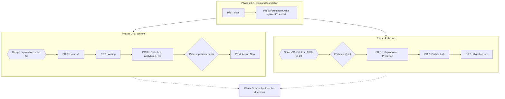

# Roadmap

What gets built, in which pull request and in what order; when each pull request counts as done; which platform questions are tested before code depends on them; and where Joseph decides before work continues. Scope details live in the docs that own each topic, and this file links to them. [product.md](product.md) carries a summary of the phases and the open decisions (Q1 to Q29) that block them.

Status: Draft for review in PR 1 · 2026-10-22

## How we work

- **One pull request in flight.** The next one starts when the previous one merges. One person has no one to hand half-finished work to, and two open branches that touch the same tokens, layout or CI file produce rebases instead of progress. This is a work-in-progress (WIP) limit of one. With throughput fixed at one person, more work in progress only makes each piece take longer (Little's law). Doc-only pull requests count too, so a decision change rides in the pull request that needs it. Dependabot's grouped minor and patch pull requests are maintenance, merged every other Monday, and do not count against the limit; a major version is a pull request of its own, counts against it, and draws on building time rather than the maintenance budget. The cost of the limit: a blocked pull request stops everything, which is why open decisions are due before the pull request they block (below). Two-way door; revisit if a pull request sits blocked for more than a week while other work is ready. **Relaxed on 2026-10-23**, when Joseph asked to move faster: while PR 3 waits on his manual checks, PR 5 is built on a branch stacked on PR 3's, and the lab's spikes run outside the repository. Two branches touch the docs, so the second one merges the first before it changes them.
- **A branch per pull request,** named for its scope. This one is `docs/site-plan`.
- **Never push to `main`.** While the repository is private on GitHub Free, GitHub cannot enforce that: branch protection for private repositories is a paid feature, and the rulesets and branch-protection APIs answer 403 for this repository[^gh]. From PR 2, a local pre-push hook refuses pushes to `main` (`.githooks/pre-push`, enabled with `git config core.hooksPath .githooks`). Behind the hook, the pipeline is the gate: the deploy job `needs:` `verify` and `firewall`, so nothing reaches production without passing them ([ADR 0006](adr/0006-github-actions-owns-deploys.md)). If the repository goes public, a ruleset moves the rule to the server ([gate](#gate-repository-public)).
- **No force pushes to a pull request branch while the repository is private.** Fix forward with a new commit. A force push leaves the replaced commits reachable on GitHub by SHA, where the audit before the [gate](#gate-repository-public) cannot see them ([ADR 0012](adr/0012-public-repository.md)). With one pull request in flight, merging `main` into the branch replaces a rebase.
- **An ADR for every decision that meets the threshold in [ADR 0001](adr/0001-record-architecture-decisions.md)** (costly to reverse, a technology or plan a reviewer would question, or a moved boundary), written in the pull request that makes the decision and accepted at the latest in the pull request that first builds on it. Everything else is decided in the pull request and written into the doc that owns the topic.
- **Open decisions are due before the pull request they block, not all at once.** Each Q-item in product.md names what it blocks. This is the last responsible moment: decide when waiting longer would remove an option, and no earlier.
- **Spikes before dependence.** When the design relies on platform behavior the docs imply but do not state, a throwaway experiment tests it before any code depends on it ([spikes](#spikes)).
- **"Write about it" is part of done.** Every pull request leaves at least one field note behind (below).
- **Time is budgeted in focused days** ([time budget](#time-budget)).

### Definition of done, every pull request

The per-PR checklists below add to this one.

- [ ] CI is green: `verify`, `firewall`, `preview`, `e2e` and, since 2026-10-25, `lighthouse` on the pull request (from PR 2; PR 1 was scanned locally before commit). Until the first deploy from `main` creates production, `preview` publishes nothing and `e2e` runs on `wrangler dev` ([delivery.md](delivery.md#pipeline)).
- [ ] Joseph has read the preview end to end on a phone-width screen and a desktop, against the pull request template's content checklist. A pull request with no preview, PR 2 among them, is read on `wrangler dev` serving the same `dist/`. That checklist covers what regex cannot see: paraphrase, screenshots, image metadata. A pull request that changes copy gets this read on a later day than it was written: with no second reviewer, a night's distance is the cheapest stand-in for one.
- [ ] The doc that owns each topic the pull request touched is updated in the same pull request. If an ADR changed, so did the [ADR index](adr/README.md).
- [ ] The ADRs the pull request builds on are Accepted, or rewritten and then Accepted.
- [ ] Open decisions the pull request needed are marked decided in product.md, with the date.
- [ ] **Write about it:** at least one field note drafted from the work, in 30 minutes or less, per the writing plan in [content.md](content.md). Until `/notes/` ships in PR 5, drafts stay unpublished; they become PR 5's first posts.
- [ ] The actual focused days spent go in the Actual column of the [phases table](#phases-and-pull-requests), not only in the pull request description, which does not travel with a clone.

### Time budget

A focused day is about five hours of uninterrupted work on this repository. Several evenings add up to one. The five hours are an assumption, to be corrected from the actuals each pull request records.

| Work | Focused days |
|---|---|
| Spikes S7 and S8, inside PR 2; S9, in PR 3 | about 1 |
| Phases 1–3: the site with content (PR 2, PR 3, the gate, PR 4, PR 5) | 9.5–12.5 |
| Phase 4: the lab (PR 6, including spikes S1–S6; PR 7; PR 8) | 18–23 |
| Total | 28.5–36.5 |

Recurring work comes on top: writing at 8–10 hours a month ([Q-writing-budget](product.md) asks whether that is realistic) and maintenance at 2 hours a month or less, the target product.md sets for "manageable alone". The [maintenance calendar](operations.md#maintenance-calendar) itemizes about 1 h 50 min of it before the lab.

How many hours a month Joseph can give the site is the input this plan does not have. It decides the calendar more than any estimate does:

| Hours a month for the site | Left for building, after ~10 h of writing and ~2 h of maintenance | Phases 1–3 take | Phase 4 takes |
|---|---|---|---|
| 20 | 8 h, about 1.6 focused days | about 6–8 months | about 11–14 months |
| 40 | 28 h, about 5.6 focused days | about 2 months | about 3–4 months |

At 20 hours a month, writing takes half the hours, the first demo goes live 9–12 months out, and the last one 18–23 months out. The plan accepts that on purpose: content comes first. If the real number is near 20, the lab's scope is cut before the content pages are ([risks](#risks-to-the-plan)).

**Re-baselined on 2026-10-23.** PR 3's build plan measured its work at 47 focused hours, about 9.5 focused days, against the 2–3 days estimated here: about 34 hours stayed in PR 3, and about 12 moved to PR 3b with the colophon, the beacon and Lighthouse CI. That moves Phases 1–3 from 9.5–12.5 focused days to about 17–19. The same day PR 4 shrank from 3–4 focused days to about 2, when owned work became cards, which brings Phases 1–3 to about 16–17. The other estimates stand until the actuals below give the ratio the outside view asks for.

Solo estimates run optimistic. That is the planning fallacy, and the remedy is the outside view: forecast from how comparable work actually went, not from the plan. After PR 3, divide the actual focused days of PR 2 and PR 3 by their estimates and scale every remaining estimate by that ratio.

## Phases and pull requests

| Phase | Pull request | Scope | Est. (focused days) | Actual | Blocked by |
|---|---|---|---|---|---|
| 0 | [PR 1](#pr-1-the-plan-docs) | `docs/` (this pull request) | done | — | — |
| 1 | [PR 2 Foundation](#pr-2-foundation) | pnpm workspace; `apps/web` Astro static site; `tokens.css`, base layout, 404; `wrangler.jsonc`; CI (`verify`, `firewall`, `preview`, `e2e`, `deploy`, `prod-smoke`); hooks; Dependabot; security headers; zone hardening executed; a minimal real Home deployed to `ihaveasegway.com` | 2–3 | — | — (spikes S7 and S8 run inside it) |
| 2 | [PR 3 Home v1](#pr-3-home-v1) | Direction C: its typefaces (spike S9), tokens and components; the theme toggle; final Home copy; OG images; JSON-LD; byte, contrast, fold, theme and motion budgets enforced | 2–3, re-baselined to about 7 | — | — (the design exploration chose direction C on 2026-10-23) |
| 3 | [PR 5 Writing](#pr-5-writing), next | `/writing/`, `/notes/`, `/rss.xml`, first posts (Writing renders from the first published post) | 2 | — | — |
| 2 | [PR 3b Colophon, Web Analytics, Lighthouse CI](#pr-3b-colophon-web-analytics-and-lighthouse-ci) | `/colophon/` rendering opted-in ADRs; the Web Analytics beacon with its disclosure; LHCI | about 2.5 | — | PR 5's prose layout; Joseph's ADR opt-ins and analytics site token |
| 2 | [Gate: repository public](#gate-repository-public) | [ADR 0012](adr/0012-public-repository.md) | 0.5 | — | Q-visibility |
| 3 | [PR 4 About + Now](#pr-4-about-and-now) | `/about/`, `/now/`; stillhere's card turned on (its code shipped ahead, on 2026-10-23); the ⌘K palette, moved from PR 3 (the served-from readout was dropped on 2026-10-24) | about 2, re-estimated on 2026-10-23 | — | stillhere's and the GitHub profile's readiness checks; Q-career-arc, Q-resume, Q-projects |
| 4 | [PR 6 Lab platform + Presence](#pr-6-lab-platform-and-presence) | `workers/lab/`; admission; LabControl; recordings; `/privacy/`; kill switch; spikes S1–S6 first | 4–5 | — | spikes S1–S6 (running from 2026-10-23); Q-ip. Q-budget was decided on 2026-10-23: $50 |
| 4 | [PR 7 Outbox Lab](#pr-7-outbox-lab) | The transactional outbox demo | 8–10 | — | Q-first-demo |
| 4 | [PR 8 Migration Lab](#pr-8-migration-lab) | The saved-plan migration demo | 6–8 | — | — |
| — | [Route Lab](#route-lab-static-built-2026-10-25) | `/lab/`, `/lab/routes/`: VROOM in the browser, static ([ADR 0016](adr/0016-route-lab-in-the-browser.md)) | 7–10 | built on 2026-10-25 by agents, at Joseph's direction | the merge gates below |
| 5 | [Later](#explicitly-later) | A résumé PDF, Pagefind, Mission-AI references, terminal mode | — | — | Joseph's decisions |

The order is the plan's main decision. The ask led with Durable Objects. Starting with the lab would put the riskiest, costliest work first and show an unexplained demo before there is a page to explain it; an unexplained or broken demo is worse than none. A single launch with everything at once would ship nothing for months and get no feedback. Thin slices, content first, each one deployed, keep something real and current on the domain from PR 2 on. The order is a two-way door: it can change at any pull request boundary. Evidence that it was wrong: in conversations about his work, people ask for the lab more than for the writing or the projects.

**Changed on 2026-10-25, as that rule allows.** Joseph directed the Route Lab first: "Goal post is VROOM running." Built as static files, it needs none of the lab platform, so it sits outside Phase 4's chain ([ADR 0016](adr/0016-route-lab-in-the-browser.md)).

**Changed on 2026-10-23, as that rule allows.** Joseph asked for the blog and the playground (the lab) first. So:

- PR 3 ships Home v1 as built, and the colophon, the Web Analytics beacon and Lighthouse CI become PR 3b.
- PR 5 (Writing) comes next. It ships its machinery hidden until a post is published, and Joseph writes the posts.
- PR 3b follows PR 5: it reuses Writing's prose layout, and it waits on Joseph's ADR opt-ins and his Web Analytics site token.
- The lab's prep runs in parallel: spikes S2–S6 on 2026-10-23, and S1 at 23:00 UTC that night with his go-ahead. Platform pieces that publish no demo may be built while Q-ip is open; no demo ships before it closes.
- Owned work became cards on Home that link to their repositories: no `/work/` pages, terminal recordings or lab companions. stillhere's card waits on its readiness check and the GitHub profile's; gitops stays off the site until it is public again ([content.md](content.md#owned-work)). So PR 4 shrinks to `/about/`, `/now/` and turning stillhere's card on.

## Pull requests

### Route Lab, static (built 2026-10-25)

Scope: `/lab/` and `/lab/routes/`; VROOM 1.15.0 in WebAssembly with its build, tests and lock (`tools/vroom-wasm/`); the OpenStreetMap pipeline and its outputs (`tools/route-data/`); the domain core `apps/web/src/lib/route-lab/`; the lab collection and the Home card; the six page-scoped rule changes in [ADR 0016](adr/0016-route-lab-in-the-browser.md), each with its test and known answer.

Definition of done: the repository's own (format, lint, types, the three builds, the unit suite, `e2e` and `e2e:writing` pass), plus `e2e/lab.spec.ts`: a solve in Chromium with no policy violation on the page or in the worker, a tap on the map, the keyboard's list, the page without JavaScript, axe and the glyph check after a solve, the motion rules before and after, and the known answer that a worker refused WebAssembly says so.

Gates before merge, which only Joseph can clear (ADR 0016, Consequences): Q13 (Q-ip); the Seattle region, an ASK review under [lab.md](lab.md)'s "Rules for every demo"; the five markets among the places, run by organizations; reading the demo beside his résumé and LinkedIn; the credit line for work built with agents; ADR 0016's acceptance and Q12's answer; and the review stamp on `src/content/lab/routes.md`, which keeps `verify` red until he reads the entry.

### PR 1: The plan (docs/)

Phase 0 · estimate: done (this pull request) · blocked by: —

**Scope.** `docs/`: the index, product, architecture, stack, content, design system, lab, delivery, operations, security, cost, this roadmap, the reading list and twelve Proposed ADRs.

**Done when:**
- [x] Every planned doc exists, and every relative link resolves.
- [x] The docs were scanned locally with the firewall's private term list before commit, and the scan was clean.
- [x] All twelve ADRs are Proposed, and every open decision in product.md names what it blocks.
- [x] Joseph has answered, or put a date on, the two decisions that block PR 2: [Q-deploy-token](product.md) and [Q-mail](product.md). [Q-renew](product.md) is answered by 2026-10-31, the only open decision with a calendar deadline.

**What it teaches.** The architect's pass written down before any code: the need behind the ask, data ownership, prior art, options and their tradeoffs. **C4** context and container diagrams ([architecture.md](architecture.md)). **ADRs** as a decision log, and **one-way and two-way doors** as the measure of how much care a choice needs. The **last responsible moment**: each open question carries the pull request it blocks instead of being decided up front.

### PR 2: Foundation

Phase 1 · estimate: 2–3 focused days · blocked by: — (Q-deploy-token and Q-mail were decided on 2026-10-22; spikes [S7 and S8](#spikes) run inside it)

**Scope.** pnpm workspace; the Astro site in `apps/web` as static output; `tokens.css` with direction C's Petrol + Apricot values, chosen on 2026-10-23 ([design-system.md](design-system.md#chosen-direction); fonts stay system stacks until spike S9 in PR 3), the base layout and the 404 page; `wrangler.jsonc`; the CI job graph; local hooks; Dependabot; security headers; zone hardening; `/robots.txt` and the root icons; a minimal real Home on `https://ihaveasegway.com/`. Home is drawn in direction C's frame: a ruler, the wordmark, the name, title and location, an Email button, the quiet line "The rest of the site is being built.", a readout row (build commit, build date, JavaScript 0 KB), and a footer with the contact address, the © line and the build line. Details: [delivery.md](delivery.md), [stack.md](stack.md), [security.md](security.md), [operations.md](operations.md). Q-ai-crawlers, Q-token-owner, Q-alerts and Q-s1-timing are decided ([product.md](product.md#decided)).

**Done when:**
- [x] A clean clone installs and builds with the pinned toolchain alone: `pnpm install --frozen-lockfile`, then the build (pins in [stack.md](stack.md)).
- [x] The site Worker `ihaveasegway-web` is assets-only, with no `main`, configured as [ADR 0002](adr/0002-host-on-workers-static-assets.md) says. CI fails if `cache.enabled` appears anywhere in its configuration, `previews` included.
- [ ] The job graph runs as [delivery.md](delivery.md) draws it, and its failure paths are proven rather than assumed: `scripts/firewall/test.sh` shows exits 0, 1 and 2 with a throwaway rule, and a run with the rules secret unset exits 2 and blocks `preview` and `deploy`.
- [x] The first deploy from `main` creates the Worker with `wrangler deploy` and attaches the domain. Every later deploy goes `wrangler versions upload`, then a smoke test of the Version URL, then `wrangler versions deploy <id>@100%`. One rollback with `wrangler rollback <id>` has been rehearsed, following the runbook in operations.md as written.
- [x] The first pull request after the first deploy gets a preview with the deploy token alone: spike S7's preview leg. PR 2's own `preview` publishes nothing, because production does not exist yet ([delivery.md](delivery.md#pipeline)).
- [ ] The pre-push hook refuses a push to `main` (tried once). The pre-commit hook scans the staged files and the commit identity.
- [ ] Commits use the GitHub noreply identity, and the CI identity check passes. The only Cloudflare credential anywhere in GitHub is the scoped deploy token that S7 proved sufficient. No Global API Key is used anywhere or kept in a shell environment ([operations.md](operations.md)).
- [ ] Dependabot runs with the planned configuration, and its first pull request has been reviewed.
- [x] Security headers match [security.md](security.md), and the `e2e` header checks assert them.
- [ ] Zone hardening is done per security.md's checklist and confirmed by `scripts/verify-zone.sh`, which needs no Cloudflare token. HSTS starts its ramp at 300 s ([ADR 0011](adr/0011-dnssec-and-hsts-ramp.md)).
- [x] `https://ihaveasegway.com/` serves a minimal real Home: Joseph's name, his title and location line (Q-title, Q-location) and the contact address from Q-mail, and nothing that waits on a later check (links to profiles or repositories). `www` redirects to the apex with a 301, and `/.well-known/security.txt`, `/robots.txt` (with its `Sitemap` line) and the root icons are served.
- [x] ADRs 0001, 0002, 0003, 0005, 0006, 0007, 0008 and 0011 are Accepted, or rewritten and then Accepted. ADR 0001 goes first, because the others are accepted under its rules. ADR 0010 waits for PR 3 and the design direction.

**What it teaches.** The **walking skeleton**: the thinnest slice that builds, gates, deploys, serves and rolls back, before any feature. The **deployment pipeline**: build once, gate, promote the artifact that was tested. **Blue/green** in miniature: the Version URL is tested on the edge before it takes traffic. **Single writer**: one path to production. **Policy as code** with a **fail-safe default**: the firewall is a versioned script, and "cannot prove clean" blocks publication just as a finding does. And a question to ask early: when does **infrastructure as code** pay for itself? Not yet. Zone settings stay in the dashboard with a checklist and an audit script until a trigger in operations.md fires.

### PR 3: Home v1

Phase 2 · estimate: 2–3 focused days, re-baselined to about 7 ([time budget](#time-budget)) · blocked by: — (the design exploration chose direction C on 2026-10-23, [ADR 0010](adr/0010-quiet-console-design-tokens.md); Q-threat-model, Q-title, Q-location and Q-availability were decided on 2026-10-22, [product.md](product.md#decided))

**Scope.** The rest of the design direction Joseph picked on 2026-10-23 from an exploration of three, each rendered on Home's real wireframe. PR 2 shipped direction C's palette and accent; PR 3 adds its typefaces (spike S9 for the fonts) and the components built from it; the theme toggle; final Home copy; Open Graph images; JSON-LD; budgets enforced in CI. Details: [content.md](content.md), [design-system.md](design-system.md). Q-theme, Q-analytics and Q-accent are decided ([product.md](product.md#decided)). Split on 2026-10-23: the colophon with its rendered ADRs, the Web Analytics beacon and Lighthouse CI moved to [PR 3b](#pr-3b-colophon-web-analytics-and-lighthouse-ci); the ⌘K palette, the served-from readout and the GitHub facts step moved to [PR 4](#pr-4-about-and-now) (the facts step was dropped on 2026-10-23), where there are pages to find and project cards to feed.

**Done when:**
- [ ] Home's copy is final and checked against the firewall classes in content.md. Each item in the ASK class is cleared by Joseph in writing in the private record; until then the strictest class applies. LinkedIn was cleared that way on 2026-10-23.
- [x] The hero's proof comes from computed values, each with a `verify` test: the readout row's commit, build date and JavaScript, and the card's JavaScript and fonts figures, from the module the byte budgets use. The planned terminal panel, with its fixture names, gave way to the readout row. Both the row and the card left on 2026-10-24, when no page was to describe the site any more; the budgets stay in CI, and the deploy smoke reads the commit from the `X-Build` response header ([design-system.md](design-system.md#nothing-on-the-page-describes-the-site)).
- [x] Rows 1–3 of Home are visible without scrolling at 390×844 and at 1440×900, by the fold rule in [content.md](content.md#home-page): row 2 ends at 495.5 and 545.7 px, with the web fonts and without them (row 3 is not rendered yet).
- [ ] Joseph has checked the fold once in Safari on a real phone, and recorded the visible height in the pull request: a Playwright viewport is the whole screen, and a phone's browser bars take part of it.
- [ ] Before merge, Joseph runs the 7-second test on the preview, as [product.md](product.md) defines it. If it fails, the hero is rewritten first.
- [x] Components are built from the tokens, and a unit test computes the contrast of every token pair from the tokens themselves and requires WCAG 2.2 AA.
- [x] The budgets in design-system.md fail the build when exceeded: eager JavaScript, lazy JavaScript per feature, CSS, preloaded fonts, glyph coverage, the fold, the theme states, reduced motion and axe violations. Home transfer size and the Lighthouse CI assertions moved to PR 3b.
- [ ] The theme toggle passes Joseph's manual keyboard and screen-reader check, VoiceOver on macOS and NVDA on Windows, noted in the pull request. axe does not cover a custom widget's behavior. The ⌘K palette gets the same check in PR 4.
- [x] External links render only from records whose readiness check is recorded in `profile.json` ([content.md](content.md#repo-readiness-checklist)), and `test/readiness.test.ts` holds that gate on fixtures and over `dist/`. LinkedIn is checked, with Joseph's written clearance; the GitHub profile's button, `sameAs` and `rel="me"` wait for its own check.
- [x] Open Graph images (1200×630) are built at build time, one per page that names a card: Home's in PR 3, drawn from the same strings as its `og:title` and `og:image:alt`.
- [ ] After merge, Joseph checks one unfurl in LinkedIn's Post Inspector and one in a Slack message, against production.
- [x] Home carries WebSite JSON-LD. No structured data anywhere has a `worksFor`.
- [x] ADR 0004 is Accepted, with the weekly rebuild's exception (it fails rather than drop project facts) written into its decision. Merging this pull request accepts it.
- [x] ADR 0010 is rewritten with the chosen direction and Accepted. Merging this pull request accepts it.

**What it teaches.** **Fitness functions**: budgets, the contrast test, the fold and the first-frame theme check turn design intentions into failing builds. **Islands architecture** and **progressive enhancement**: the page is complete with zero JavaScript, and the theme toggle is an addition that fails safe, hidden when its script cannot run. **Schema-on-write**: `profile.json` is validated at build, the way events are validated at the producer, and a field the schema does not name fails the build. **Make illegal states unrepresentable**: the profile has no slot for an employer or a city, and a record without its readiness stamp cannot render. And the **mosaic effect**: lines that are harmless alone can identify together, which is why Q-threat-model came before any copy.

### PR 3b: Colophon, Web Analytics and Lighthouse CI

Phase 2 · estimate: about 2.5 focused days (about 12 of PR 3's 47 measured hours) · after [PR 5](#pr-5-writing), whose prose layout it reuses · blocked by: Joseph's ADR opt-ins, and his Web Analytics site token ([operations.md](operations.md), access setup step 4)

**Scope.** What moved out of PR 3 on 2026-10-23: `/colophon/` with the ADRs Joseph opts in, rendered at `/colophon/decisions/<nnnn-slug>/`, and its "how this site runs" diagram; the Web Analytics beacon, its CSP entries, its disclosure and a new ADR for its third-party allowance; Lighthouse CI against the preview. Details: [content.md](content.md), [security.md](security.md), [design-system.md](design-system.md).

**Done when:**
- [ ] `/colophon/` is live, and the ADRs Joseph has opted in render at `/colophon/decisions/<nnnn-slug>/`. An ADR that is not opted in does not render.
- [ ] Unless Q-analytics says no, the Web Analytics beacon is live with its CSP entries, and the request watcher allows exactly its path.
- [x] Home transfer size and the Lighthouse CI assertions fail the build when exceeded. Done on 2026-10-25 by the `lighthouse` job, on every page of the build ([delivery.md](delivery.md#pipeline)).
- [ ] How the field p75 is read from Web Analytics is settled ([delivery.md](delivery.md)).
- [x] The CSP owner is revisited: a header policy generated at build would govern the theme script too ([security.md](security.md#headers-and-content-security-policy)). Done on 2026-10-25: the build writes the page policy as a header, and the theme script is governed ([ADR 0018](adr/0018-page-policy-as-a-header.md)).

**What it teaches.** **System of record**: the colophon reads `docs/adr/` at build time and never holds a copy. A **third-party allowance** as a trust decision: one origin, one exact path, a disclosure, and an ADR that says what it costs.

### Gate: repository public

Phase 2 · estimate: 0.5 focused days · blocked by: [Q-visibility](product.md); [Q-license](product.md) is answered before the switch

**Scope.** Carry out [ADR 0012](adr/0012-public-repository.md) if Joseph says yes. If he says no, the gate closes, the repository stays private, and PR 4 starts.

**Done when:**
- [ ] The firewall job is in CI and green on `main`.
- [ ] A full-history scan (`--log-opts=--all`) is clean, including commit identities. It runs on a clone that has also fetched every pull request head (`git fetch origin '+refs/pull/*/head:refs/remotes/origin/pr/*'`), because closed pull requests stay public through `refs/pull/` after their branches are deleted. No pull request timeline shows a force push; if one does, the commits it replaced are scanned by SHA first ([ADR 0012](adr/0012-public-repository.md)).
- [ ] A read of every past pull request title, body, review, review comment and conversation comment, every issue and issue comment, each with its edit history, every branch name and every Actions log is clean (each can be listed with `gh api`), because the switch publishes all of them. A finding in an edit history is removed by deleting that revision, because editing the text leaves the old revision visible. Actions logs are also checked for the account ID and email addresses ([security.md](security.md#scrubbing-evidence)), or the runs from before the switch are deleted.
- [ ] Joseph has said yes, and ADR 0012 is Accepted. License files match Q-license.
- [ ] After the switch, a ruleset requires a pull request and the checks `verify`, `firewall`, `e2e` and `lighthouse`. GitHub rejects a direct push to `main` (tried once).
- [ ] [security.md](security.md) records the new trust boundary.

**What it teaches.** A **one-way door**: clones and forks keep whatever was public, so history must be clean before the switch, not after it. **Trust boundaries move**: in a private repository CI prevents publication; in a public one content is published at `git push` and CI can only detect, which leaves the local hooks as the only prevention. Choosing where prevention happens is the design decision here.

### PR 4: About and Now

Phase 3 · estimate: about 2 focused days, re-estimated on 2026-10-23 when the case studies were dropped · blocked by: stillhere's readiness check and the GitHub profile's (stillhere's is in progress); [Q-career-arc](product.md), [Q-resume](product.md), [Q-projects](product.md)

**Scope.** `/about/` and `/now/`, and stillhere's card on Home turned on: its record checked, the GitHub profile checked, its hold lifted, and its tag and facts added ([content.md](content.md#how-a-projects-card-turns-on)). The card's code shipped ahead, on 2026-10-23. From PR 3's plan: the ⌘K palette. The served-from readout is dropped: since 2026-10-24 no page describes the site ([design-system.md](design-system.md#nothing-on-the-page-describes-the-site)). The GitHub facts step that was to feed project cards is dropped: a card's figures are copied by hand into `profile.json`, with the day they were measured ([content.md](content.md#how-a-projects-card-turns-on)). Details: [content.md](content.md). Also due before it, though not blocking: [Q-photo](product.md), [Q-segway](product.md), [Q-other-repos](product.md).

Owned work is cards, not pages (Joseph, 2026-10-23). stillhere's card links to its repository, whose README carries its story, and gitops stays off the site until it is public again ([content.md](content.md#owned-work)). Q-projects stays open for the capacitor line.

**Done when:**
- [ ] stillhere's repository and the GitHub profile have passed the [readiness checklist](content.md#repo-readiness-checklist): firewall scans of the tree, history and pull request text, and the commit identities checked. Every number on the card comes from a public source.
- [ ] stillhere's README leads with what it does, its limits statement and its public numbers ([content.md](content.md#stillhere-lead)), in a pull request in its own repository.
- [ ] stillhere's card renders on Home with its link, and `test/project-cards.test.ts` passes on the real build.
- [ ] Credit is exact: other people's contributions are named as theirs.
- [ ] `/about/` is generated from `profile.json`, which has no employer field, and carries ProfilePage and Person JSON-LD without `worksFor` ([ADR 0004](adr/0004-content-as-code.md)).
- [x] The résumé line follows Q-resume: a LinkedIn link and "Full résumé on request", on `/resume/` since 2026-10-25 (Q9 (a), as a page). No résumé PDF is hosted or committed.
- [ ] `/now/` shows the date it was written.
- [ ] The header shows only sections that have content.

**What it teaches.** **System of record** again, for people data: LinkedIn owns the employment history, the repository owns the public profile, and nothing is copied between them, so nothing drifts. And for project stories: the repository owns its README and decisions, and the site links to them instead of keeping a second copy. The **mosaic effect** applied to a career arc.

### PR 5: Writing

Phase 3 · estimate: 2 focused days · next, ahead of PR 3b and PR 4 (re-ordered on 2026-10-23) · blocked by: — (due before it, not blocking: [Q-writing-budget](product.md))

**Scope.** `/writing/`, `/notes/`, `/rss.xml`, and the first posts. Details: [content.md](content.md). The machinery merges before the posts: it ships hidden until a post is published, and Joseph writes the posts. Built on 2026-10-23: the `writing` and `notes` collections; the indexes and post pages as dynamic routes, which build nothing before the first published post; the feed, with `@astrojs/rss`; drafts on pull-request previews only; a link-preview card and BlogPosting JSON-LD per post; Writing in the header and on Home, and RSS in the footer and in each page's `<head>`; and a generic prose layout, which PR 3b's colophon reuses. With no real post yet, test-only builds from fixture posts stand in for content (`apps/web/scripts/build-fixtures.mjs`): two drafts and nothing published, with drafts and without, and again under `NODE_ENV=development`; exactly 1 published post and two drafts; and 5 and a draft, with drafts and without, one of them a tour of every Markdown construct the layout styles. Every check over `dist/` runs again on `dist-preview/` and on three fixture builds, and `pnpm e2e:writing` runs the browser checks on the five-post build.

**Done when:**
- [x] Essays and notes are content collections with validated front matter. Drafts build only in `astro dev` and pull-request previews, never in a production build: `pnpm build` writes `dist/` without them by construction, the tests hold `dist/` to that whatever `DRAFTS` says, and the deploy job refuses a build with any `noindex` page but the 404 (`scripts/deploy-guard.mjs`).
- [x] `/writing/` renders only once a post is published, drafts not counted ([content.md](content.md#sitemap-and-phases) owns the number; it was 3 until 2026-10-24). Until then it is absent from the header, Home, the feed and the sitemap. The fixture builds at 0 and 1 published posts prove both sides (`test/writing.test.ts`).
- [x] `/rss.xml` passes the W3C feed validator. The fixture build's feed, submitted as text on 2026-10-23, was valid with 0 errors. Its one warning, "Self reference doesn't match document location", comes from submitting text rather than the URL, and goes once the live feed is validated by URL. `e2e` also parses the feed with the browser's XML parser.
- [x] Before the first post, each Writing guard has a known answer, and a mutation that breaks it fails a test (the hardening pull request, 2026-10-23): the deploy guard as a script with one `noindex` marker; `dist/` held to `dist-preview/` byte for byte ([ADR 0015](adr/0015-preview-build-superset-of-production.md)); the glyph check, the feed smoke and the draft-leak search fail closed; style attributes and post images read with an HTML parser; dates read with Astro's YAML parser; the satteri and yaml pins; prod-smoke's fallback walks production's sitemap; and `e2e` runs in Playwright's image.
- [ ] At least one post is published, as [content.md](content.md#sitemap-and-phases) asks since 2026-10-24. The field notes drafted in PRs 2–4 count. Joseph writes it; this box ticks with the first.
- [x] Each post carries a `firewall_reviewed` date: the schema refuses a post without one, and the review stamp in [delivery.md](delivery.md#quality-gates-and-budgets-as-fitness-functions) fails a pull request that changes a post, or any stamped entry, unless that date is current: moved forward to the UTC day the read is committed, or already the day of the pull request's head commit, and never earlier than the last commit that touched the entry (`apps/web/scripts/review-stamp.mjs`, with known answers on git in `test/review-stamp.test.ts`).

**What it teaches.** **Cool URIs**: a post's slug is permanent from its first publish, and a rename is a 301 in `_redirects` ([ADR 0005](adr/0005-url-scheme.md)). Writing as a system rather than a resolution: a cadence, a definition of done that produces drafts, and a fallback when the cadence slips. **Test fixtures for content**: a rule about content ("nothing before the first post") can only be proven with content, so known fixture posts stand in for the real ones, the same move as a test double, and a check proves no fixture ever reaches the real build. **Explicit environment over inference**: production is the default, and drafts need a named switch that only pull requests set; a build that guessed its environment from the branch would fail open.

### PR 6: Lab platform and Presence

Phase 4 · estimate: 4–5 focused days, spikes S1–S6 included · blocked by: [spikes S1–S6](#spikes), which run from 2026-10-23; [Q-ip](product.md), not yet checked as of 2026-10-23. [Q-budget](product.md) was decided on 2026-10-23: $50. While Q-ip is open, platform pieces that publish no demo may be built; Presence and every other demo wait for it.

**Scope.** The lab Worker `ihaveasegway-lab` in `workers/lab/`, which holds every Durable Object (DO) class; admission; LabControl; recordings; `/privacy/`; the kill switch; the first demo, Presence. Details: [lab.md](lab.md), [ADR 0009](adr/0009-lab-worker-same-origin.md). Also due before it, though not blocking: [Q-live-count](product.md).

**Done when:**
- [ ] S1–S6 have run, and their results are recorded below before any lab code is written. A failed spike changes the design first.
- [ ] The lab route is `ihaveasegway.com/lab/api/*` and nothing wider, and it fails closed at the Free cap, so a tripped cap answers Error 1027 rather than the site's 404 ([cost.md](cost.md#guardrails)). Requests for `/lab/<slug>/` itself are served from the site Worker's assets: the lab Worker's logs show no request for that path. Presence's `/lab/api/` calls are expected.
- [ ] Every DO class is SQLite-backed and declared as lab.md's rules require, and every socket uses the WebSocket Hibernation API. SQLite-only storage is what keeps the move between Workers Free and Paid a two-way door ([ADR 0008](adr/0008-workers-free-with-guardrails.md)).
- [ ] Messages follow protocol v1 as lab.md defines it. Presence's recording freezes what v1 means: from here on, a change to that meaning is v2. ADR 0013, protocol v1 and the recording format, is written in this pull request and Accepted before Presence's recording ships.
- [ ] Admission runs Turnstile, then the signed session cookie, then the Rate Limiting binding, then LabControl's per-demo daily budget at 70% of each Free cap, and otherwise recorded mode. A fault-injection test makes LabControl throw and checks that admission returns recorded, never live.
- [ ] Each kill-switch layer, L0 to L4, has been exercised once, and operations.md has a runbook step for each.
- [ ] Presence ships with a recorded run, and the client falls back to it on any non-2xx answer (HTTP 429, 503, Error 1027, a WAF block's 403 under L3, the site's 404 under L4), a network error, a 3-second connect timeout and close code 4003, with one test per trigger.
- [ ] WebSocket upgrades check `Origin`. The session cookie is `Path=/lab/api; HttpOnly; Secure; SameSite=Strict`. Visitors cannot send free text, no location finer than a country is kept or shown, and IP addresses are kept only as an HMAC with a daily salt.
- [ ] `/privacy/` is live before the route is enabled.
- [ ] Q-budget is answered, and the IP check (Q-ip) is done. If the account moves to Workers Paid, the guardrails in [ADR 0008](adr/0008-workers-free-with-guardrails.md) are in place the same day.
- [ ] Joseph has read the demo list and each write-up beside his résumé and LinkedIn profile and cleared the demos as a set, in the private record ([lab.md](lab.md)).
- [ ] The maintenance calendar in [operations.md](operations.md#maintenance-calendar), with the lab's rows added, still fits product.md's target, or that target changes with the time log as evidence. Automating the weekly ledger reconciliation is the main lever.
- [ ] ADR 0009 is Accepted, or rewritten and then Accepted.
- [ ] ADR 0014, TypeScript for code that runs on Workers, is Accepted before the first DO class deploys.

**Open for PR 6: the room layer.** lab.md picked PartyServer, and it has had no commit since 2026-08-03 (0.5.10, one npm maintainer; checked 2026-10-23), while Cloudflare's Agents SDK, which stopped depending on it, ships weekly. The recommendation: a Room port the lab owns, with its first adapter on the raw Hibernation API (about 41 lines and 0.75 KB min+gzip in a prototype, against PartyServer's 32 lines and 5.0 KB), so the library choice stays a one-adapter change. Decide it before the first DO class, and record it in lab.md's decision row.

**What it teaches.** The **bulkhead**: the lab can exhaust the account's quota while the site keeps serving, which S1 proves rather than assumes. **Admission control** and **load shedding**: work is refused at the door, before it costs a DO request. The **token bucket**, per socket, kept in the connection's state so it survives hibernation. The **fail-safe default**: when anything is unsure, a visitor gets a recording, not an error. The **circuit breaker**, in the kill switch's layers. The **virtual actor**: a DO is addressed by name and exists when it is called. **Denial of wallet**: on Free the budget is the quota; on Paid it is money, and only the guardrails stop it. The **multiplayer authority model**: the server's state is the truth, and clients converge on its snapshot.

### PR 7: Outbox Lab

Phase 4 · estimate: 8–10 focused days · blocked by: [Q-first-demo](product.md) (Outbox after Presence is the recommendation)

**Scope.** A transactional outbox with schema-validated CloudEvents, retries with full jitter, a dead-letter queue, replay, crash injection, and a "naive dual write" mode that visibly loses events. Orders as the domain, synthetic data. Details: [lab.md](lab.md).

**Done when:**
- [ ] Under the same injected crash, naive dual write loses an event and the outbox does not. One test asserts both.
- [ ] Consumers deduplicate by idempotency key, and a full replay produces no duplicate effect.
- [ ] Retries back off exponentially with full jitter. A poison event lands in the dead-letter queue after a fixed number of attempts and can be replayed from there.
- [ ] Events are validated against their schema before they enter the outbox.
- [ ] A recorded run ships, and the write-up page under `/lab/<slug>/` explains the pattern with the demo's own numbers.
- [ ] The domain is neutral, the data synthetic, the algorithms public. Nothing comes from any employer's systems: no code, no numbers.
- [ ] This demo's write-up was cleared with the set ([lab.md](lab.md)).

**What it teaches.** The **transactional outbox** against the dual-write problem. The **idempotency key**. The **dead-letter queue**. **Exponential backoff with full jitter**. **Schema-on-write** at the producer.

### PR 8: Migration Lab

Phase 4 · estimate: 6–8 focused days · blocked by: —

**Scope.** Saved-plan apply with a plan hash; batches on alarms; crash and resume through a ledger; rollback by inverse plan or by SQLite point-in-time recovery. A contact list as the domain, synthetic data. Details: [lab.md](lab.md).

**Done when:**
- [ ] Apply refuses a plan whose hash does not match the plan the visitor reviewed.
- [ ] A crash in the middle of a batch resumes from the ledger without applying any batch twice.
- [ ] Rollback works both ways: by inverse plan, and by point-in-time recovery. Recovery is proven on a deployed Worker before the page promises it, because it does not run in local development[^pitr].
- [ ] A restore cannot reset a cap. On the same deployed Worker, a test applies, restores, tries a second restore, then applies up to the cap: the second restore and the apply past the cap are refused ([lab.md](lab.md#migration-lab)).
- [ ] Plans order their steps expand, migrate, contract.
- [ ] A recorded run ships; the domain is neutral and the data synthetic.
- [ ] This demo's write-up was cleared with the set ([lab.md](lab.md)).

**What it teaches.** **Saved-plan semantics**: apply executes exactly what was reviewed, or refuses. **Expand/contract**: every step is reversible until the contract step. Idempotent batches with a ledger, so a crash costs a retry and never a double write.

## Decision gates

Four points where work stops until Joseph decides. Each one is a decision about exposure or money, not code.

| Gate | Opens when | Door | Recorded in |
|---|---|---|---|
| Repository public | The firewall job is green in CI, a full-history scan is clean, and Joseph says yes ([Q-visibility](product.md)) | One-way: clones and forks keep whatever was public | [ADR 0012](adr/0012-public-repository.md) |
| Workers Paid | Any one of the upgrade triggers in [cost.md](cost.md) fires: the first Container-backed demo, the first Error 1027 or a day above half of a Free daily cap, a route that needs more CPU than Free allows, a dated moment when demo uptime matters, or email to arbitrary recipients or more Queues operations a day than Free allows. Budget alerts use $50 a month, Joseph's answer to [Q-budget](product.md) on 2026-10-23 | Two-way while only SQLite-backed DOs are used | [ADR 0008](adr/0008-workers-free-with-guardrails.md) |
| IP check: every demo and Mission-AI | Joseph has read his invention-assignment agreement and the statute of the state he works in, and confirmed that they reach neither the lab's demos nor a Mission-AI reference ([Q-ip](product.md)). It comes before PR 6, the first demo; not yet checked as of 2026-10-23. This is a check, not legal advice | One-way once published | [product.md](product.md#decided), only as done, with the date. Anything about the agreement stays in the private record ([product.md](product.md#content-firewall)) |
| Mission-AI references | Joseph decides when and how ([Q-mission](product.md)). Mission-AI is his own earlier project and is off the site at launch. Any reference first passes the same readiness checks as a linked repository, and the IP check above. The change that allows it is a deliberate pull request | One-way once published | [product.md](product.md) |

Thresholds that change the plan without a gate of their own: Writing renders from its first post ([content.md](content.md)), and search (Pagefind) arrives at about 20 ([content.md](content.md)); infrastructure as code arrives when a trigger in [operations.md](operations.md) fires; HSTS preload waits at least three months after the 12-month max-age ([ADR 0011](adr/0011-dnssec-and-hsts-ramp.md)).

## Spikes

A spike answers one question with the least code that can answer it, and the code is thrown away. Rules:

- Throwaway Workers, repositories and projects. Nothing a spike builds merges.
- Spikes run from the laptop with a short-lived token from [operations.md](operations.md#2-short-lived-tokens-for-inspection-and-one-off-changes-as-needed) (access setup, step 2): only the permissions that spike needs, a 1-day TTL, deleted when it ends. Never `wrangler login`.
- Each spike is time-boxed to half a focused day. If the box runs out, the answer is "unknown" and the design takes the safe branch.
- Results go in the Result column with the date and a link to the evidence (metrics screenshots and command output, scrubbed as [security.md](security.md#scrubbing-evidence) lists). A result that changes a design also updates the doc that owns it and gets a postscript or a superseding ADR.
- **Ask Joseph before anything that burns the account's daily quota.** Workers Free counts 100,000 Worker requests a day for the whole account, reset at 00:00 UTC[^limits], and a Worker already runs in this account.

S7 and S8 run inside PR 2, so the site ships sooner (decided 2026-10-22): S7 is PR 2's own first deploy, which fails safe because the domain serves nothing yet, and S8 is this repository's first Dependabot run. S9 moves to PR 3, where the typefaces are chosen. S1–S6 take about one focused day, inside PR 6's estimate. At Joseph's request they run ahead of PR 6, in parallel with PR 5: S2–S6 on 2026-10-23, and S1 at 23:00 UTC that day, with the go-ahead he gave the same day. [lab.md](lab.md) says what changes in the lab's design if any of S1–S6 fails.

| Spike | Question | Why it matters | Method | Pass criteria | Cost and risk | Result |
|---|---|---|---|---|---|---|
| **S1** · before PR 6 | Do static assets keep serving after the account passes the Free daily cap? The docs imply it ("only requests that hit a Worker" count[^assets]) but never state it | The $0 plan rests on it: a demo that exhausts the account's quota must not take the site down ([ADR 0008](adr/0008-workers-free-with-guardrails.md)). Before PR 6, only the Worker already in the account can spend the quota; the lab is the first thing this plan adds that can. [Q-s1-timing](product.md) asks whether that Worker's traffic justifies running S1 before PR 2 | Drive a throwaway Worker on workers.dev at about 35 requests a second from an hour before 00:00 UTC, so the cap trips about 12 minutes before the reset (sooner if the account has already used part of the day's quota). Then send 100 requests each to a throwaway assets-only Worker and to the production site | The throwaway Worker answers Error 1027, and all 200 asset requests answer 200 with the expected bytes | About 100,000 requests in under an hour. **Needs Joseph's go-ahead:** exhausting the Free daily quota affects every Worker in the account for the rest of the UTC day. Timing it just before the reset keeps that to about 12 minutes | **Run 2026-10-23, inconclusive: the cap did not trip.** From 23:00:26 to 23:59:10 UTC, vegeta drove a throwaway script Worker on workers.dev at 35 requests a second: 123,336 requests, all 200 (p50 22 ms). Cloudflare's GraphQL (`workersInvocationsAdaptive`) counts 124,061 Worker requests for the account that day, with 0 errors: 24% over the documented 100,000-a-day Free limit, and no Error 1027 at any point, including about 11 minutes after crossing 100,000 at about 23:48. The 23:00 baseline (100 of 100 requests 200 with the expected bytes, on an assets-only Worker and on production) and every check after the 00:00 reset passed. So the bulkhead question is still open, and enforcement of the documented cap was not observed within 11 minutes of crossing it: the plan must not treat Cloudflare's cap as a precise ceiling, and `LabControl`'s ledger, at 70% of each Free cap, stays the primary control, as designed. Re-run options: a larger overshoot (for example 70 requests a second from 23:00, about 250,000), which needs Joseph's go-ahead again, or accepting the docs' statement that asset requests do not count |
| **S2** · before PR 6 | Does a WAF custom rule block a request before the Worker runs, so that a blocked request is not an invocation? Likely, not documented[^waf] | The L3 kill switch, and the only control that protects both the Free quota and Paid money, depend on it | WAF rules apply to the zone, not to workers.dev, so this one uses a throwaway route such as `ihaveasegway.com/spike-s2/*` to a throwaway Worker, and a Block rule on that path. Send 1,000 requests | Security Events show 1,000 blocks, and the Worker's metrics show 0 requests for the window (metrics lag by minutes) | Uses 1 of the zone's 5 custom rules on Free[^waf] for an hour. A wrong expression could block the site: match the spike path only, and delete the rule and the route afterwards | Pending: Joseph runs the rule step. Since 2026-10-23 a throwaway route Worker answers `ihaveasegway.com/spike-s2/*`, and a 20-request control reached it (20 × 200). Creating the Block rule changes the production zone, so Joseph runs that step; the rule is deleted however the script exits |
| **S3** · before PR 6 | Does a DO handler on Free get 30 s of CPU or 10 ms? The DO limits page says 30 s with no plan split; the Workers limits page gives Free 10 ms[^dolimits] | It decides whether any server-side check heavier than O(n) can run in a DO on Free | A throwaway DO on workers.dev runs a fixed amount of pure computation, calibrated locally to about 5, 50 and 200 ms; 20 calls at each size, with CPU time read from Workers Logs[^cputime]. A time-based busy loop would never end, because a deployed Worker's clock does not advance during computation[^clock] | All 20 calls at 50 ms finish without a CPU-limit error; the 200 ms result is recorded too. If they fail, plan for 10 ms and keep every handler O(n) | 60 DO requests; no risk | **Passed, 2026-10-23.** A SQLite-backed DO on workers.dev ran a fixed pure-compute loop, calibrated in Node 24 at about 1.4 ms per million iterations. 20 calls each at 3.5 M, 36 M and 145 M iterations all returned 200, with no CPU-limit error. `wrangler tail` (best effort: it kept 40 of about 120 invocations) read the DO's `cpuTime` at 6–26 ms (median 8) for 3.5 M and 249–255 ms (median 252) for 145 M; the stateless Worker in front used 0–1 ms. Cloudflare's DO analytics returned no rows for the window. So the Free plan's 10 ms binds the stateless Worker, not a DO handler ([ADR 0008](adr/0008-workers-free-with-guardrails.md)'s postscript). The raw output was not committed; these numbers are the record |
| **S4** · before PR 6 | Is the Workers Rate Limiting binding available on Free at no charge? The docs state neither plan nor price[^rl] | It is the second admission layer for session minting and WebSocket upgrades | A throwaway Worker on workers.dev with a `ratelimits` binding of 5 requests per 60 s, the lab's planned session limit. Send 30 requests in 10 s from one machine, and check billable usage the next day | It deploys; calls past the 5th return `success: false` (counts are approximate and per location); no new billable line appears | About 30 Worker requests | **Passed functionally, 2026-10-23; the billing check is due 2026-10-24.** A `ratelimits` binding of 5 per 60 s deployed on Free. 30 requests over 10 s, 3 a second with vegeta, against a fresh key: 6 allowed, then 24 refused with 429. Counts are approximate and per location, as the docs say. A first run's 404s were the new workers.dev route propagating |
| **S5** · before PR 6 | With `workers_dev` and `preview_urls` set to false, do Worker Previews still publish on workers.dev? The Previews docs mention neither setting[^previews] | If they do, every lab preview is a public entry point outside the zone's WAF kill switch, spending the same account quota | A throwaway Worker with both settings false. Run `wrangler preview --name s5` with and without a `previews: {}` block, and request the URL it prints | A clear answer either way. "No side door" holds only if no preview URL answers; otherwise the lab gets no previews, and lab changes are tested with `wrangler dev` and the Vitest plugin | Negligible | **Passed: no side door, 2026-10-23.** With both settings false and no `previews` block, `wrangler preview` refuses. With `previews: {}` it creates the Preview and reports that it has no active URLs (`preview_urls` and `deployment_urls` empty), and the Preview's workers.dev name answers 404. Wrangler also offers a custom-domain route with `previews_enabled: true`, which would put lab previews behind the zone's WAF |
| **S6** · before PR 6 | Do preview DO namespaces count toward the Free limit of 100 DO classes per account[^dolimits]? | Every open lab preview may hold one namespace per class; with about 5 classes, production plus 19 open previews would reach the limit | Count the account's DO namespaces through the API before, during and after two previews of a throwaway Worker with two DO classes | Previews add nothing to the count, or the count returns to its baseline once the previews are deleted. If they count, `preview-cleanup` becomes a checked job for any lab preview | Negligible; delete the previews afterwards | **Counted, 2026-10-23.** Previews count while they exist and return to the baseline when deleted. A Worker with two SQLite classes took the account's DO namespaces from 0 to 2; each Preview added one per class (4, then 6); `wrangler preview delete` took it back to 4, then 2. A Worker with DOs needs a `previews` block with its DO bindings, or `wrangler preview` refuses. So `preview-cleanup` is a checked job for any lab preview |
| **S7** · in PR 2 | Can the minimal account-owned token (`cfat_`) deploy to a custom domain? Its scopes are "likely, not tested" | It is PR 2's deploy credential. A missing permission found during the first production deploy stalls the launch; an over-broad token is a standing risk | PR 2's pipeline is the test: its first `deploy` (which creates the Worker and attaches the domain) and the rollback rehearsal, then the first `preview`, on the first pull request after that deploy, all with the stored deploy token alone: the four permissions in [ADR 0006](adr/0006-github-actions-owns-deploys.md). PR 2's own `preview` publishes nothing, because `wrangler preview` would create the missing Worker itself, without its domain ([delivery.md](delivery.md#pipeline)) | Every command succeeds with that token alone. If one fails, add the narrowest permission that fixes it, and record it in operations.md (token setup), the [secrets inventory](security.md#secrets-inventory) and ADR 0006 | About an hour. Trial and error widens a token: remove any permission the final run did not use | Deploy leg passed on 2026-10-23: the first deploy from `main` created `ihaveasegway-web` and attached `ihaveasegway.com` with the stored token alone ([run 39897300961](https://github.com/IHaveASegway/website/actions/runs/39897300961)). Preview leg passed the same day: pull request 3's `preview` job published `pr-3`, and `e2e` ran against it ([run 39900452878](https://github.com/IHaveASegway/website/actions/runs/39900452878)). `rollback` and `preview-cleanup` passed with it too, the same day ([run 39907144351](https://github.com/IHaveASegway/website/actions/runs/39907144351), [run 39905564872](https://github.com/IHaveASegway/website/actions/runs/39905564872)), so the stored token covers every step the pipeline takes |
| **S8** · after PR 2 merges | Does Dependabot round-trip a pnpm 11 workspace lockfile? Its pnpm 11 support shipped 2026-10-20[^dependabot] | If Dependabot's lockfile fails a frozen install, every dependency update fails CI, and the dependency policy has to move to Renovate | This repository's first Dependabot pull requests, once PR 2 has merged the workspace (`packageManager`, a catalog, `allowBuilds`) and `dependabot.yml`. Dependabot checks when the configuration file is checked in[^dependabot]. CI runs `pnpm install --frozen-lockfile` on each. A failure fails only those pull requests | The frozen install passes, or fails only on pnpm's minimum release age with the documented workaround, and the dependency graph lists the workspace's packages, which is what security alerts need | One to two hours; delete the repository afterwards | Pending. Dependabot's first runs on `main` succeeded on 2026-10-23, for npm and for GitHub Actions, and found nothing to propose inside the cooldowns, so no lockfile has round-tripped yet |
| **S9** · in PR 3, once the typefaces are chosen | Can Astro's Fonts API serve the custom HUD subset through its local provider[^fonts]? | The design's glyphs (box drawing, ▸ ✓ ✗ ⌘ →) are not in the stock Latin subsets, and the font budget assumes the subset in [design-system.md](design-system.md) | A scratch Astro 7.4 project. Register the chosen text face and the mono subset with `fontProviders.local()`, build, and open a page that uses every HUD glyph | Both files ship at their measured sizes with preload links, and a Playwright check of the fonts Chromium used for each glyph (`CSS.getPlatformFontsForNode`[^cdp]) shows the subset, not a fallback. Otherwise: plain `@font-face` rules and hand-written preload links, with the same budget | About two hours | Passed on 2026-10-23, inside PR 3 rather than in a scratch project, with the faces direction C chose: Instrument Sans (55,984 B) and a JetBrains Mono subset (8,156 B). The local provider serves both from `/_astro/fonts/` at their locked sizes, passes Instrument Sans's width range through to `font-stretch`, writes both preload links, and hashes the `<style>` it emits into `style-src`. Its own fallback, one face fitted to Arial at full width, is off: `src/styles/font-fallbacks.css` fits one face per local font and width instead. The glyph check (`e2e/glyphs.spec.ts`) finds every glyph on every page drawn by a self-hosted face, and its known answer reports characters outside both subsets with the system font that drew them ([design-system.md](design-system.md#typography)) |

S1 and S3 to S6 ran on 2026-10-23 with two departures from the rules above: they used Joseph's own Cloudflare token rather than a short-lived one (a risk he has accepted, recorded in the private record), and their raw output was not committed, so the Result cells are the record. Every throwaway Worker was deleted after its spike, except S1's and S2's, which stay until those spikes end: S1 may run again.

## Risks to the plan

| Risk | How it would show | Response |
|---|---|---|
| **Over-scoping before content exists.** The research behind this plan proposed four labs at 25–33 build days, about 25 ADRs, 11 runbooks and 7 effects. This plan keeps three demos, 14 ADRs (12 in PR 1, ADR 0013 in PR 6, ADR 0014 on 2026-10-23) and the launch effects in design-system.md, and it still adds up to about 35–41 focused days since the 2026-10-23 re-baseline (spikes about 1, Phases 1–3 about 16–17, Phase 4 18–23) | A pull request runs past 150% of its estimate; effects or lab work start while a content page is missing | The phase order puts content first, and the launch effects list is closed. Lab appears on Home only when a demo is live; Writing only at 3 posts. If actuals run over, cut in this order: Migration Lab becomes an essay; Outbox Lab ships as a recorded run with its write-up; the lab waits. Content pages are not cut. On 2026-10-23 Joseph chose to run the lab's spikes and build Writing before the other content pages, and made owned work cards instead of case studies; the cut order still holds |
| **Framework churn.** Astro shipped three majors between 2024-12-03 and 2026-06-22 (5.0, 6.0, 7.0)[^astro]. The lab's room layer, PartyServer, is 0.x; Lighthouse CI has had no release since 2025-06-26[^lhci]; Dependabot's pnpm 11 support is new[^dependabot] | An Astro major takes more than a day to adopt, or the build path stays broken for more than two weeks ([ADR 0003](adr/0003-astro-static-first.md)) | Exact pins, grouped Dependabot pull requests, majors adopted at x.1, each in its own pull request. Thin MDX, so content ports. Demo domain logic kept free of framework code. The quarterly checks in the maintenance calendar watch the slow movers: gitleaks, Lighthouse CI, TypeScript 7 readiness ([operations.md](operations.md)) |
| **A solo bus factor.** One person holds every account, every credential and every reason | Nothing shows until it happens, which is the risk | Runbooks a stranger could follow ([operations.md](operations.md)). Account continuity in [security.md](security.md): recovery codes kept offline, no account whose primary or recovery email depends on an employer, auto-renew on a card valid by 2027-09-18, Cloudflare's first renewal attempt, about 30 days before the domain expires on 2027-10-18. A second copy of the repository: the monthly `git bundle` in the maintenance calendar. Copy changes get a next-day read ([definition of done](#definition-of-done-every-pull-request)) in place of a second reviewer |
| **Writing cadence.** 8–10 hours a month competes with building | Three months without a post | The writing plan's own rule: drop to field notes only and hide Writing from Home ([content.md](content.md)). Prevention: "write about it" in every definition of done, notes capped at 30 minutes, and PR 5 publishing drafts that already exist |

## Explicitly later

| Item | Why it waits | What would bring it forward |
|---|---|---|
| A résumé PDF (printed from `/resume/`, clean PDF metadata) | It needs the firewall answers first (Q-threat-model, Q-career-arc), and a PDF is a one-way door. The HTML edition, with "Full résumé on request", serves recruiters meanwhile: `/resume/` since 2026-10-25 | Joseph chooses it in [Q-resume](product.md), option (b) |
| Pagefind search | No search until about 20 posts. Then a static index, $0 at runtime, which can also feed the ⌘K palette | The 20th post |
| Terminal mode (lazy-loaded, opened with Ctrl and the backtick key, or from the palette) | An effect, not content. The launch effects are capped | Content pages complete and budgets green with room to spare |
| Mission-AI references | Off the site at launch ([Q-mission](product.md)) | Joseph's decision, after the IP check |
| Containers | Paid-only, and the first Container-backed demo is itself an upgrade trigger ([ADR 0008](adr/0008-workers-free-with-guardrails.md)) | A demo that needs a native solver or a long-running process |
| gitops back on the site | Private since 2026-10-23. Joseph's plan: clean its history the way stillhere's was cleaned, make it public, then turn its card on ([content.md](content.md#owned-work)) | His go-ahead for the history cleanup |

## Patterns and further reading

- WIP limits, small batches and Little's law: Donald Reinertsen, *The Principles of Product Development Flow* (2009), chapters 3, 5 and 6.
- The last responsible moment: Mary and Tom Poppendieck, *Lean Software Development: An Agile Toolkit* (2003), chapter 3.
- The walking skeleton: Steve Freeman and Nat Pryce, *Growing Object-Oriented Software, Guided by Tests* (2009), chapter 4.
- Spikes: Extreme Programming's rules, "Create spike solutions" (Don Wells).
- The planning fallacy and the outside view: Bent Flyvbjerg, "From Nobel Prize to Project Management: Getting Risks Right" (2006).
- One-way and two-way doors: Jeff Bezos, 2015 letter to Amazon shareholders.
- Every pattern named in "What it teaches", with one canonical source each: [reading-list.md](reading-list.md).

[^gh]: [GitHub's plans](https://docs.github.com/en/get-started/learning-about-github/githubs-plans) list protected branches for private repositories under GitHub Pro. On this account, the rulesets and branch-protection APIs answered 403, "Upgrade to GitHub Pro or make this repository public", for this private repository (observed while planning). As of 2026-10-22.
[^limits]: [Workers limits](https://developers.cloudflare.com/workers/platform/limits/): Free allows 100,000 Worker requests a day per account, reset at 00:00 UTC; past the cap, requests that run Worker code get Error 1027. As of 2026-10-22.
[^assets]: "Only requests that hit a Worker will count against your limits and your bill": [Workers pricing](https://developers.cloudflare.com/workers/platform/pricing/); see also [static assets billing](https://developers.cloudflare.com/workers/static-assets/billing-and-limitations/). As of 2026-10-22.
[^waf]: [WAF custom rules](https://developers.cloudflare.com/waf/custom-rules/): 5 rules on the Free plan. The [ruleset phases list](https://developers.cloudflare.com/ruleset-engine/reference/phases-list/) has no Workers entry, so the order of the WAF and Workers is an inference. As of 2026-10-22.
[^dolimits]: [Durable Objects limits](https://developers.cloudflare.com/durable-objects/platform/limits/): 30 s of CPU per request, configurable to 5 minutes, with no plan split, while the same page says DOs "have the same per invocation CPU limits as any Workers do"; 100 DO classes per account on Free, 500 on Paid. [Workers limits](https://developers.cloudflare.com/workers/platform/limits/): 10 ms of CPU per request on Free. As of 2026-10-22.
[^cputime]: [Cloudflare changelog, 2025-04-09](https://developers.cloudflare.com/changelog/post/2025-04-09-workers-timing/): "CPU time and Wall time are surfaced in the Invocation Log" of Workers Logs, for every invocation. As of 2026-10-22.
[^clock]: [Workers security model](https://developers.cloudflare.com/workers/reference/security-model/): "`Date.now()` returns the time of the last I/O. It does not advance during code execution." As of 2026-10-22.
[^rl]: [Rate Limiting binding](https://developers.cloudflare.com/workers/runtime-apis/bindings/rate-limit/): counts are approximate and kept per location, over 10 s or 60 s periods; the page states no plan or price. As of 2026-10-22.
[^previews]: [Worker Previews](https://developers.cloudflare.com/workers/previews/): Wrangler 4.135.0 or later; 100 previews per Worker on Free; preview URLs are public by default, and workers.dev previews send `X-Robots-Tag: noindex`. The page does not mention `workers_dev` or `preview_urls`. Isolation per preview: [Resources](https://developers.cloudflare.com/workers/previews/resources/). As of 2026-10-22.
[^dependabot]: [GitHub changelog, 2026-10-20](https://github.blog/changelog/2026-10-20-dependabot-now-supports-npm-12-pnpm-11-and-12-and-bun-1-4/): Dependabot supports pnpm 11 and 12. [Configuring Dependabot version updates](https://docs.github.com/en/code-security/dependabot/dependabot-version-updates/configuring-dependabot-version-updates): "When this file is checked in, Dependabot checks the manifest files on the default branch for outdated dependencies." [About Dependabot version updates](https://docs.github.com/en/code-security/dependabot/dependabot-version-updates/about-dependabot-version-updates): version updates have a default cooldown of 3 days. As of 2026-10-22.
[^fonts]: [Astro fonts guide](https://docs.astro.build/en/guides/fonts/): `fontProviders.local()` takes `variants` with `src`, `weight` and `style`; preload is opt-in per font (``). As of 2026-10-22.
[^cdp]: [Chrome DevTools Protocol, CSS domain](https://chromedevtools.github.io/devtools-protocol/tot/CSS/): `getPlatformFontsForNode` "Requests information about platform fonts which we used to render child TextNodes in the given node." As of 2026-10-22.
[^astro]: [npm registry, astro](https://registry.npmjs.org/astro): 5.0.0 published 2024-12-03, 6.0.0 on 2026-03-10, 7.0.0 on 2026-06-22, 7.4.2 on 2026-10-21. As of 2026-10-22.
[^lhci]: [Lighthouse CI releases](https://github.com/GoogleChrome/lighthouse-ci/releases): the latest release is 0.15.1, published 2025-06-26 (the [npm registry](https://registry.npmjs.org/@lhci%2fcli) records 2025-06-25 23:52 UTC). As of 2026-10-22.
[^pitr]: [Durable Objects SQL storage API](https://developers.cloudflare.com/durable-objects/api/sql-storage/): "The PITR API is not supported in local development because a durable log of data changes is not stored locally." Recovery reaches back 30 days. As of 2026-10-22.
