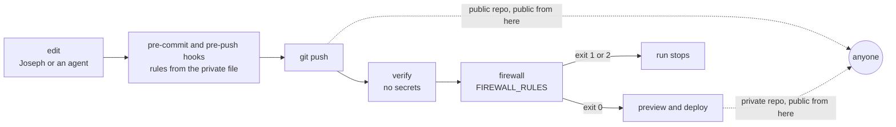

# Security

What this site protects, from whom, and how. This doc covers the threat model, response headers and the Content Security Policy (CSP), zone hardening, mail, secrets, the mechanism of the content firewall, commit identities, the supply chain, visitors' data and account continuity. The firewall policy (what it protects and why) is in [product.md](product.md). The decisions that are hard to reverse are ADRs: [0007](adr/0007-content-firewall.md) (firewall), [0011](adr/0011-dnssec-and-hsts-ramp.md) (DNSSEC and HSTS) and [0012](adr/0012-public-repository.md) (repository visibility). Every price, limit and version here is as of 2026-10-22.

Status: Draft for review in PR 1 · 2026-10-22

## Threat model

Scope: the static site, the repository and its pipeline, the domain, and the two accounts that control them. Lab internals (admission, budgets, the kill switch) are in [lab.md](lab.md), and money is in [cost.md](cost.md).

### Assets

| Asset | Why it matters | Where it lives |
|---|---|---|
| The domain `ihaveasegway.com` | Every link Joseph hands out points at it. Whoever controls it publishes in his name. | Cloudflare Registrar and Cloudflare DNS, in one account |
| The Cloudflare account | It controls registration, DNS, certificates and every Worker. Taking the account is taking the domain. | Cloudflare |
| The GitHub repository | It holds the source and the pipeline. Whatever reaches `main` deploys. | `IHaveASegway/website` |
| The deploy token | It can replace what the site serves. | Actions secret `CLOUDFLARE_API_TOKEN` |
| The firewall rules | The list of terms that must never appear. It grants no access. Publishing it is the leak it exists to prevent. | A private file and two GitHub secrets ([Content firewall design](#content-firewall-design)) |
| Joseph's privacy and reputation | The site speaks in his name. A defacement, an employer detail or a spoofed email from the domain costs the trust the site exists to build. | All of the above |
| Visitors' data | Small today (a theme choice); larger once the lab ships. | [Privacy and data inventory](#privacy-and-data-inventory) |

### Actors

- **Joseph, by mistake.** The likeliest source of a content leak, and the only admin.
- **AI coding agents** working in the repo. They make the same mistakes, faster. They can skip hooks, and they write commit metadata.
- **Opportunistic attackers**: phishing, password reuse, poisoned packages and Actions, scanners. None of it needs anyone to target Joseph.
- **Abusers of lab endpoints**, who spend quota or money (denial of wallet).
- **Readers Joseph does not choose.** Every page, and once the repo is public every commit, can be read by anyone, including people he works with. They are an audience, not attackers, and the firewall is designed around them.

Out of scope: an insider at Cloudflare or GitHub, legal compulsion, and targeted attacks on Joseph's devices beyond the account controls below.

### Threats

| Threat | How it happens | Mitigation | Residual risk |
|---|---|---|---|
| Account takeover (Cloudflare or GitHub) | A phished or reused password, a SIM swap, a work email that stops working | Hardware-key 2FA with no SMS fallback, unique passwords from a password manager, recovery codes offline, a personal email as primary on both accounts ([Account continuity](#account-continuity)) | Malware on Joseph's laptop can steal a signed-in session, and 2FA does not stop that. One account controls registrar, DNS and hosting. |
| Deploy token leak | Committed by mistake, printed in a log, or read by a compromised action or package in a job that holds it | An account-owned token: 4 permissions, 1 zone, a 12-month expiry. It sits only in the `env:` of the 6 steps that call Cloudflare, in the `preview`, `preview-cleanup`, `deploy` and `rollback` jobs, none of which restores a shared cache ([delivery.md](delivery.md)). No Global API Key anywhere ([Secrets inventory](#secrets-inventory)). Once the repo is public, GitHub push protection blocks all 3 Cloudflare credential formats and reports leaked ones to Cloudflare ([supported patterns](https://docs.github.com/en/code-security/reference/secret-security/supported-secret-scanning-patterns)) | Until it is revoked, the token can publish anything at `ihaveasegway.com`, because it can deploy Workers and add routes on the zone. prod-smoke notices a changed home page, not a quiet extra route. |
| Firewall rules leak | A report or log prints a match; a debug file is committed | Logs carry rule id, file, line and commit only; `--redact`; temp files in `$RUNNER_TEMP`, removed by `trap`; no artifacts from the firewall job ([Logging rules](#logging-rules)) | GitHub's log redaction "largely relies on finding an exact match", "is not guaranteed", and can fail for structured data, which the TOML rules are ([GitHub](https://docs.github.com/en/actions/reference/security/secure-use)). A derived form (lowercased, split across lines) is never masked. Hence no match is ever printed. |
| Supply chain: GitHub Actions | A maintainer's tag is moved to malicious code that runs in a job with secrets (tj-actions/changed-files, CVE-2025-30066) | An allowed-actions list; jobs that hold secrets run only GitHub-created actions and pnpm/action-setup; step-scoped secrets ([Supply chain](#supply-chain)) | Tags stay mutable, by choice, and a moved tag arrives with no Dependabot PR, so no cooldown applies. A compromise of a GitHub-created action or of pnpm/action-setup reaches the token. Since 2026-10-25 the repository and its Actions logs are public, so a moved tag that prints the token publishes it, as in the tj-actions case; accepted with the tag preference, and the first thing to change (SHA pins on pnpm/action-setup in the jobs that hold the token) if it stops being acceptable. |
| Supply chain: npm | A malicious version of a dependency runs an install script or ships build-time code | Frozen lockfile; pnpm `minimumReleaseAge` (1 day) and `allowBuilds`; Dependabot cooldown (3 days, 14 for majors); the build runs in `verify`, which holds no secrets | A malicious version older than the cooldown. Wrangler runs with the token because it is the deploy tool. Build-time code can still change the built pages. |
| Content leak by accident | Joseph or an agent writes an identifying name or detail into a file, a commit, a PR, an image or a built page | The content firewall (local hooks, plus a CI job that fails closed), the identity allowlist, the PR checklist, metadata stripping for images ([Content firewall design](#content-firewall-design)) | Paraphrase, and combinations of harmless facts (the mosaic effect), pass any regex. On a public repo, content is public at `git push`, before CI runs ([ADR 0012](adr/0012-public-repository.md)). |
| Script injection and CSP gaps | Injected script through content, a dependency, or an edge feature that rewrites HTML | No visitor input is rendered on content pages; a hash-based CSP with no `'unsafe-inline'` for scripts; HTML-rewriting zone features off; e2e fails on any CSP violation ([Headers and CSP](#headers-and-content-security-policy)) | From the first code block, `style-src-attr 'unsafe-inline'` (for Expressive Code) allows style attributes. The Web Analytics beacon is a Cloudflare-hosted script without Subresource Integrity, because it is served from one unversioned URL. |
| Cross-site WebSocket hijacking (Phase 4) | A hostile page opens a WebSocket to `/lab/api/`. The browser attaches the visitor's cookie, and upgrades ignore CORS. | An exact `Origin` check against `https://ihaveasegway.com` on every upgrade; the session cookie is `Path=/lab/api; HttpOnly; Secure; SameSite=Strict`; no free text from visitors in v1 ([OWASP](https://cheatsheetseries.owasp.org/cheatsheets/WebSocket_Security_Cheat_Sheet.html)) | `SameSite` treats subdomains as same-site, so a forgotten subdomain record would sit inside the boundary. The quarterly zone export lists every record. |
| Denial of wallet | Floods or loops against `/lab/api/*` spend quota or money | Workers Free, where operations fail instead of billing ([ADR 0008](adr/0008-workers-free-with-guardrails.md)); admission control and a recorded fallback ([lab.md](lab.md)); page views run no Worker code | The Free daily caps are per account, so an abuser can push every demo into recorded mode until 00:00 UTC. On Workers Paid, budget alerts arrive a day late ([cost.md](cost.md)). |
| DNS hijack | A transfer away, a DNS edit through a taken-over account, or forged resolver answers | Registrar lock, 2FA, DNSSEC, a weekly token-free audit ([Zone hardening checklist](#zone-hardening-checklist)) | DNSSEC protects answers in transit, not the account: whoever holds the account holds the signing keys. |
| Mail spoofing | Someone sends mail with a `From:` address at the domain, for example to phish recruiters | DMARC `p=reject` with SPF, and DKIM under Email Routing ([Mail posture](#mail-posture)) | Lookalike domains; receivers that ignore DMARC. |
| Drafts on public previews | A PR preview is public on workers.dev, and its URL shows up in PR comments and link unfurls | The firewall job runs before the preview job; a draft's page is `noindex` and says Draft, has no card or JSON-LD, and nothing lists it, the sitemap and the feed included; no page but a draft links a draft, at any post count, so no published post does (`test/urls.test.ts` checks every build by the Draft label); a production build never holds one: `pnpm build` excludes drafts by construction, the tests hold `dist/` to that whatever `DRAFTS` says, and the deploy job refuses an artifact with any `noindex` page but the 404, with `scripts/deploy-guard.mjs` and its known answers ([content.md](content.md), "Drafts"); `X-Robots-Tag: noindex`, which the preview job checks before it posts the link; previews are deleted when the PR closes; the account's workers.dev subdomain, public from the first preview comment, and the Worker names are checked once to name nothing private, and no other Worker in the account answers on that subdomain: each has workers.dev and Version URLs off, or moves to its own account | Anyone holding the URL can read the preview while the PR is open. The escalation is Cloudflare Access in front of previews, which means CI needs an Access service token. |
| Unreviewed change to `main` | A push to `main` deploys what it holds, and GitHub Free cannot protect a branch on a private repo | Deploy jobs `needs:` verify and firewall; the pre-push hook refuses `main`; a ruleset with required checks once the repo is public ([ADR 0006](adr/0006-github-actions-owns-deploys.md)) | Joseph is the only admin and can skip the hook with `--no-verify`. |

## Headers and Content Security Policy

The rule is **one owner per directive**. When a page has two policies, the browser enforces both, and each can only restrict further ([MDN](https://developer.mozilla.org/en-US/docs/Web/HTTP/Reference/Headers/Content-Security-Policy)). A second owner for `script-src` adds no safety. It blocks the first owner's hashes.

| Header or directive | Owner | Value | Why |
|---|---|---|---|
| `script-src` | Astro's CSP (`security.csp`), a `<meta>` tag with hashes | `'self'` plus SHA-256 hashes, and nothing else: from PR 3, the pre-paint theme script's, and Astro's own (below). No host, no scheme, no `'unsafe-inline'` or `'unsafe-eval'` | No `'unsafe-inline'`, so an injected inline script does not run. The theme script runs before the `<meta>` and is the one exception (below) |
| `style-src`, `style-src-attr` | Astro's CSP | `style-src 'self'` plus hashes only: from PR 3, the two `<style>` elements the Fonts API writes, and Astro's own. `style-src-attr 'unsafe-inline'` from the first code block. Nothing needs it yet, and Astro's own syntax highlighting is off | Expressive Code colors tokens through `style` attributes. Hashes cannot allow attributes without `'unsafe-hashes'`, and `'unsafe-inline'` in `style-src` would make Astro drop its style hashes. Scoping it to `-attr` keeps `<style>` elements hash-only. |
| `default-src`, `img-src`, `font-src`, `connect-src`, `object-src`, `base-uri`, `form-action` | Astro's CSP (`security.csp.directives`) | `'self'`, except `object-src 'none'` and `base-uri 'none'`. `img-src` has no `data:`, because nothing uses it | The whole page policy lives in one file, and the build tests it |
| `frame-ancestors` | `apps/web/public/_headers`, as a `Content-Security-Policy` header | `'none'` | A `<meta>` policy cannot carry it ([MDN](https://developer.mozilla.org/en-US/docs/Web/HTTP/Reference/Headers/Content-Security-Policy/frame-ancestors)). Nothing frames this site. |
| `worker-src` on `/lab/routes/` | Astro's CSP, per page (`Astro.csp.insertDirective()` in `pages/lab/[demo].astro`) | `'self'` | The one page that starts a worker names where one may come from. It allows nothing `script-src 'self'` does not, and keeps a later `script-src` host from also becoming a worker source ([ADR 0016](adr/0016-route-lab-in-the-browser.md)) |
| The whole policy of the Route Lab's solver worker, `/lab/routes/solver/*` | `_headers`, as a second `Content-Security-Policy` header beside `/*`'s | `default-src 'none'; script-src 'self' 'wasm-unsafe-eval'; connect-src 'self'` | A dedicated worker takes its policy from its own response, never from the page that starts it, and compiling WebAssembly needs `'wasm-unsafe-eval'`. A worker is its own context, so this owner does not compete with Astro's: within each context, one owner per directive still holds. It is the one `script-src` a header sends and the one place the keyword appears ([ADR 0016](adr/0016-route-lab-in-the-browser.md)) |
| `X-Content-Type-Options` | `_headers` | `nosniff` | Browsers use the declared type and never guess |
| `Referrer-Policy` | `_headers` | `strict-origin-when-cross-origin` | Outbound links send only the origin. GitHub's traffic insights still list the site as a referrer. |
| `Permissions-Policy` | `_headers` | `camera=(), microphone=(), geolocation=(), payment=(), usb=()` | Turns off features no page uses |
| `Cross-Origin-Opener-Policy` | `_headers` | `same-origin` | A cross-origin window gets no handle on these pages through `window.opener` |
| `Strict-Transport-Security` | The zone setting, nowhere else | Ramped to `max-age=31536000; includeSubDomains` | One owner for every response through the zone ([ADR 0011](adr/0011-dnssec-and-hsts-ramp.md)) |

Never sent:

- `X-XSS-Protection: 1`. The [OWASP HTTP Headers Cheat Sheet](https://cheatsheetseries.owasp.org/cheatsheets/HTTP_Headers_Cheat_Sheet.html): "Do not set this header or explicitly turn it off."
- `Expect-CT`. OWASP: "Do not use it."
- `X-Frame-Options`, by choice rather than by OWASP. OWASP's first advice is "Use Content Security Policy (CSP) frame-ancestors directive if possible", but its example still sends `X-Frame-Options: DENY`. CSP Level 3 tells a browser to ignore `X-Frame-Options` when an enforced policy carries `frame-ancestors` ([CSP Level 3](https://www.w3.org/TR/CSP3/#frame-ancestors-and-frame-options)), so the header would matter only to browsers older than `frame-ancestors`, such as Internet Explorer, which Microsoft retired in 2022. Sending both costs one line and adds a second owner for the same rule. Two-way; revisit if an auditor or a browser still in use needs the header.

That rules out Cloudflare's "Add security headers" managed transform. As of 2026-10-22 it adds five headers: `x-content-type-options: nosniff`, `x-xss-protection: 1; mode=block`, `x-frame-options: SAMEORIGIN`, `referrer-policy: same-origin` and `expect-ct: max-age=86400, enforce` ([Cloudflare](https://developers.cloudflare.com/rules/transform/managed-transforms/reference/)). Three are on the list above, and the other two would be second owners of headers that `_headers` already sends, one with a different value.

```js
// apps/web/astro.config.mjs, CSP part, as PR 3 ships it. The commented line arrives with its feature.
const themeScript = readFileSync(new URL('./src/scripts/theme.js', import.meta.url), 'utf8');
const themeHash = `sha256-${createHash('sha256').update(themeScript).digest('base64')}`;

export default defineConfig({
  build: { format: 'directory', inlineStylesheets: 'never' }, // an inlined <style> would need a hash
  markdown: { syntaxHighlight: false }, // Shiki's inline styles would need style-src-attr
  security: {
    csp: {
      algorithm: 'SHA-256',
      directives: [
        "default-src 'self'",
        "img-src 'self'",
        "font-src 'self'",
        "connect-src 'self'",
        "object-src 'none'",
        "base-uri 'none'",
        "form-action 'self'",
      ],
      // The theme script. The layout inlines this exact file, and the hash is computed from it, so
      // the two cannot drift.
      scriptDirective: { hashes: [themeHash] },
      // The first code block (Expressive Code). kind: 'attribute' puts the source in style-src-attr
      // only (Astro 7.1 and later):
      // styleDirective: { resources: ["'self'", { resource: "'unsafe-inline'", kind: 'attribute' }] },
    },
  },
});
```

```text
# apps/web/public/_headers, security part (sketch — confirm against current docs when building)
/*
  Content-Security-Policy: frame-ancestors 'none'
  X-Content-Type-Options: nosniff
  Referrer-Policy: strict-origin-when-cross-origin
  Permissions-Policy: camera=(), microphone=(), geolocation=(), payment=(), usb=()
  Cross-Origin-Opener-Policy: same-origin
```

The `kind` field (Astro 7.1 and later) and Astro's rule that a directive listing `'unsafe-inline'` gets no hashes both come from its [configuration reference](https://docs.astro.build/en/reference/configuration-reference/), as of 2026-10-22. Cache headers in the same file belong to [delivery.md](delivery.md).

Astro also writes hashes of its own into the policy: 5 in `script-src`, one for each of its `client:*` directive loaders, and 1 in `style-src`, for an empty style. No page includes those scripts, and they cannot be configured off ([`core/csp/common.ts`](https://github.com/withastro/astro/blob/astro%407.4.2/packages/astro/src/core/csp/common.ts), Astro 7.4.2, as of 2026-10-23). They allow nothing on these pages, and the e2e known-answer test shows that an injected inline script is still refused. As counted in PR 3's build on 2026-10-23, every page's `script-src` holds 6 hashes (the theme script and Astro's 5) and its `style-src` 3 (the Fonts API's 2 `<style>` elements and Astro's 1).

**Why a `<meta>` policy.** Three ways to deliver the page policy:

| Option | What allows the inline theme script | What it trades | Verdict |
|---|---|---|---|
| Astro's `<meta>` policy with build-time hashes, plus `_headers` for what a `<meta>` cannot carry | A hash per script, computed at build | Keeps security (no `'unsafe-inline'`) and cost (no Worker on a page view). Gives up violation reports: CSP Level 3 excludes Report-Only, `report-uri`, `frame-ancestors` and `sandbox` from `<meta>` ([CSP Level 3](https://www.w3.org/TR/CSP3/)) | Chosen |
| One hand-kept policy in `_headers` for every page | `'unsafe-inline'`, because a static file cannot track per-page hashes | Simpler to operate, weaker: any injected inline script runs | Rejected |
| A nonce minted per request | A Worker on every page view | As strong as hashes, but every page view becomes a Worker invocation against the Free plan's daily cap, which undoes the bulkhead ([ADR 0008](adr/0008-workers-free-with-guardrails.md)) | Rejected |
| The same hashes, sent as a header: a build step writes the policy, with the hashes the build computed, into `dist/_headers` | A hash per script, as above | A header applies before the first byte of markup, so it would govern the theme script too (below), and `frame-ancestors` would join the one policy. Costs a build step that owns the policy instead of Astro's config, which means turning Astro's `<meta>` off so the two never both apply, and a check that the header and the pages agree | The end state; not yet (below) |

Two-way: it is configuration. Revisit if violation reports become worth collecting, which needs a header policy and an endpoint, or if Astro can write per-page hashes into headers for static output.

**The theme script, from PR 3.** The theme follows the OS until the visitor presses the toggle, and the choice is then stored for the tab in `sessionStorage` (in `localStorage` until 2026-10-24; [design-system.md](design-system.md#theme-before-first-paint)). The script carries no comments, since every visitor downloads it as written. A small inline script applies it before first paint; loaded as a separate file, it would flash the wrong theme. Astro does not hash `is:inline` scripts ([ADR 0003](adr/0003-astro-static-first.md)), so the config adds the hash. Because the hash is computed at build time from the file the layout inlines, an edit cannot leave a stale hash behind.

**Where it runs, and what that costs.** The script runs in `<head>`, before any stylesheet, so no frame can paint before a stored choice applies. PR 3 first put it after the policy, as the first child of `<body>`, and the first Worker Preview showed one frame painting before it ran when the HTML arrived in pieces. Astro writes its `<meta>` at the end of `<head>`, and a `<meta>` policy covers only what follows it ([CSP Level 3](https://www.w3.org/TR/CSP3/)). So this one script runs before the policy and is not governed by it. It is ours and generated at build, not input from anywhere, and everything after the `<meta>` stays governed. Two checks bound the exception:

- `test/csp.test.ts` allows exactly one script before the policy, and it must be byte for byte the file `astro.config.mjs` hashes. A second script there, or a changed byte, fails the build.
- An e2e test places a copy of the theme script with one byte changed after the policy, and requires the browser to refuse it and report the violation: proof that the policy checks hashes, not merely that it exists.

**The alternative, and why not now.** Sending the policy as a header (the last row above) would cover the theme script as well, because a header applies before the document is parsed, and it would bring `frame-ancestors` into the one policy. It needs a build step to own the policy, Astro's `<meta>` turned off, and a check that the two cannot both apply. That is a change to the policy's owner, with its own tests, so it does not ride in PR 3: the exception is one known script, pinned by the two checks above. Revisit it in PR 3b, which adds the first third-party origin (the Web Analytics beacon), or when anything other than the theme script needs to run before the `<meta>`.

**Enforced from the first deploy, with no Report-Only phase.** Report-Only is how an existing site with unknown inline code adopts CSP: collect reports, fix, then enforce. This site has no history, and every preview serves the exact bytes that will deploy, so e2e sees each violation before production does. A `<meta>` policy cannot be Report-Only anyway (above).

**What CI checks.** [delivery.md](delivery.md) owns the jobs; the rules are these:

- `verify` reads the built policy on every page (`test/csp.test.ts`): the directive set is exactly the one above, with `worker-src 'self'` on the Route Lab's page and nowhere else; `script-src` and `style-src` hold only `'self'` and SHA-256 hashes, with no host, scheme, `'unsafe-inline'` or `'unsafe-eval'`; the theme script's hash matches the file the page inlines; every inline `<style>` is hashed; no element carries a `style` attribute, which the policy would refuse; and the `<meta>` comes before every script but the theme script.
- `verify` also scans the markup and CSS for anything the browser would fetch from another origin, such as a preconnect, prefetch, preload, script or `url()`. The policy cannot stop all of those (it governs only what follows its `<meta>`, and no directive stops a preconnect), so the scan does, with known answers.
- e2e, against the preview, collects `securitypolicyviolation` events and CSP console messages on every page in the smoke set and on the 404. One is a failure. A known-answer test injects an inline script and requires the browser to refuse it, so a missing or loose policy cannot pass for the wrong reason; a second one refuses a theme script with one byte changed, placed after the policy. e2e also asserts the `_headers` values on a page, an asset and the 404. With no preview, it runs against `wrangler dev` serving the same `dist/`, which applies every `_headers` rule.
- From PR 5 the same `verify` checks run on `dist-preview/` and on three test-only builds with posts in them, and e2e runs its CSP, request and page checks on their posts and indexes (`pnpm e2e:writing`), so the post layout and the feed meet the policy before a real post ships. The feed and the post pages load nothing new: no script, no style and no host.
- e2e watches every request each page makes and fails if one leaves the site's origin. A known answer removes the policy, adds a foreign image, and requires the watcher to see it. The Web Analytics beacon's exact path joins this check in the change that ships it (PR 3b).
- Previews are served from workers.dev, so they never pass through the zone ([delivery.md](delivery.md)). prod-smoke and the weekly audit request the production hostname, which does. They assert that HSTS is at a step of the ramp, with `includeSubDomains` and without `preload`, and the absence of `X-XSS-Protection`, `Expect-CT` and `X-Frame-Options`. prod-smoke also compares the served HTML of its pages with the artifact it just deployed, byte for byte, in the run attempt that promoted it; the weekly audit holds no artifact, so it looks for injected `/cdn-cgi/` scripts instead. That is what catches a zone feature switched on in the dashboard, such as the managed transform or Email Address Obfuscation. The weekly audit also names the step the zone serves, and warns once the date the maintenance calendar records for the next step has passed, or when none is recorded ([operations.md](operations.md#hsts-ramp-step)). A warning never fails a job: a stalled ramp is noticed and blocks no deploy.

**Lab Worker responses.** `_headers` applies to static-asset responses only, never to responses a Worker generates ([Cloudflare](https://developers.cloudflare.com/workers/static-assets/headers/)). When the lab ships in Phase 4, `packages/security-headers` becomes the one source. It writes `_headers`, which stays committed, and `verify` fails if the committed file differs from what it writes ([delivery.md](delivery.md)). It also exports the function the lab Worker wraps every response with, and a unit test asserts that both carry the same values. API responses are not documents, so their policy is `default-src 'none'; frame-ancestors 'none'`. HSTS stays with the zone. The weekly audit checks that the zone's header also reaches a `/lab/api/` response; if it does not, the shared function adds HSTS to Worker responses only.

**CSP additions, by feature:**

| Feature | Adds | On | From |
|---|---|---|---|
| Cloudflare Web Analytics, manual beacon | `script-src https://static.cloudflareinsights.com`; `connect-src https://cloudflareinsights.com` | Every page | PR 3b |
| Turnstile | `script-src` and `frame-src https://challenges.cloudflare.com` ([Cloudflare](https://developers.cloudflare.com/turnstile/reference/content-security-policy/)) | Lab pages only | Phase 4 |
| A live lab connection | Nothing. `connect-src 'self'` already covers the same-host `wss:` socket. MDN still warns that some browsers disagree, but WebKit, the last engine to differ, fixed it on 2022-04-02 ([bug 235873](https://bugs.webkit.org/show_bug.cgi?id=235873)), and a live-socket test in Playwright's WebKit project keeps it checked ([lab.md](lab.md)). | Lab pages | Phase 4 |
| A demo that runs WebAssembly in a worker (the Route Lab, 2026-10-25) | `'wasm-unsafe-eval'` in the worker's own response header, not in the page's policy; `worker-src 'self'` in the page's | The solver's folder; `/lab/routes/` | [ADR 0016](adr/0016-route-lab-in-the-browser.md) |

Lab-only additions go through Astro's per-page CSP API (`Astro.csp.insertDirective()`, `insertScriptResource()` and their siblings, since Astro 6.0, per the [API reference](https://docs.astro.build/en/reference/api-reference/) as of 2026-10-22), so content pages never carry the extra origins. The calls apply to prerendered pages: the Route Lab's `worker-src` reaches its `<meta>` (2026-10-25, Astro 7.4.2), and `test/csp.test.ts` holds it to that page alone.

**WebAssembly in a worker, measured.** This table first planned `'wasm-unsafe-eval'` in the page's policy. The browser says otherwise: in Chromium through `wrangler dev` (2026-10-25), a module worker compiled the solver when its own response allowed `'wasm-unsafe-eval'`, whatever the page's policy held, and failed with "violates ... script-src 'self'" when its response did not, even with the keyword in the page's policy. That is the HTML standard's rule for a dedicated worker loaded from a URL. So the keyword lives in `_headers`, on the solver's folder, and no page's policy may hold it. Firefox and WebKit were not measured; a browser that behaved otherwise would fail safe, keeping the plan worked out at build. Checked by `test/headers-rules.test.ts` (exactly one rule sends a `script-src`, the solver's, with exactly that policy, and no rule sends an `'unsafe-*'` source), by `test/csp.test.ts` (no page's `script-src` holds `'wasm-unsafe-eval'`), by `e2e/headers.spec.ts` (each solver file arrives with both policies, its type and a year's cache) and by `e2e/lab.spec.ts`, whose known answer serves the worker without the keyword and requires the page's failure line.

## Zone hardening checklist

The zone's settings live in the Cloudflare dashboard. This table is the target, and `scripts/verify-zone.sh` checks it every week without a Cloudflare token (DNS over HTTPS, RDAP, `curl`, `openssl`). Its DNS questions go to `dns.google`, so a validating resolver outside the zone's own DNS host checks the signatures, as most visitors' resolvers do. Zone config moves to code (OpenTofu) only when a trigger in [operations.md](operations.md) fires. "As found" comes from a read-only API session and the public RDAP record on 2026-10-22; "not read" means the session did not record it.

| # | Item | As found 2026-10-22 | Target | Why | How to verify without a token | Door |
|---|---|---|---|---|---|---|
| 1 | Registrar lock | On | On | A transfer moves the domain out of Joseph's control | RDAP `status` includes `client transfer prohibited` | Two-way |
| 2 | Auto-renew | On; expires 2027-10-18 | On; the primary card is valid on 2027-09-18 | Cloudflare first tries to renew about 30 days before expiry, with the primary payment method only, then allows 40 days of grace ([FAQ](https://developers.cloudflare.com/registrar/faq/)) | RDAP `expiration` date; the weekly job warns under 60 days | Two-way |
| 3 | WHOIS privacy | Redaction on: name, street, city and postal code redacted; the phone is the registrar's proxy; the state is published | Only what Q5 · Q-location in [product.md](product.md) allows. Hiding the state would take a registrar with a privacy or proxy service, which means a transfer ([stack.md](stack.md) covers the registrar), so it is a consequence of Q5, not a setting | Anyone can read the registrant record, and each location field in it adds to the mosaic effect | The registrar's RDAP registrant record shows only redacted street, city and postal code, plus the state. `scripts/verify-zone.sh` fails if the street, city, postal code or the address label (where a registrar can put the whole formatted address) ever appears unredacted | Two-way |
| 4 | DNSSEC | Off | On: one click; the DS record reaches the registry through CDS/CDNSKEY in 1–2 days ([Cloudflare](https://developers.cloudflare.com/registrar/get-started/enable-dnssec/)) | Forged DNS answers fail validation | A DS record over DNS over HTTPS, and `"AD": true` on answers; RDAP `delegationSigned: true` | Near one-way ([ADR 0011](adr/0011-dnssec-and-hsts-ramp.md)) |
| 5 | Minimum TLS version | 1.0 | 1.2 | TLS 1.0 and 1.1 are deprecated ([RFC 8996](https://www.rfc-editor.org/rfc/rfc8996.html)) | A TLS 1.1 handshake fails and a TLS 1.2 one succeeds. OpenSSL 3 refuses to offer TLS 1.1 at its default security level, so the test passes `-cipher 'DEFAULT:@SECLEVEL=0'`; without it the check passes against any server. A refusal counts only when the same client negotiates TLS 1.1 with `example.com` and the zone completes TLS 1.2 with a certificate valid for its name. | Two-way |
| 6 | TLS 1.3 | Not read | On | Fewer round trips; no legacy cipher suites | `openssl s_client -tls1_3` completes, with a certificate valid for the hostname at the default security level | Two-way |
| 7 | Always Use HTTPS | Off | On | Nothing is served over plain HTTP | `curl -sI http://ihaveasegway.com/` returns a 301 to `https://` | Two-way |
| 8 | HSTS | Off | Zone only. Ramp 300 s → 1 week → 1 month → 12 months, with `includeSubDomains`; preload deferred. The setting's No-Sniff option stays off, because `_headers` owns `nosniff` | Browsers refuse plain HTTP for the max-age | `curl -sI https://ihaveasegway.com/` shows the planned max-age; from Phase 4, also a `/lab/api/` response. Row 8b names the step and warns, never fails, when the next one is overdue by the maintenance calendar | Each served max-age is one-way for its duration; preload near one-way ([ADR 0011](adr/0011-dnssec-and-hsts-ramp.md)) |
| 9 | SSL/TLS encryption mode | Full | Full (strict) | No origin exists today. Strict is the safe default if a proxied origin is ever added. | Not observable without an origin: the audit prints SKIP, and the setting is read in the dashboard | Two-way |
| 10 | HTML rewriting: Email Address Obfuscation, Rocket Loader, Automatic HTTPS Rewrites | Obfuscation on; the others not read | All off | They change the served bytes after CI tested them, and Obfuscation injects a script the CSP does not allow ([Cloudflare](https://developers.cloudflare.com/waf/tools/scrape-shield/email-address-obfuscation/)) | Served HTML has no `/cdn-cgi/` script; in prod-smoke it also equals the deployed artifact byte for byte | Two-way |
| 11 | "Add security headers" managed transform | Not read | Off | It sends `X-XSS-Protection: 1; mode=block` and `Expect-CT`, which OWASP says not to send | `curl -sI` shows neither header | Two-way |
| 12 | Bot Fight Mode | Off | Off | "You cannot bypass or skip Bot Fight Mode using WAF custom rules or Page Rules", and its JavaScript detections "cannot be disabled" ([Cloudflare](https://developers.cloudflare.com/bots/get-started/bot-fight-mode/)). A link-preview crawler or a WebSocket client cannot solve a challenge, so one false positive breaks an unfurl or a live demo, with no rule to exempt it | Served HTML has no `/cdn-cgi/challenge-platform/` script (the same check as row 10). It decides by bot scoring, so a faked user agent proves nothing. | Two-way |
| 13 | AI crawlers | Blocking off | Allowed (recommended; Q15 · Q-ai-crawlers in [product.md](product.md)) | Recruiters use AI search | `robots.txt` carries no Cloudflare-managed AI block. Blocking keys on verified crawlers, so the setting itself is read in the dashboard, quarterly. | Two-way |
| 14 | CAA records | None | None at launch | Custom Domains use Advanced Certificates, for which Cloudflare adds no CAA records automatically, so a lone record could block issuance or renewal ([Cloudflare](https://developers.cloudflare.com/ssl/edge-certificates/caa-records/)) | A CAA query over DNS over HTTPS gets an answer (NOERROR or NXDOMAIN) that holds no CAA record. A failed lookup fails the row | Two-way |
| 15 | Canonical host | 0 DNS records | The apex on the Workers Custom Domain; `www` → apex 301 through a proxied placeholder (AAAA `100::`) and 1 Single Redirect | One origin for links, cookies and CSP | `curl -sI https://www.ihaveasegway.com/a/?b=1` returns a 301 to the apex with path and query kept | Two-way |
| 16 | Mail records | None | Per Q2 · Q-mail ([Mail posture](#mail-posture)) | Nobody can send mail as the domain | MX, TXT and `_dmarc` TXT over DNS over HTTPS, and a DKIM record that publishes a key: an empty `p=` is a revoked one | Two-way, bounded by TTL |
| 17 | `security.txt` | No site yet | `/.well-known/security.txt` with `Contact` and an `Expires` under a year out, served as `text/plain; charset=utf-8` ([RFC 9116](https://www.rfc-editor.org/rfc/rfc9116.html), section 3). Production's asset server sends no charset of its own, so `_headers` sets the type | A reporter knows where to write | The weekly job fails when `Expires` is under 30 days away | Two-way |
| 18 | Site Worker on workers.dev | No Worker yet | `workers_dev: false`, `preview_urls: true` | One public origin; previews stay on workers.dev with `noindex` | A check in `verify` reads `wrangler.jsonc`; the audit prints SKIP | Two-way |

**State on 2026-10-23.** Read back through the API that day: minimum TLS 1.2; TLS 1.3 on; Always Use HTTPS on; SSL/TLS mode Full (strict); HSTS on at the ramp's first step, max-age 300 with `includeSubDomains`, preload off and the setting's No-Sniff off; Email Address Obfuscation, Rocket Loader and Automatic HTTPS Rewrites off; no Managed Transforms on. DNSSEC reads "pending": the DS record has not reached the registry, so rows 4a to 4c of the audit fail until it does. Set up on 2026-10-22: the `www` placeholder (AAAA `100::`, proxied) with a Single Redirect to the apex (301, path and query kept), and Email Routing for `hello@`, with its MX, SPF and DKIM records and DMARC `p=reject`. The "As found" column keeps what was found before these changes. Bots, read back the same day: Bot Fight Mode off; Cloudflare's AI-crawler blocking off in every category (training, search and user agents), AI Labyrinth off, and its managed `robots.txt` off, so `robots.txt` is served byte for byte as committed; Browser Integrity Check on and the security level medium, both defaults; no WAF custom rule. Fetched from an ordinary address with the user agents of Googlebot, Bingbot, GPTBot, ClaudeBot, PerplexityBot, Applebot, CCBot, LinkedInBot and Slackbot, Home answered 200 with the bytes a browser gets. Verified crawlers skip those checks anyway, so rows 12 and 13 hold for crawlers, not only for `robots.txt`. DNSSEC still read "pending" at 04:11 UTC; Cloudflare is the registrar, so it publishes the DS record itself.

Later, in Phase 4: the pre-built, disabled WAF custom rule that blocks `/lab/api/` (the kill switch) and the zone's one rate-limiting rule ([lab.md](lab.md)).

```sh
# scripts/verify-zone.sh, excerpt. One line per check (PASS, FAIL, SKIP for what cannot be seen
# from outside, or WARN for a late ramp step); any FAIL exits 1.
ZONE="${ZONE:-ihaveasegway.com}"   # overridable only to test the script against another domain
DOH="https://dns.google/resolve"   # a validating resolver outside the zone's own DNS host
answer() {   # the resolver's JSON, only when the lookup worked: NOERROR or NXDOMAIN, never SERVFAIL
  curl -fsS --max-time 15 -H 'accept: application/dns-json' "$DOH?name=$1&type=$2" |
    jq -e 'select(.Status == 0 or .Status == 3)'
}
check 4a "DNSSEC: a DS record is published at the parent" test -n "$(records "$ZONE" DS)"
caa_absent() { answer "$ZONE" CAA | jq -e '[.Answer // [] | .[] | select(.type == 257)] | length == 0'; }
check 14 "no CAA record" caa_absent   # a failed lookup is not "no record"

# A handshake counts only when s_client exits 0: a failed one still prints the protocol it tried.
tls12="$(protocol "$ZONE" -tls1_2)"   # row 5a: TLS 1.2, with a certificate valid for the name
legacy() { handshake "$1" -tls1_1 -cipher 'DEFAULT:@SECLEVEL=0'; }   # no TLS 1.1 offer without the flag
if [ "$(legacy example.com)" != TLSv1.1 ]; then fail 5b "this client cannot offer TLS 1.1: a refusal would prove nothing"
elif [ "$tls12" != TLSv1.2 ]; then fail 5b "the zone does not answer over TLS: a refusal would prove nothing"
elif [ "$(legacy "$ZONE")" = TLSv1.1 ]; then fail 5b "the zone accepted TLS 1.1"
else pass 5b "the zone refuses TLS 1.1"; fi
```

The cipher flag on the TLS line is the firewall canary's lesson again: a check that cannot fail proves nothing. Measured on 2026-10-22 with OpenSSL 3.6.3, `-tls1_1` alone failed inside the client ("no protocols available") before any server was asked, so the check would have passed against every server. With the flag, the same client negotiated TLS 1.1 with `example.com` and `cloudflare.com`. That is the known answer: the client can offer TLS 1.1, so a refusal comes from the server. The script asks it on every run, together with a second one: the zone must complete TLS 1.2 with a valid certificate, or a refusal of TLS 1.1 proves nothing either. Building PR 2 also showed that OpenSSL 3.6 prints "Protocol: TLSv1.1" even when the handshake fails, so every probe reads `s_client`'s exit status, never its output. Rows 5a and 6 check the certificate and the hostname at the default security level; only the TLS 1.1 offer drops to level 0.

## Mail posture

Q2 · Q-mail chose A on 2026-10-22 ([product.md](product.md#decided)), and its records were set up that day ([zone checklist](#zone-hardening-checklist)). The two postures cannot coexist: "A domain that advertises a null MX MUST NOT advertise any other MX RR" ([RFC 7505](https://www.rfc-editor.org/rfc/rfc7505.html), section 3), and Email Routing needs its own MX records.

| | A. Receive-only inbox (recommended) | B. Never sends, never receives |
|---|---|---|
| Public contact | `hello@ihaveasegway.com` | None on the domain: a contact form later (Turnstile and a Worker), or GitHub and LinkedIn |
| MX | `route1`, `route2` and `route3.mx.cloudflare.net`, created by Email Routing | `0 .` (null MX) |
| SPF | `v=spf1 include:_spf.mx.cloudflare.net ~all`, as Email Routing writes it | `v=spf1 -all` |
| DKIM | `cf2024-1._domainkey`, created by Email Routing | None |
| DMARC (`_dmarc` TXT) | `v=DMARC1; p=reject; sp=reject; adkim=s; aspf=s` | The same |
| Replies | From Joseph's personal address | None |
| `security.txt` `Contact` | `mailto:hello@ihaveasegway.com` | A URL: the form, or the repo's private vulnerability reporting page once it is public |
| Cost | $0: Email Routing is free on all plans | $0 |

Records as documented by [Email Routing](https://developers.cloudflare.com/email-routing/setup/email-routing-dns-records/), as of 2026-10-22.

**Why `p=reject` is safe under A.** DMARC judges mail by the domain in its `From:` header. A recruiter's message forwarded to Joseph carries the recruiter's domain, so it is judged against theirs. Nothing legitimate sends with a `From:` at `ihaveasegway.com`, so `reject` drops only forgeries. That is the setup the [M3AAWG parked-domains guidance](https://m3aawg.org/M3AAWG-Protecting-Parked-Domains-BCP-update-2022-06) recommends for a domain that sends nothing. There is no `rua` report address at launch: aggregate reports are noise for a domain that sends no mail. Add one if spoofing is suspected.

**Why replies come from his personal address.** Sending as `hello@` needs a sender that signs with DKIM for the domain, so that DMARC aligns. Cloudflare's own sending to arbitrary recipients needs Workers Paid, as of 2026-10-22 ([Email Service](https://developers.cloudflare.com/email-service/)), and any other provider adds an account, a DKIM selector and an SPF include. Revisit if Joseph wants the domain as the address recruiters keep.

**Door:** two-way, bounded by record TTLs. The address is less reversible: once printed on a résumé, `hello@` has to keep working.

## Secrets inventory

| Secret | What it is | Stored in | Read by | If it leaks | Rotation |
|---|---|---|---|---|---|
| `CLOUDFLARE_API_TOKEN` | An account-owned token (`cfat_`). Account: Workers Scripts Edit, Account Settings Read. Zone `ihaveasegway.com`: Workers Routes Edit, Zone Read. | Actions repository secret; never a Dependabot secret | The `env:` of the 6 steps that run Wrangler, in `preview`, `preview-cleanup`, `deploy` and `rollback` | Anything can be published at the domain until it is revoked | 12-month expiry; at once on suspicion ([operations.md](operations.md)) |
| `CLOUDFLARE_ACCOUNT_ID` | An identifier, not a credential | Actions repository secret, so GitHub masks it in logs, which go public with the repository at the [ADR 0012](adr/0012-public-repository.md) switch | The same steps | Nothing on its own. It is still never echoed and never written in docs. | None |
| `GITHUB_TOKEN` | Minted by GitHub for each job | Nowhere | Each job, with `permissions: {}` at the top and grants per job | It expires when the job ends | Automatic |
| `FIREWALL_RULES` | The firewall rules, as gitleaks TOML | An Actions secret and a Dependabot secret, both copied from `~/.config/ihaveasegway/firewall.toml` (mode 600, backed up in the password manager) | The `firewall` step and `pr-text.yml`'s one step, as `GITLEAKS_CONFIG_TOML`; the local hooks read the private file | It grants no access. Its contents are the disclosure. | On every term change, through `scripts/firewall/sync-secrets.sh`, then a full-history scan |
| `SESSION_HMAC_KEY` (Phase 4), plus `SESSION_HMAC_KEY_PREV` during a rotation | The key that signs lab session cookies | `wrangler secret put` for production, the lab's only deployed environment ([lab.md](lab.md)); `.dev.vars` locally (git-ignored; `.dev.vars.example` holds names only) | The lab Worker | Forged lab sessions | Yearly, with an overlap so live sessions survive ([lab.md](lab.md)); at once on suspicion |
| `TURNSTILE_SECRET` (Phase 4) | The server half of a Turnstile widget created in the dashboard. Account-owned tokens cannot manage Turnstile ([Cloudflare](https://developers.cloudflare.com/fundamentals/api/get-started/account-owned-tokens/)). | A Worker secret | The lab Worker's siteverify call | Challenges can be skipped | Yearly; at once on suspicion |
| `CLOUDFLARE_READ_TOKEN` (Phase 4) | An account-owned token with Workers Scripts Read only | Actions repository secret | The one step of the nightly `lab-objects` job, so a scheduled job never holds write access | Read access to the account's Workers | Expires on the deploy token's end date (12 months at most), and rotates with it ([operations.md](operations.md#rotate-the-cloudflare-token)) |
| Cron-breaker token (upgrade day) | An account-owned token with analytics read on the account and edit on this zone's WAF custom rules; the exact permission names are confirmed when building | A Worker secret on the breaker Worker | That Worker, every 15 minutes | It can enable or disable the zone's WAF rules, so it can block the site or switch the lab's kill rule off | Expires on the deploy token's end date (12 months at most), and rotates with it; the breaker alerts on a 401 or 403 ([operations.md](operations.md#rotate-the-cloudflare-token)) |
| A short-lived read-only token | For a zone export, an audit or an agent's inspection | Nowhere: created for the task, with an expiry of 7 days or less, deleted after | Whoever runs the task | Read access to zone settings | It expires on its own |
| A short-lived write token | One planned change: an HSTS ramp step, or a spike ([operations.md](operations.md), access setup step 2) | Nowhere: created for the task with a 1-day TTL | The operator, in one process's environment | That task's permissions, for at most a day | Deleted after use |

Not secrets: the Web Analytics beacon token and the Turnstile site key appear in page HTML by design.

**Stored nowhere, ever:**

- **Global API Keys** (`cfk_` prefix, [token formats](https://developers.cloudflare.com/fundamentals/api/get-started/token-formats/)). Such a key "has the exact same permissions as the user" ([API keys](https://developers.cloudflare.com/fundamentals/api/get-started/keys/)), which for an account's owner includes the registrar and billing. Not in a shell environment, a CI secret or a script's config. Scoped tokens cover every task here, and Cloudflare recommends them instead.
- **Tokens in git config** or in remote URLs. Credentials belong in the system credential store (`gh auth login`, then `gh auth setup-git`), and new tokens are fine-grained, scoped to selected repositories, with an expiry.
- **Real values in any committed file**: `.env`, `.dev.vars`, test fixtures.

## Content firewall design

The policy (what is protected, and why) is in [product.md](product.md); the decision is [ADR 0007](adr/0007-content-firewall.md). This section is the mechanism. It names no term, and no doc in this repo ever will.

**What it guards against.** Accidental disclosure by Joseph or by an AI coding agent: a name, an internal system, a colleague, a work email address. It is not built against someone trying to sneak a term past it, so it does not handle homoglyphs or encodings. The rules match names, product and system names, people and domains.



### Pieces

| Piece | Responsibility | Why this piece |
|---|---|---|
| gitleaks 8.30.1 (released 2026-03-21), pinned by version and sha256 in `scripts/firewall/gitleaks.version`, and installed by `scripts/firewall/install-gitleaks.sh`, which checks the sha256 before every run | The scan engine for trees, commit ranges and stdin; JSON reports; `--redact` | It reads rules from the `GITLEAKS_CONFIG_TOML` variable, so no rules file ever enters the repo ([gitleaks](https://github.com/gitleaks/gitleaks)) |
| `FIREWALL_RULES`, an Actions secret and a Dependabot secret | The rules, as gitleaks TOML, for the `firewall` job and `pr-text.yml` | Dependabot runs see only Dependabot secrets, and fork runs see none |
| `~/.config/ihaveasegway/firewall.toml` (mode 600, backed up in the password manager) | The source of truth, read by the local hooks | Outside the repo by construction |
| `scripts/firewall/check.sh`, about 560 lines | Guards, the canary and the git known answer, forced git settings, orchestration, exit codes, log-safe output. Five modes (CI, `--staged`, `--range`, `--history`, `--pr-text`), so the hooks, the full-history scan and `pr-text.yml` run the same code as CI | The only bespoke code. What the length buys is in [ADR 0007](adr/0007-content-firewall.md) |
| `scripts/firewall/test.sh` | A self-test of 75 cases against fixture repositories, with throwaway rules only (`zq-test-term`, a non-ASCII twin, filler rules up to the floor, the canary last); it runs in `verify` | Proves exit codes 0, 1 and 2 without any real term, and that no output prints a term or an address |
| `scripts/firewall/allowed-identities.txt` | The public allowlist of commit emails | An allowlist fails closed and reveals nothing |
| `scripts/firewall/sync-secrets.sh` | `gh secret set FIREWALL_RULES` for Actions, and again with `--app dependabot`, from the private file, after checking the file's mode, the floor and that `fw-canary` is the last rule | One source, two copies, one command, and a bad copy never reaches either |
| `.githooks/pre-commit`, `.githooks/pre-push` | Local prevention | The only control before publication on a public repo |
| The checklist in `.github/pull_request_template.md` | Paraphrase, images, PDFs | What regex cannot see |

**Where the rules live, and why there.** The term list is the one thing this design cannot publish, because the list is the disclosure. Hashing does not hide it ([ADR 0007](adr/0007-content-firewall.md) explains why). So the rules are kept the way a key is kept, and everything else is public: scripts, rule format, exit codes, this page. That is open design (Kerckhoffs's principle): the mechanism can be read by anyone, and only the key is secret. Here the term list plays the key's role.

### Rule-writing rules

- Opaque ids (`fw-01`, `fw-02`, ...). An id appears in public CI logs, so it must say nothing.
- Case-insensitive, with word boundaries on every word. Without `\b`, a rule for `cat` would fire on `concatenate`. A long, specific string, such as an ID or an address, may go without `\b`, so that it also matches inside a longer token; it is too specific to fire by accident.
- A term that is also an ordinary word needs context: a case-sensitive form, a multi-word phrase or a domain form.
- **A keyword must be a literal that every match contains.** gitleaks runs a rule's regex only on text that contains one of the rule's keywords, compared in lowercase: it lowercases each keyword when it loads the rules, and lowercases the text before it looks for them ([config.go](https://github.com/gitleaks/gitleaks/blob/v8.30.1/config/config.go), [detect.go](https://github.com/gitleaks/gitleaks/blob/v8.30.1/detect/detect.go), v8.30.1, as of 2026-10-23). The check is on the whole fragment, so a keyword that some match lacks can hide that match, with no error. A rule written as a regular expression with alternatives or character classes, where no single literal is in every match, gets no keywords and runs on every fragment, which costs time, never coverage.
- Suppression only through `.gitleaksignore` fingerprints (`file:rule:line`, with the commit first for a commit; it contains no term), reviewed in the PR diff. A suppression counts only once it is committed. Each scan reads the reviewed copy, the staged one for a commit and the committed one otherwise. CI, the pre-push hook and the history scan exit 2 when the working tree's copy differs from it, and CI refuses a `.gitleaksignore` anywhere but the repository root. Inline `gitleaks:allow` comments are switched off with `--ignore-gitleaks-allow`, because a bypass written into the scanned text defeats the scan.
- The private rules also cover the account and zone IDs and Joseph's personal email addresses, so logs and command output that reach a scanned surface are checked for them too. Like the terms, their values exist only in the private file and the two secrets.
- The `fw-canary` rule is always the last rule ([The canary](#the-canary)).
- After every rule change: `sync-secrets.sh`, then a full-history scan (`check.sh --history`), because a new rule can match old commits. When the count changes, `RULE_FLOOR` in `check.sh` changes with it.

```toml
# Rule shape only. The real rules exist in the private file and the two secrets, nowhere else.
[[rules]]
id = "fw-01"
regex = '''(?i)\b<term>\b'''
keywords = ["<term>"]

# The canary comes last, always.
[[rules]]
id = "fw-canary"
regex = '''zq-fw-canary-[0-9a-f]{8}'''
keywords = ["zq-fw-canary-"]
```

### Scan surfaces

| # | Surface | How | What it catches |
|---|---|---|---|
| 1 | The tracked tree at `HEAD` | Every blob at `HEAD` written out byte for byte with `git cat-file` into `$RUNNER_TEMP`, then `gitleaks dir`. Not `git archive`, which applies a committed `.gitattributes`: `export-ignore` would drop a file from the scan | A term in any committed file. `node_modules/` and untracked files are excluded by construction. |
| 2 | The commit range | `gitleaks git --log-opts="$BASE..$HEAD"` (a PR: base to head; a push: before to after; the weekly rebuild has no range, and surfaces 1 and 4 cover it), with `--no-color --text --no-textconv --no-ext-diff --diff-merges=first-parent`, so files marked binary and a merge's own changes are read too. The full history (`--log-opts=--all`, `check.sh --history`) after any rule change, and before the repo goes public on a clone that has also fetched every pull request head (`refs/pull/*/head`), which the switch publishes too ([ADR 0012](adr/0012-public-repository.md)). Each git scan first proves itself on a known answer (below). | A term added and then removed inside the range, which history still holds, and a term that exists only in a merge's conflict resolution |
| 3 | Commit and PR metadata, file paths and ref names | Each commit's message on its own, so a finding names its commit; every path at `HEAD`, in the range and in `dist/`, NUL-separated and never quoted; the pushed ref's name (pre-push) or every ref name (`--history`); each annotated tag's message and tagger; and the PR title, body and branch name, passed through `env:`, on every push and again whenever the title or body is edited (`pr-text.yml`). All go to `gitleaks stdin` | A term in a message, a title, a branch or tag name, or a file name. Surfaces 1 and 4 read what files contain, not what they are called, and a slug is a file name ([content.md](content.md)). PR reviews, comments and issues are not scanned per pull request: sensitive answers never go there ([product.md](product.md#content-firewall)), and the audit before the public switch reads them ([ADR 0012](adr/0012-public-repository.md)) |
| 4 | Built output | `gitleaks dir` over `dist/`, and from Phase 4 the lab bundle (`wrangler deploy --dry-run --outdir`). A symbolic link in `dist/` exits 2, because gitleaks skips links | A term that exists only after the build, such as data fetched at build time |
| 5 | PDFs and packed files | Every file in the tree, in `dist/` and in the staged changes is typed by its first bytes, whatever its name. A PDF's text goes through `pdftotext <file> - \| gitleaks stdin`, and its metadata through `pdfinfo`; without both tools, PDFs are blocked. An archive, an Office document or another packed format (zip, gzip, 7z, tar, SQLite, executables and more) exits 2. Commit ranges and history are not typed yet | Text inside documents, metadata fields (Author, Creator, Producer) that name a machine, a path or an account, and files no rule could read |
| 6 | Commit identities | The author, the committer and every `Co-authored-by:` trailer in the range, each trailer holding exactly one address, and each annotated tag's tagger must be on `allowed-identities.txt` (exact match, case-insensitive) | A work address in commit metadata |

`check.sh` reads git through 16 forced settings (`GIT_CONFIG_COUNT`) and takes attributes from git's empty tree, so neither the caller's git configuration nor a committed `.gitattributes` can change what gitleaks reads. A committed `.gitattributes` is still part of the firewall's trust surface, and a change to it gets a firewall review.

The allowlist holds Joseph's GitHub noreply address (`<id>+IHaveASegway@users.noreply.github.com`), `noreply@github.com` (the committer of commits made in GitHub's web interface), `49699333+dependabot[bot]@users.noreply.github.com`, `41898282+github-actions[bot]@users.noreply.github.com`, and an AI agent's co-author address only if Joseph approves one.

### Exit codes

| Code | Meaning | Examples |
|---|---|---|
| 0 | Clean | Every surface scanned with no finding; every identity on the allowlist |
| 1 | Finding | A rule matched; an identity is not on the allowlist |
| 2 | Cannot prove clean | `FIREWALL_RULES` unset or empty; fewer rules than the floor set in `check.sh`; the canary not detected, or not the last rule; the git known answer failing; a gitleaks checksum mismatch; `dist/` missing, or holding a symbolic link; the base SHA not in the clone; the PR's text missing; a `.gitleaksignore` that is not the reviewed one, or sits below the root; a file no rule can read; any gitleaks error, and any error the script did not expect |

Codes 1 and 2 both fail the job, and `preview` and `deploy` `needs:` it, so a misconfigured check blocks publication instead of passing. gitleaks itself exits 1 both for "leaks found" and for "error", so `check.sh` runs it with `--exit-code 3`. A 3 becomes exit 1; anything else that is not 0 becomes exit 2.

These are the fail-open traps that exit 2 closes:

- gitleaks with no config "will use the default config" ([README](https://github.com/gitleaks/gitleaks)): its built-in secret rules, which know no term, so it passes.
- A Dependabot run sees no Actions secrets, which is why the Dependabot secret exists.
- A fork PR sees no secrets at all. It fails with exit 2, and an outside contribution passes only after Joseph pushes it from a branch in the repo.
- A shallow clone hides the commit range, so checkout uses `fetch-depth: 0`, and a missing base SHA is exit 2.
- A truncated secret: the rule count falls below the floor, and the canary, kept last, is cut off with the rest.
- A swapped binary: the sha256 does not match.
- Rules from somewhere else: `check.sh` unsets `GITLEAKS_CONFIG`, which would outrank the secret, and outside CI it ignores a `GITLEAKS_CONFIG_TOML` left in the environment and reads only the private file.
- Git settings that change what git prints (colors, `-diff` attributes, UTF-16 messages, abbreviated commit ids) and so hide a term: forced settings, and the git known answer below.

### The canary

A known-answer test. At runtime, `check.sh` generates `zq-fw-canary-` followed by 8 random hex characters and pipes it through `gitleaks stdin` with the same configuration. The `fw-canary` rule lives inside the secret, next to the real rules. If gitleaks loaded the secret, it reports the canary. If it fell back to its defaults, or the secret is empty or malformed, it does not, and the script exits 2. The full canary never exists in the repo, so the tree scan cannot match the script. For the same reason, this page writes it only as a prefix.

The `fw-canary` rule must be the last rule in the file. A copy cut short anywhere then loses it, whatever the count, and both `check.sh` and `sync-secrets.sh` refuse a file whose last rule is anything else. The floor beside it, `RULE_FLOOR` in `check.sh`, is 51 on 2026-10-23: at least that many rules, the canary included. It is raised to the real count whenever rules are added, so a copy that lost rules exits 2. The number is not a secret.

The git path gets a known answer of its own. Before it scans commits, `check.sh` commits the canary in a scratch repository and requires gitleaks to report it with that commit's id, under the same forced settings. A git setting the script does not override, that still changes what gitleaks reads, then fails the run with exit 2 instead of hiding a term.

```sh
# scripts/firewall/check.sh, guard section, condensed
set -euo pipefail
umask 077
RULE_FLOOR=51   # at least this many rules, the canary included; raised to the real count when rules are added
unset GITLEAKS_CONFIG   # it would outrank the rules below
if [ -n "${CI:-}" ]; then
  [ -n "${GITLEAKS_CONFIG_TOML:-}" ] || cannot_prove "FIREWALL_RULES is not set for this run"
else
  GITLEAKS_CONFIG_TOML="$(cat "$HOME/.config/ihaveasegway/firewall.toml")"   # the private file, never the environment
fi
count="$(grep -c '^[[:space:]]*\[\[rules\]\]' <<<"$GITLEAKS_CONFIG_TOML" || true)"
[ "$count" -ge "$RULE_FLOOR" ] || cannot_prove "$count rules loaded, below the floor of $RULE_FLOOR"
# ...and the last rule's id must be fw-canary, or exit 2

printf 'zq-fw-canary-%s\n' "$(od -An -N4 -tx1 /dev/urandom | tr -d ' \n')" >"$T/canary"
rc=0
(cd "$T/empty" && exec "$GL" stdin --no-banner --redact --exit-code 3 --log-level error \
  --gitleaks-ignore-path "$T/empty") <"$T/canary" >/dev/null 2>&1 || rc=$?
[ "$rc" -eq 3 ] || cannot_prove "the canary was not detected, so the rules did not load"
```

### Logging rules

- Print only the rule id, file, line and commit SHA, for example `::error file=apps/web/src/pages/about.astro,line=42::content-firewall fw-07`. Read them from the JSON report with `jq`; never print the report.
- Never print a match, the matched line, an offending email address, or any normalized or derived form of them. GitHub's log redaction relies on exact matches and "is not guaranteed" ([GitHub](https://docs.github.com/en/actions/reference/security/secure-use)), and nothing redacts a derived form.
- Once a file name itself has matched, no path is printed for the rest of the run: the name is the leak.
- Control characters in any reported field become `?`, so a crafted file name cannot start a new log line or a GitHub workflow command.
- `umask 077`, temp files in `$RUNNER_TEMP` removed by `trap`, never `set -x`, and never an uploaded report or artifact.

### Local parity

Enabled with `git config core.hooksPath .githooks`, which needs no extra dependency. `pnpm install` warns while they are off (`scripts/check-hooks.sh`), and nothing turns them on for you.

- **pre-commit:** `check.sh --staged` scans the staged files: the staged contents of every added, copied, modified, renamed or retyped file, through `gitleaks dir`, then their names, then the author and committer identities git is about to record, against the allowlist. It scans the staged files rather than the staged diff, because the diff's form depends on the user's git settings. Then `scripts/image-metadata.mjs` rejects a staged image or PDF that carries EXIF, XMP, IPTC or C2PA metadata, or PDF Info fields other than Title and Author. A binary file's metadata never shows in a text scan, so the text scan cannot see it.
- **pre-push:** refuses `refs/heads/main`, then `check.sh --range` scans each pushed ref: its commits' diffs, messages, paths and identities, the ref's own name, and an annotated tag's message and tagger.
- **No private file:** exit 2, with setup steps. The hooks read the rules only from the private file.

Hooks can be skipped (`--no-verify`, edits in GitHub's web interface, an agent that skips them). On a private repo the CI job is the backstop. On a public repo the hooks are the only prevention.

### The trust boundary

| Repository | Content becomes public | Prevents a leak | Detects a leak |
|---|---|---|---|
| Private (until 2026-10-25) | At preview or deploy, and both `needs:` the firewall | CI and the hooks | n/a |
| Public (since 2026-10-25, [ADR 0012](adr/0012-public-repository.md)) | At `git push` | The hooks only | CI, after publication |
| Private source plus a public mirror (the escalation) | When CI publishes the mirror, after the firewall passes | CI and the hooks | n/a |

The escalation is the pattern Google's [Copybara](https://github.com/google/copybara) ("used internally at Google") and Meta's [FBShipIt](https://github.com/facebookarchive/fbshipit) (archived 2023) implement: develop in a private repository and publish to a public one through a filter.

### What regex cannot see

| Gap | What carries it |
|---|---|
| Paraphrase, and combinations of harmless facts (an industry, a region, a role, a tenure) that identify an employer: the mosaic effect | The copy classes in [content.md](content.md) and the PR checklist. Each entry's `firewall_reviewed` date, and `profile.json`'s, records that a person read it, and `verify` fails a change to anything other than the stamp that leaves the date alone |
| Screenshots and diagrams rendered as images | The PR checklist; no screenshots of work tools, ever |
| Image metadata (EXIF, XMP and IPTC: location, device owner, file paths) | Rejected before commit: the pre-commit hook runs `scripts/image-metadata.mjs` on every staged image or PDF, and `verify` runs it on every tracked one. It also rejects C2PA Content Credentials, which can carry the same fields and an author. The image pipeline strips again at build |
| Open Graph images | They are rendered from text in the repo, and that text is scanned |
| PDFs | Extracted or blocked (surface 5) |
| Archives, Office documents and other packed files | No rule can read inside one, so CI and the pre-commit hook refuse it with exit 2 (surface 5), and the PR checklist asks for what it holds instead. Commit ranges and history are not checked for them yet |
| Names outside the repo: the workers.dev subdomain, Worker names, the Cloudflare account name, the Email Routing destination | Checked once in PR 2 and after any change. Every other Worker in the account keeps workers.dev and Version URLs off, or moves to its own account, so nothing else answers on the subdomain (access setup step 1, item 8, in [operations.md](operations.md#1-deploy-token-pr-2)) |
| The linked GitHub profile: its fields, README, organizations, gists, pinned items, and every public repository and fork it lists | The profile item in the [readiness checklist](content.md#repo-readiness-checklist), before PR 3 links the profile and again before any new link to it |
| Copies outside GitHub: forks, clones, the Wayback Machine, package proxies, link-unfurl caches | Nothing but prevention. The leak-response runbook is in [operations.md](operations.md). |

Before the site links any other repository, the same scan runs over that repository (tree, full history, PR text, identities). The readiness checklist is in [content.md](content.md).

PR 1, which is docs only, was scanned locally before commit. CI scanning starts with the first workflow in PR 2.

### Scrubbing evidence

Spike results, incident notes and upgrade issues ask for evidence. Before command output, a log excerpt or a screenshot goes into the repository, a pull request, an issue or a gist, remove:

- account and zone IDs;
- Worker names other than `ihaveasegway-web` and `ihaveasegway-lab`;
- every email address;
- `cf-ray` suffixes, and the `ip=`, `colo=` and `loc=` lines of `/cdn-cgi/trace` output;
- the colo, wherever a tool or a page shows it (no page of the site does since 2026-10-24).

Crop a dashboard screenshot to one chart of one Worker. Record a deployment by its version id alone (for example, extracted with `jq -r`), never with the deployment's JSON or text output, which carries the author's email.

Each item names the account or locates whoever ran the command. A `cf-ray` suffix is the colo's airport code, so either one names a city near the person who made the request. The rules catch the IDs and personal addresses only where the firewall scans ([Rule-writing rules](#rule-writing-rules)); nothing scans an issue, a comment or a gist as it is written, so this list is applied by hand. The workers.dev subdomain is not on the list: every preview comment publishes it, so it is chosen to name nothing private instead ([operations.md](operations.md#1-deploy-token-pr-2), item 8).

## Commit identity hygiene

Every commit carries an author and a committer email, public in every clone forever. A work address in a personal repo is a firewall leak and a link between the two. Prevention costs one config file; a cure means rewriting history.

```ini
# ~/.gitconfig (sketch)
[user]
    name = Joseph Peterson
    useConfigOnly = true        # no global user.email: git refuses to commit until a per-directory identity applies
[includeIf "gitdir:~/Documents/GitHub/IHaveASegway/"]
    path = ~/.config/git/identity-personal
[includeIf "hasconfig:remote.*.url:git@github.com:IHaveASegway/**"]
    path = ~/.config/git/identity-personal    # clones that live elsewhere (git 2.36 or later)
[includeIf "gitdir:~/work/"]
    path = ~/.config/git/identity-work

# ~/.config/git/identity-personal
[user]
    email = <id>+IHaveASegway@users.noreply.github.com
```

- `useConfigOnly = true` with no global email is the fail-closed default: a new clone in an unexpected folder cannot commit until an identity applies, instead of silently using the wrong one ([git-config](https://git-scm.com/docs/git-config#_conditional_includes)).
- Check inside any repo with `git config --show-origin user.email`.
- GitHub settings: "Keep my email addresses private" on, and "Block command line pushes that expose my email" on. The block is a seatbelt, not a firewall control. It checks only "the most recent commit" of a push, and blocks only when that commit's author email "is a private email on your GitHub account" ([GitHub](https://docs.github.com/en/account-and-profile/setting-up-and-managing-your-personal-account-on-github/managing-email-preferences/blocking-command-line-pushes-that-expose-your-personal-email-address)). Older commits in the push, and any address not registered on the account, pass.
- The control is the CI identity check (surface 6). The pre-commit hook is the early warning.
- AI agents follow the same rules. They inherit the repo's git config, never use `--no-verify`, and add a co-author trailer only with an approved address. The repo's agent instructions say so from PR 2.

**Commit dates carry a time zone.** Every commit records its author and committer dates with a UTC offset, and an offset names a time zone. Committing with `TZ=UTC` records `+0000` instead, though the hours of the commits still hint at one, and a commit made in GitHub's web interface, a merge included, never sees the local `TZ`. Whether that matters is part of Q5 · Q-location in [product.md](product.md), since the domain's RDAP record already publishes the state ([zone checklist](#zone-hardening-checklist), row 3). This note informs that decision; it adds no rule.

## Supply chain

Four doors lead in: GitHub Actions, npm, the container image `e2e` and `prod-smoke` run in, and the firewall's gitleaks binary. Joseph prefers version tags to SHA pins, so the controls work around mutable tags instead of removing them. Each control is configured once, in [delivery.md](delivery.md) (the dependency policy and the Actions hardening rules); this section says what they defend against and what still gets through.

| Door | The attack | Controls, in layers | What still gets through |
|---|---|---|---|
| GitHub Actions | A tag is moved to new code, which runs in a job that holds a secret | The repository allows only GitHub-created actions plus a short list ([GitHub](https://docs.github.com/en/repositories/managing-your-repositorys-settings-and-features/enabling-features-for-your-repository/managing-github-actions-settings-for-a-repository)); jobs that hold a secret use only GitHub-created actions and `pnpm/action-setup`; each secret sits in the `env:` of the steps that need it and no others; `permissions: {}` at the top; PR text reaches scripts only through `env:` ([GitHub Security Lab](https://securitylab.github.com/resources/github-actions-untrusted-input/)); no `pull_request_target`; Wrangler runs from the lockfile, not through a deploy action | A moved tag on an allowed action. A moved tag is not a new version, so no Dependabot PR and no cooldown ever sees it |
| npm | A malicious version runs an install script or changes what the build emits | `pnpm install --frozen-lockfile`; `minimumReleaseAge` of 1,440 minutes and `strictDepBuilds` with an `allowBuilds` list, both pnpm 11 defaults as of 2026-10-22 ([pnpm 11](https://pnpm.io/blog/releases/11.0)); Dependabot's cooldown, 3 days and 14 for majors, because in most of the attacks William Woodruff surveyed the malicious version was pulled within a week ([delivery.md](delivery.md)); the build runs in `verify`, which holds no secret, and no job that holds the deploy token restores the pnpm cache `verify` writes ([delivery.md](delivery.md#hardening-rules), rule 11) | A malicious version older than the cooldown; Wrangler itself, which holds the token because it is the deploy tool; build-time code that changes the pages |
| Playwright's container image | `e2e` and `prod-smoke` run every step in `mcr.microsoft.com/playwright:v<version>-noble`, a mutable tag: the image under `v1.64.1-noble` was rebuilt on 2026-10-23, nine days after npm published 1.64.1. A changed image runs its own `git` (checkout), `npm` (pnpm's setup) and browser, next to the job's `GITHUB_TOKEN` and `ACTIONS_RUNTIME_TOKEN` | Microsoft publishes the image, in its own registry; the tag is the version the lockfile installs, read by `verify`, never typed by hand; neither job holds a secret; both jobs' `GITHUB_TOKEN` has `contents: read` and nothing more, and the incident issue's `issues: write` stays on the runner in `prod-verdict`; checkout keeps no credentials (`persist-credentials: false`); `prod-smoke`, which runs on `main`, saves no pnpm cache | A changed image under the same tag runs unnoticed, and three things are within its reach. `permissions:` does not govern `ACTIONS_RUNTIME_TOKEN`, which the actions in the image carry: `e2e`, with `contents: read` alone, saved a pnpm cache from inside the container (run 40037413699). So an image job can write caches and artifacts, and `prod-smoke` runs on `main`, so a cache it wrote would land in the scope every pull request, and `verify`, restores; it saves none by design, but a changed image could still write one with that token, or replace the run's `dist` artifact, which a re-run of `deploy` would publish without a new scan. It can also read the repository with the job's token, which on a private repository is unpublished source. On the runner, `prod-smoke` already ran apt scripts and Playwright's downloaded Chromium next to the same token, so this moves trust onto the tag rather than adding a capability. Revisit, and pin by digest (`tag@sha256:…`), if either job ever holds a secret or a write token, or if the repository is still private once [ADR 0012](adr/0012-public-repository.md) is decided |
| The firewall's engine | A swapped gitleaks binary in the job that holds the rules | An exact version and a sha256 check (`scripts/firewall/gitleaks.version`) | A malicious release that was pinned on purpose |

Escalation: SHA-pin an action the day it gets a tag-retarget advisory, and rotate whatever its jobs could read. For every action at once, the repository setting "Require actions to be pinned to a full-length commit SHA".

**The cautionary tale.** In March 2025 the version tags of tj-actions/changed-files pointed at a commit that printed the runner's secrets into the build log, "making them publicly accessible in repositories with public workflow logs". Over 23,000 repositories used the action ([GitHub advisory](https://github.com/advisories/GHSA-mrrh-fwg8-r2c3), CVE-2025-30066). The maintainer said the attack "appears to have been conducted from a PAT" of the project's bot account ([The Register](https://www.theregister.com/2025/03/17/supply_chain_attack_github/)), and CISA says an earlier compromise of reviewdog/action-setup (CVE-2025-30154) "potentially enabled" it ([CISA](https://www.cisa.gov/news-events/alerts/2025/03/18/supply-chain-compromise-third-party-github-action-cve-2025-30066)). Every repository that referenced a tag ran the new code on its next build. Here the controls answer in layers: such an action would not be on the allowed list, would not run in a job that holds a secret, and would find no secret in its step's environment.

The weaker designs: SHA pins bumped without review stop retargeting but invite blind bumps; tags with secrets at the workflow level hand every step and every action the token.

**Residual risk.** A compromise of a GitHub-created action, of pnpm/action-setup, or of Wrangler itself reaches the deploy token. The cooldown buys days, not certainty.

## Privacy and data inventory

| Data | Collected by | Held by | Kept for | Purpose |
|---|---|---|---|---|
| Theme choice (`sessionStorage` key `theme`: `light` or `dark`) | The toggle, only when pressed; choosing System deletes the key ([design-system.md](design-system.md)) | The visitor's tab | Until the tab closes or the visitor picks System | Keep an explicit choice for the visit |
| IP address, user agent and path of every request | Cloudflare, as the host | Cloudflare, under its own policy | Cloudflare's policy | Serving the site. Joseph sees aggregates only. |
| Page views: path without query string, referrer, browser, country (from PR 3b) | The Web Analytics beacon | Cloudflare | 6 months | Counting. No cookies, no `localStorage`, no fingerprinting ([Cloudflare](https://www.cloudflare.com/web-analytics/)). |
| Mail to `hello@` | Email Routing | Relayed by Cloudflare, which says it does "not store or access the content of your emails" ([Cloudflare](https://www.cloudflare.com/en-au/developer-platform/products/email-routing/), its own claim, unaudited); then Joseph's inbox | Until he deletes it | Contact |
| Turnstile signals (Phase 4) | Turnstile, on lab pages | Cloudflare | Cloudflare's policy | Abuse prevention. No pre-clearance, so no `cf_clearance` cookie. |
| Lab session cookie (Phase 4) | The lab Worker, after Turnstile | The visitor's browser | 15 minutes | Admission to a live demo |
| Hashed IP address (Phase 4) | The lab Worker writes `HMAC(daily salt, IP)`; the address itself is never stored or logged | The lab's own log lines | Logs: 3 days, 7 days from 2026-12-01 ([Workers Logs](https://developers.cloudflare.com/workers/observability/logs/workers-logs/)). The salt lives in memory for one UTC day. | Rate limits, budgets, abuse review |
| Country, continent and network (ASN) (Phase 4) | `request.cf` | The lab's log lines, and Workers Analytics Engine (one data point per session start, end and deny) | Logs as above; Analytics Engine 3 months ([limits](https://developers.cloudflare.com/analytics/analytics-engine/limits/)) | Capacity and abuse review. Never city, region, postal code or coordinates. Automatic invocation logs are off because they carry those ([lab.md](lab.md)). |
| Presence counts (Phase 4) | The Presence demo | Sent to visitors on the page; not stored | While the page is open | "N here now", by continent, not country: a country with one visitor in it identifies that visitor |
| Demo state (Phase 4) | The demo | A Durable Object's SQLite storage | 15 minutes or less (a TTL alarm, then `deleteAll()`) | The demo itself |
| The Route Lab's orders, vans and plans (2026-10-25) | The visitor, on `/lab/routes/` | The page's memory and its worker's; nothing is stored or sent: the only requests are the route data and the solver's files, from this origin | Until the page closes | The demo itself |

Rules: no cookies on content pages; no third-party embeds (video players, social widgets), since each adds a third party, a cookie and a CSP origin; no free text from visitors in lab v1.

**Why the IP salt is random and daily.** There are only 2^32 IPv4 addresses, so an unsalted hash of one is reversed by hashing them all, which takes minutes on a laptop. A random salt that exists only in the lab's memory blocks that. Deleting it at the end of each day means a hash from one day cannot be linked to the next. While the salt exists, the hash is pseudonymous personal data under the GDPR (Recital 26), so it gets the same short retention as logs.

**`/privacy/`** ships before the first lab (PR 6). It lists every row above with its retention, and the footer links it.

**No consent banner while storage stays strictly necessary.** EU rules (ePrivacy Directive, Article 5(3)) treat `localStorage` like a cookie and exempt storage strictly necessary for a service the visitor asked for. The Article 29 Working Party's Opinion 04/2012 ([WP194](https://ec.europa.eu/justice/article-29/documentation/opinion-recommendation/files/2012/wp194_en.pdf)) covers each case here. The lab session cookie is a short session cookie for a service the visitor started, and it exists to protect that service: exempt under sections 3.1 and 3.3. An interface preference set by an explicit click is exempt for a session, and for longer storage "the addition of additional information in a prominent location" counts as valid consent (section 3.6). So the theme choice lives in `sessionStorage`, for the tab, which needs no notice; it forgets the choice when the tab closes, so a returning visitor gets the OS theme again. Until 2026-10-24 it lived in `localStorage`, and the toggle said "Theme: dark · saved in this browser" after every press to keep the longer storage inside section 3.6: the site describing its own storage to every visitor who touched it, which Joseph's direction that the site stop demonstrating ruled out. The toggle cycles System, then the theme the OS is not showing, then the one it is; choosing System deletes the key. `e2e/theme.spec.ts` checks that nothing reaches `localStorage`. Any analytics cookie, third-party embed or cross-site identifier ends the exemption, and then consent comes first. This is not legal advice.

## Account continuity

| Risk | Control | When |
|---|---|---|
| A lost or broken 2FA device | Two hardware security keys on both Cloudflare and GitHub, one kept off-site; recovery codes printed and stored offline | At PR 2 setup; checked yearly |
| An account tied to a job | A personal address as the primary and recovery email on both accounts, and no work address on either. A job change must not lock the accounts. | At PR 2 setup; checked yearly and at any job change |
| Domain expiry | Auto-renew on. The first attempt comes about 30 days before expiry (2027-09-18 for this term), charged to the primary payment method only; 40 days of grace follow ([FAQ](https://developers.cloudflare.com/registrar/faq/)). Extending the term early (Q14 · Q-renew) means fewer renewals that depend on a card. | Card valid past 2027-09-18; RDAP checked weekly |
| Deploy token expiry (12 months) | A reminder 30 days ahead. When it expires, the site keeps serving and only deploys stop. | Calendar in [operations.md](operations.md) |
| GitHub as the only copy of the content | A second remote, or a monthly `git bundle create website.bundle --all` kept with personal backups | Monthly |
| Zone settings only in the dashboard | A quarterly export with `cf-terraforming`, using a short-lived read-only token, kept outside the repo | Quarterly |
| Analytics history | Web Analytics keeps 6 months; numbers worth keeping go into the repo, for example in a `/now/` update | Quarterly |
| Leaving Cloudflare | "All domains on Cloudflare Registrar use Cloudflare nameservers" ([FAQ](https://developers.cloudflare.com/registrar/faq/)), so moving DNS means a registrar transfer. DNSSEC is handed off first ([ADR 0011](adr/0011-dnssec-and-hsts-ramp.md)). The site itself is static files any host can serve ([ADR 0002](adr/0002-host-on-workers-static-assets.md)). | When needed; plan about a week |
| Joseph unavailable for months | Nothing breaks. Static assets need no runtime, certificates renew themselves, and the domain is paid through 2027-10-18 and set to auto-renew. | n/a |

## Patterns and further reading

Canonical sources for each pattern are collected in [reading-list.md](reading-list.md).

- **Defense in depth**: the firewall has three layers (hooks, CI, the PR checklist), and the supply-chain controls stack so that no single one has to hold.
- **Least privilege**: a deploy token with four permissions on one zone; `permissions: {}`; secrets scoped to one step. Saltzer and Schroeder, ["The Protection of Information in Computer Systems"](https://web.mit.edu/Saltzer/www/publications/protection/Basic.html) (1975), section I.A.3.
- **Fail-safe defaults (fail closed)**: firewall exit 2; `useConfigOnly`; Workers Free. Same paper.
- **Open design**: the firewall's mechanism is public and only its rules are secret (Kerckhoffs's principle). Same paper.
- **Policy as code**: the firewall rules, the CSP config, `_headers`, and a zone checklist checked by a script.
- **Known-answer test**: the firewall canary; the TLS 1.1 check with a client that can actually offer TLS 1.1.
- **Mosaic effect**: why the firewall needs a human checklist next to the regex.
- [OWASP HTTP Headers Cheat Sheet](https://cheatsheetseries.owasp.org/cheatsheets/HTTP_Headers_Cheat_Sheet.html) and [OWASP WebSocket Security Cheat Sheet](https://cheatsheetseries.owasp.org/cheatsheets/WebSocket_Security_Cheat_Sheet.html).
- [M3AAWG, Protecting Parked Domains BCP](https://m3aawg.org/M3AAWG-Protecting-Parked-Domains-BCP-update-2022-06) (2022 update), and [RFC 7505](https://www.rfc-editor.org/rfc/rfc7505.html) (null MX).
- [RFC 9116](https://www.rfc-editor.org/rfc/rfc9116.html) (`security.txt`) and [RFC 8996](https://www.rfc-editor.org/rfc/rfc8996.html) (deprecating TLS 1.0 and 1.1).
- [hstspreload.org](https://hstspreload.org/): the preload requirements, the ramp and the warnings about removal.
- GitHub Security Lab, ["Keeping your GitHub Actions and workflows secure Part 2: Untrusted input"](https://securitylab.github.com/resources/github-actions-untrusted-input/).
